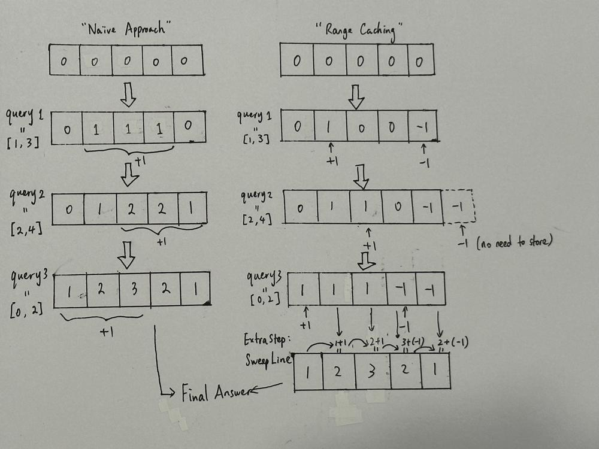
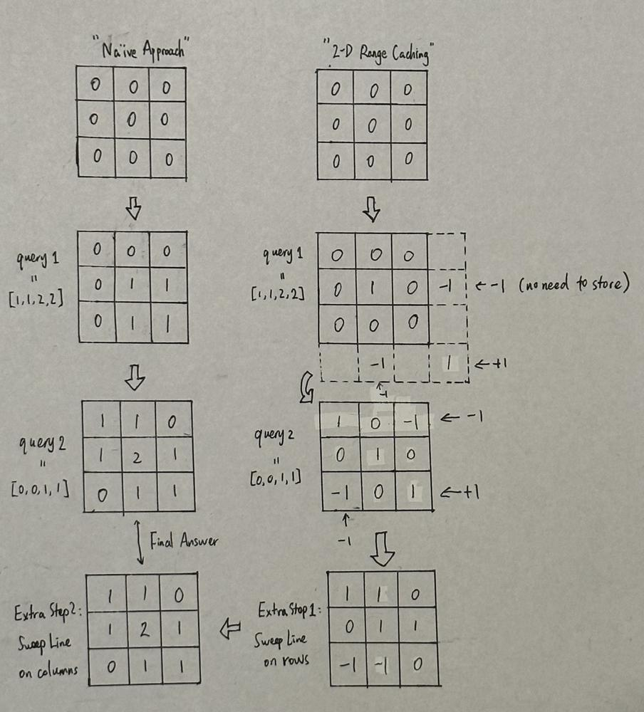

# [Python3] Sweep Line (Range Addition w/ Visualization), Clean & Concise

**Author:** xil899
**Votes:** 206
**Link:** [https://leetcode.com/problems/increment-submatrices-by-one/solutions/3052675/](https://leetcode.com/problems/increment-submatrices-by-one/solutions/3052675/)

---

# Na\xEFve Approach
Following the description of this problem, for each query, we update the every element covered in the submatrix defined by `(r1, c1)` and `(r2, c2)`. However, it is pretty clear to know that the time complexity for this approach is $$O(n^2q)$$, which could be up to $$500 \	imes 500 \	imes 10^4 = 2.5 \	imes 10^9$$ and result in TLE.

So, how can we come up with a better algorithm with improved time complexity?

# Intuition
This problem is the 2-D version of [LC 370. Range Addition](https://leetcode.com/problems/range-addition/). Essentially, we are doing range addition for each query.

# Visualization
Consider the 1-D Range Addition problem and suppose we have `n = 5` and `queries = [[1,3],[2,4],[0,2]]`. Below is the visual illustration on the technique of `Range Caching`.




# Approach
For each query, denoted as `(r1, c1, r2, c2)`, we perform a preprocessing (range caching) on each row involved. Specifically, for each row within `[r1, r2]`, we add 1 at column `c1` and subtract 1 at the next column of `c2`.

After preprocessing, we calculate the output by performing range addition (sweeping line) on all elements of the matrix, and output the answer.

# Complexity
- Time complexity: $$O(n^2 + nq) \\approx O(nq)$$, if $$q \\gg n$$;

- Space complexity: $$O(1)$$, if not including the $$O(n^2)$$ space for output.

**Please upvote if you find this solution helpful. Thanks!**

# Solution (Range Caching)
```
class Solution:
    def rangeAddQueries(self, n: int, queries: List[List[int]]) -> List[List[int]]:
        ans = [[0] * n for _ in range(n)]
        for r1, c1, r2, c2 in queries:
            for r in range(r1, r2 + 1):
                ans[r][c1] += 1
                if c2 + 1 < n: ans[r][c2 + 1] -= 1
        for r in range(n):
            for c in range(1, n):
                ans[r][c] += ans[r][c - 1]
        return ans
```

# Follow-up (Bonus)
Now we know the concept of range caching technique to solve this problem, is there a even better solution to further improve the overall time complexity?

The answer is **yes** and the idea is straightforward as visualized below:




In brief, we can directly use 2-D range caching (previously we were using 1-D range caching in this 2-D problem). The difference here is that for each query, we now need to (1) cache the value at 4 cells (instead of 2 cells at each row); and (2) calculate the output by going through the full matrix twice, one by row and one by column (instead of once).

- Time complexity: $$O(n^2 + q)$$, which is better than the solution above;

- Space complexity: $$O(1)$$, if not including the $$O(n^2)$$ space for output.

**Remark:** Personally, I feel that 2-D range caching is bit trickier to digest, but using 1-D range caching applied to this problem would be sufficient and easier to think & code.

# Improved Solution (2-D Range Caching)
```
class Solution:
    def rangeAddQueries(self, n: int, queries: List[List[int]]) -> List[List[int]]:
        ans = [[0] * n for _ in range(n)]
        for r1, c1, r2, c2 in queries:
            ans[r1][c1] += 1
            if r2 + 1 < n: ans[r2 + 1][c1] -= 1
            if c2 + 1 < n: ans[r1][c2 + 1] -= 1
            if r2 + 1 < n and c2 + 1 < n: ans[r2 + 1][c2 + 1] += 1
        for r in range(1, n):
            for c in range(n):
                ans[r][c] += ans[r - 1][c]
        for r in range(n):
            for c in range(1, n):
                ans[r][c] += ans[r][c - 1]
        return ans
```