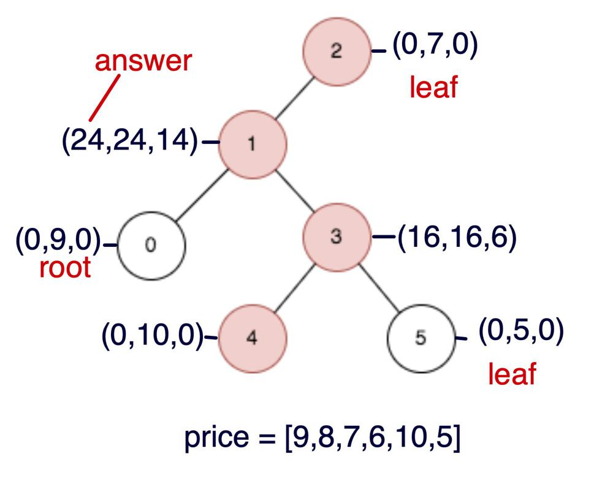

# Python 3   ||  16 lines , dfs    ||   T/S: 81 % / 55%

**Author:** Spaulding_
**Votes:** 6
**Link:** [https://leetcode.com/problems/difference-between-maximum-and-minimum-price-sum/solutions/3062470/](https://leetcode.com/problems/difference-between-maximum-and-minimum-price-sum/solutions/3062470/)

---

Here's the intuition:

- We assign a three-uple`state`to each node. the root and each leaf gets `(0,price,0)`, and each other link's`state` is determined by the recurence relation in`dfs`. The figure below is for Example 1 in the problem's description.

- Best way to figure it out is to trace it from the recurence relation.  The correct answer is`24`, which is `state[0]` for `node 1`. BTW, if you start from a root other than`0`, the `state` for some nodes may change, but the answer doesn't.



______

Here's the code
```
class Solution:
    def maxOutput(self, n: int, edges: List[List[int]], 
                                price: List[int]) -> int:

        g = defaultdict(list)
        for a, b in edges:
            g[a].append(b)
            g[b].append(a)

        def dfs(node1, node2 =-1):
            p = price[node1]
            state = (0, p, 0)

            for n in g[node1]:
                if n == node2: continue

                (a1, a2, a3), (b1, b2, b3) = state, dfs(n, node1)
                
                state = (max(a1, b1, a2 + b3, a3 + b2),
                         max(a2, b2 + p),
                         max(a3, b3 + p))

            return state


        if n <= 2: return sum(price) - min(price)

        for node in range(n):
            if len(g[node]) > 1:
                return dfs(node)[0]

```
[https://leetcode.com/problems/difference-between-maximum-and-minimum-price-sum/submissions/1297179636/](https://leetcode.com/problems/difference-between-maximum-and-minimum-price-sum/submissions/1297179636/)
```

I think that time complexity is *O*(*N*) and space complexity is *O*(*N*),