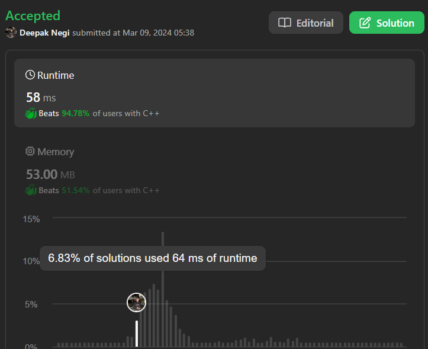

# Simple and easy approach without hashtable | | 0(1) space O(n+m) time complexity | | ✅✅✅

**Author:** Hunter_0718
**Votes:** 18
**Link:** [https://leetcode.com/problems/minimum-common-value/solutions/4845109/](https://leetcode.com/problems/minimum-common-value/solutions/4845109/)

---




# Intuition
The problem is asking to find the common element between two sorted arrays. Since the arrays are sorted, we can utilize a two-pointer approach to efficiently find the common element.

# Approach
We can initialize two pointers, one for each array, and iterate through both arrays simultaneously. At each step, we compare the elements pointed to by the pointers. If the elements are equal, we return that element. If the element in the first array is greater than the element in the second array, we increment the pointer for the second array, and vice versa. We continue this process until we find a common element or exhaust one of the arrays.

# Complexity
- Time complexity: $$O(n + m)$$, where $$n$$ and $$m$$ are the sizes of the two input arrays, respectively. We traverse through both arrays once.
- Space complexity: $$O(1)$$, as we are not using any extra space that scales with the input size.

# Code
```C++ []
class Solution {
public:
    int getCommon(vector<int>& nums1, vector<int>& nums2) {
        int i=0 , j = 0;
        int n = nums1.size();
        int m = nums2.size();
        while(i < n && j < m){
            if(nums1[i] == nums2[j])
                return nums1[i];
            else if(nums1[i] > nums2[j])
                j++;
            else
                i++;
        }
        return -1;
    }
};
```
```java []
class Solution {
    public int getCommon(int[] nums1, int[] nums2) {
        int i = 0, j = 0;
        int n = nums1.length;
        int m = nums2.length;
        
        while (i < n && j < m) {
            if (nums1[i] == nums2[j])
                return nums1[i];
            else if (nums1[i] > nums2[j])
                j++;
            else
                i++;
        }
        
        return -1;
    }
}

```
```c []
int getCommon(int* nums1, int nums1Size, int* nums2, int nums2Size) {
    int i = 0, j = 0;
    
    while (i < nums1Size && j < nums2Size) {
        if (nums1[i] == nums2[j])
            return nums1[i];
        else if (nums1[i] > nums2[j])
            j++;
        else
            i++;
    }
    
    return -1;
}

```
```javascript []
/**
 * @param {number[]} nums1
 * @param {number[]} nums2
 * @return {number}
 */
var getCommon = function(nums1, nums2) {
    let i = 0;
    let j = 0;
    
    while (i < nums1.length && j < nums2.length) {
        if (nums1[i] === nums2[j])
            return nums1[i];
        else if (nums1[i] > nums2[j])
            j++;
        else
            i++;
    }
    
    return -1;
};

```
```python []
class Solution(object):
    def getCommon(self, nums1, nums2):
        """
        :type nums1: List[int]
        :type nums2: List[int]
        :rtype: int
        """
        i = 0
        j = 0
        
        while i < len(nums1) and j < len(nums2):
            if nums1[i] == nums2[j]:
                return nums1[i]
            elif nums1[i] > nums2[j]:
                j += 1
            else:
                i += 1
        
        return -1

```
```Kotlin []
class Solution {
    fun getCommon(nums1: IntArray, nums2: IntArray): Int {
        var i = 0
        var j = 0
        val n = nums1.size
        val m = nums2.size
        
        while (i < n && j < m) {
            when {
                nums1[i] == nums2[j] -> return nums1[i]
                nums1[i] > nums2[j] -> j++
                else -> i++
            }
        }
        
        return -1
    }
}

```


# Dry Run
Let's dry run the code with the given test case:

Given: `nums1 = [1,2,3,6]`, `nums2 = [2,3,4,5]`

- Initialize `i = 0` and `j = 0`.
- Compare `nums1[0]` (which is 1) with `nums2[0]` (which is 2). Since 1 is less than 2, increment `i`.
- Now compare `nums1[1]` (which is 2) with `nums2[0]` (which is 2). They are equal, so return 2.
- The common element is 2.