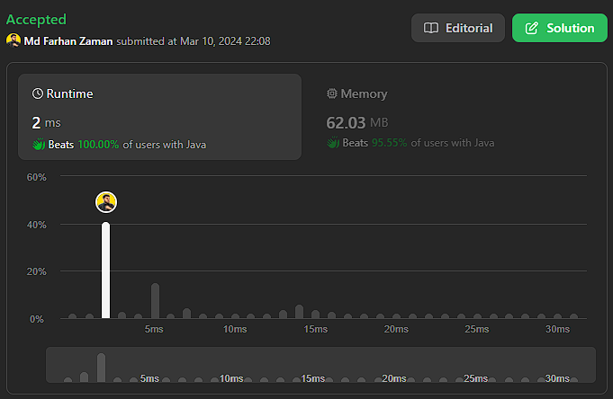

# ✅Beats 100%🔥|| 2ms ||🌟Advanced Two-Pointer Approach || Java || C++ || Python || Rust || JavaScript

**Author:** farhanzamanarnob
**Votes:** 3
**Link:** [https://leetcode.com/problems/minimum-common-value/solutions/4855252/](https://leetcode.com/problems/minimum-common-value/solutions/4855252/)

---




# Intuition
To find the minimum common integer between two sorted arrays, we can use a two-pointer approach. Start with two pointers, one for each array, and iterate until we find a common element or exhaust one of the arrays.

# Approach
1. Initialize two pointers, `i` and `j`, to point to the beginning of both arrays.
2. While both pointers are within the bounds of their respective arrays:
   - If the current elements at the pointers are equal, update the `common` variable and break the loop.
   - If the element at `nums1[i]` is smaller, increment `i`.
   - If the element at `nums2[j]` is smaller, increment `j`.
3. Return the `common` variable.

# Complexity
- Time complexity: O(min(N, M)), where N and M are the lengths of the input arrays nums1 and nums2, respectively. In the worst case, we may need to iterate through both arrays entirely.
- Space complexity: O(1), as we use only a constant amount of space.

# Code
```java []
public class Solution {
    public int getCommon(int[] nums1, int[] nums2) {
        int common = -1;
        int i = 0, j = 0;
        while (i < nums1.length && j < nums2.length) {
            if (nums1[i] == nums2[j]) {
                common = nums1[i];
                break;
            } else if (nums1[i] < nums2[j]) {
                i++;
            } else {
                j++;
            }
        }
        return common;
    }
}
```

```cpp []
class Solution {
public:
    int getCommon(std::vector<int>& nums1, std::vector<int>& nums2) {
        int common = -1;
        int i = 0, j = 0;
        while (i < nums1.size() && j < nums2.size()) {
            if (nums1[i] == nums2[j]) {
                common = nums1[i];
                break;
            } else if (nums1[i] < nums2[j]) {
                i++;
            } else {
                j++;
            }
        }
        return common;
    }
}
```
```rust []
impl Solution {
    pub fn get_common(nums1: Vec<i32>, nums2: Vec<i32>) -> i32 {
        let mut common = -1;
        let (mut i, mut j) = (0, 0);
        while i < nums1.len() && j < nums2.len() {
            if nums1[i] == nums2[j] {
                common = nums1[i];
                break;
            } else if nums1[i] < nums2[j] {
                i += 1;
            } else {
                j += 1;
            }
        }
        common
    }
}
```
```python []
class Solution:
    def getCommon(self, nums1, nums2):
        common = -1
        i, j = 0, 0
        while i < len(nums1) and j < len(nums2):
            if nums1[i] == nums2[j]:
                common = nums1[i]
                break
            elif nums1[i] < nums2[j]:
                i += 1
            else:
                j += 1
        return common

```
```javascript []
class Solution {
    getCommon(nums1, nums2) {
        let common = -1;
        let i = 0, j = 0;
        while (i < nums1.length && j < nums2.length) {
            if (nums1[i] === nums2[j]) {
                common = nums1[i];
                break;
            } else if (nums1[i] < nums2[j]) {
                i++;
            } else {
                j++;
            }
        }
        return common;
    }
}
```

This advanced two-pointer approach ensures efficient searching and a minimal time complexity for finding the minimum common integer.