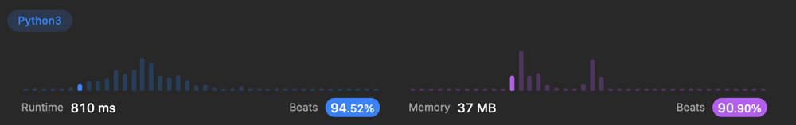

# [Python3] Heap + similar questions || beats 94% || 810ms

**Author:** yourick
**Votes:** 94
**Link:** [https://leetcode.com/problems/maximum-subsequence-score/solutions/3557261/](https://leetcode.com/problems/maximum-subsequence-score/solutions/3557261/)

---

```
class Solution:
    def maxScore(self, nums1: List[int], nums2: List[int], k: int) -> int:
        res, prefixSum, minHeap = 0, 0, []

        for a, b in sorted(list(zip(nums1, nums2)), key=itemgetter(1), reverse=True):
            prefixSum += a
            heappush(minHeap, a)
            if len(minHeap) == k:
                res = max(res, prefixSum * b)
                prefixSum -= heappop(minHeap)                           
        return res
```


## Similar questions:
[857. Minimum Cost to Hire K Workers](https://leetcode.com/problems/minimum-cost-to-hire-k-workers/description/)

```
class Solution:
    def mincostToHireWorkers(self, quality: List[int], wage: List[int], k: int) -> float:
        res, qualitySum, maxHeap = float('inf'), 0, []

        for ration, q in sorted([(w / q, q) for w, q in zip(wage, quality)]):
            qualitySum += q
            heappush(maxHeap, -q)
            if len(maxHeap) == k:
                res = min(res, qualitySum * ration)
                qualitySum -= -heappop(maxHeap)
        
        return res
```
[1383. Maximum Performance of a Team](https://leetcode.com/problems/maximum-performance-of-a-team/description/)

```
class Solution:
    def maxPerformance(self, n: int, speed: List[int], efficiency: List[int], k: int) -> int:
        res, speedSum, minHeap = 0, 0, []
        
        for ef, sp in sorted(zip(efficiency, speed), reverse=True):
            speedSum += sp
            heappush(minHeap, sp)
            res = max(res, speedSum * ef)
            if len(minHeap) == k:
                speedSum -= heappop(minHeap)
        
        return res % (10**9 + 7)
```

