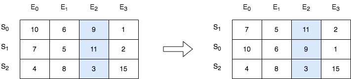

# [2545. Sort the Students by Their Kth Score](https://leetcode.com/problems/sort-the-students-by-their-kth-score/)

| Category | Difficulty | Likes | Dislikes |
| :------: | :--------: | :---: | :------: |
| Algorithms | Medium | 726 | 53 |

**Tags:** [`array`](https://leetcode.com/tag/array), [`sorting`](https://leetcode.com/tag/sorting), [`matrix`](https://leetcode.com/tag/matrix)

**Companies:** `amazon`, `ibm`

## Description

There is a class with `m` students and `n` exams. You are given a **0-indexed** `m x n` integer matrix `score`, where each row represents one student and `score[i][j]` denotes the score the `i^th` student got in the `j^th` exam. The matrix `score` contains **distinct** integers only.

You are also given an integer `k`. Sort the students (i.e., the rows of the matrix) by their scores in the `k^th` (**0-indexed**) exam from the highest to the lowest.

Return *the matrix after sorting it.*

 

**Example 1:**


```

Input: score = [[10,6,9,1],[7,5,11,2],[4,8,3,15]], k = 2
Output: [[7,5,11,2],[10,6,9,1],[4,8,3,15]]
Explanation: In the above diagram, S denotes the student, while E denotes the exam.
- The student with index 1 scored 11 in exam 2, which is the highest score, so they got first place.
- The student with index 0 scored 9 in exam 2, which is the second highest score, so they got second place.
- The student with index 2 scored 3 in exam 2, which is the lowest score, so they got third place.

```

**Example 2:**


```

Input: score = [[3,4],[5,6]], k = 0
Output: [[5,6],[3,4]]
Explanation: In the above diagram, S denotes the student, while E denotes the exam.
- The student with index 1 scored 5 in exam 0, which is the highest score, so they got first place.
- The student with index 0 scored 3 in exam 0, which is the lowest score, so they got second place.

```

 

**Constraints:**

	- `m == score.length`

	- `n == score[i].length`

	- `1 <= m, n <= 250`

	- `1 <= score[i][j] <= 10^5`

	- `score` consists of **distinct** integers.

	- `0 <= k < n`

---

**Links:** [Submissions](https://leetcode.com/problems/sort-the-students-by-their-kth-score/) | [Solutions](https://leetcode.com/problems/sort-the-students-by-their-kth-score/)
