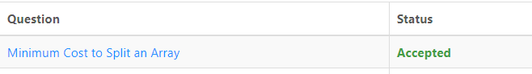

# 🔥Python3  ||  C++🔥 ✅ EASY Dynamic Programming with Dict(Map)

**Author:** abdullayev_akbar
**Votes:** 23
**Link:** [https://leetcode.com/problems/minimum-cost-to-split-an-array/solutions/3083783/](https://leetcode.com/problems/minimum-cost-to-split-an-array/solutions/3083783/)

---


An initial value would be needed in this solution. 
To that I added an element to the front of the array that is not in the array (nums=[-1]+nums) and since it is not in the array before, 
dp[0]=0 (it has no price).
Then I started from the 1-index of the array because the 0-index has -1 and calculated the minimum cost up to each element.
when I go to each index, I go back from it (to index 1).
The goal is to find the best answer.
A good answer for j-index is in dp[j].
$$for(j=i;j>0;j--)$$
$$ans=min(ans,dp[j-1]+s)$$
$$s=trimmed(nums[j:i+1])$$
And at the end of the work dp[i]=ans+k. Because after adding one element, it is split by adding it, and k is added to it.


# Complexity
- Time complexity:
<!-- Add your time complexity here, e.g. $$O(n)$$ -->
$$O(n^2)$$

If You like the Solution, Don't Forget To UpVote Me, Please UpVote! \uD83D\uDD3C\uD83D\uDE4F
# Python3
```
class Solution:
    def minCost(self, nums: List[int], k: int) -> int:
        dp=[0]
        nums=[-1]+nums
        def main(i):
            mp=defaultdict(int)
            s=0
            ans=10000000000000
            while i>0:
                if mp[nums[i]]>0:
                    s+=1
                    if mp[nums[i]]==1:
                        s+=1
                mp[nums[i]]+=1
                ans=min(dp[i-1]+s,ans)
                i-=1
            return ans+k
                
            
        for i in range(1,len(nums)):
            dp.append(main(i))
        return dp[-1]
```
# C++
```
class Solution {
public:
    int minCost(vector<int>& nums, int k) {
        vector<int>dp(nums.size()+1,0);
        reverse(nums.begin(),nums.end());
        nums.push_back(-1);
        reverse(nums.begin(),nums.end());
        for(int i=1;i<nums.size();i++)
        {
        	int s=0,ans=1e8;
        	unordered_map<int,int>mp;
        	for(int j=i;j>0;j--)
        	{
        		if(mp[nums[j]]>0)
        		{
        			s++;
        			if(mp[nums[j]]==1)
        			{
        				s++;
        			}
        		}
        		mp[nums[j]]++;
        		ans=min(ans,dp[j-1]+s);
        	}
        	dp[i]=ans+k;
        }
        return dp[nums.size()-1];
    }
};
```
Please UPVOTE if it helps \u2764\uFE0F\uD83D\uDE0A
Thank You and Happy To Help You!!