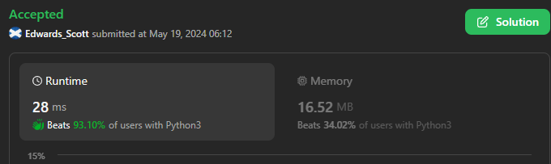
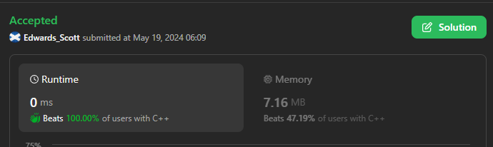

# 🏆💢💯 Faster✅💯 Lesser🧠 🎯 C++✅Python3🐍✅Java✅C✅Python🐍✅C#✅💥🔥💫Explained☠💥🔥 Beats 💯

**Author:** Edwards310
**Votes:** 2
**Link:** [https://leetcode.com/problems/count-distinct-numbers-on-board/solutions/5176735/](https://leetcode.com/problems/count-distinct-numbers-on-board/solutions/5176735/)

---

# Intuition





```C++ []
class Solution {
public:
    int distinctIntegers(int n) {
        ios_base::sync_with_stdio(0);
        cin.tie(0);
        cout.tie(0);
        return n == 1 ? 1 : n - 1;
    }
};
```
```python3 []
class Solution:
    def distinctIntegers(self, n: int) -> int:
        return 1 if n == 1 else n - 1
```
```C []
int distinctIntegers(int n) {
    return (n == 1) ? 1 : n - 1;
}
```
```java []
class Solution {
    public int distinctIntegers(int n) {
        return (n == 1) ? 1 : n - 1;
    }
}
```
```python []
class Solution(object):
    def distinctIntegers(self, n):
        """
        :type n: int
        :rtype: int
        """
        return 1 if n == 1 else n - 1
```
```C# []
public class Solution {
    public int DistinctIntegers(int n) {
        return (n == 1) ? 1 : n - 1;
    }
}
```

<!-- Describe your first thoughts on how to solve this problem. -->

# Approach
<!-- Describe your approach to solving the problem. -->

# Complexity
- Time complexity:
<!-- Add your time complexity here, e.g. $$O(n)$$ -->
     O(1)
- Space complexity:
<!-- Add your space complexity here, e.g. $$O(n)$$ -->
     O(1)
# Code
```
class Solution {
    public int distinctIntegers(int n) {
        return (n == 1) ? 1 : n - 1;
    }
}
```
# ***Please upvote if it's useful for you ..***

