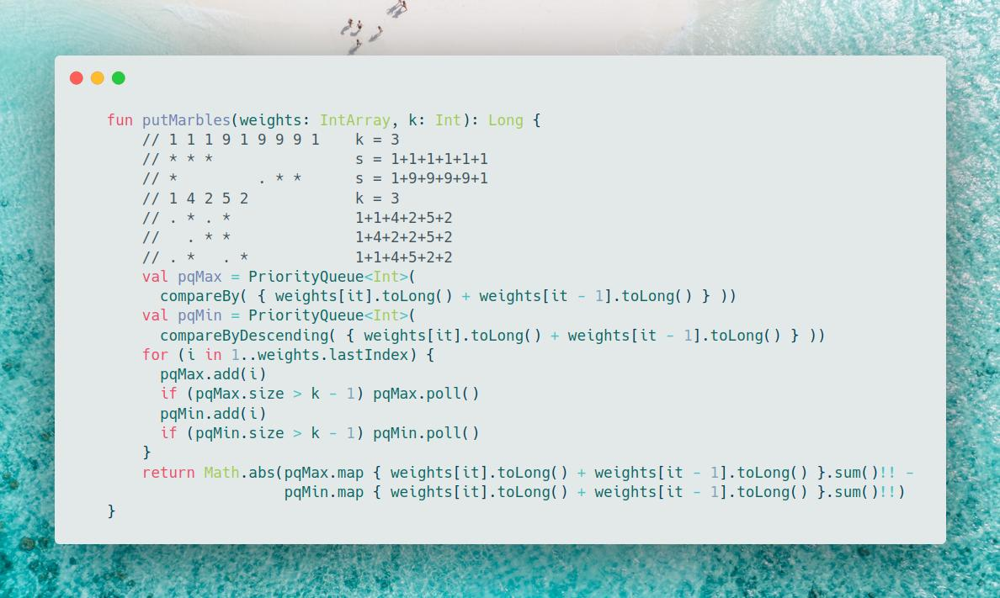
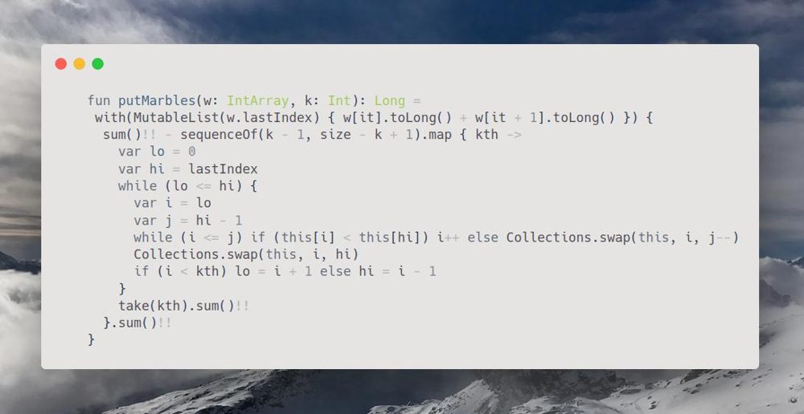

# Kotlin | PriorityQueue

**Author:** SamoylenkoDmitry
**Votes:** 1
**Link:** [https://leetcode.com/problems/put-marbles-in-bags/solutions/3734482/](https://leetcode.com/problems/put-marbles-in-bags/solutions/3734482/)

---


#### Join me on Telegram
https://t.me/leetcode_daily_unstoppable/269
#### Problem TLDR
`abs(max - min)`, where `max` and `min` are the sum of `k` interval borders
#### Intuition
Let's observe some examples:
```
        // 1 3 2 3 5 4 5 7 6
        // *   * *   
        // 1+3 2+2 3+6 = 4+4+9 = 17
        // * * *
        // 1+1 3+3 2+6 = 2+6+8 = 16
        // *             * * = 1+5 7+7 6+6
        // 1 9 1 9 1 9 1 9 1    k = 3
        // *   *           *    s = 1+9+1+9+1+1
        // * *   *              s = 1+1+9+1+9+1
        // 1 1 9 9 1 1 9 9 1    k = 3
        // * *       *          s = 1+1+1+1+1+1
        // *     *       *      s = 1+9+9+9+9+1
        // 1 1 1 9 1 9 9 9 1    k = 3
        // * * *                s = 1+1+1+1+1+1
        // *         . * *      s = 1+9+9+9+9+1
        // 1 4 2 5 2            k = 3
        // . * . *              1+1+4+2+5+2
        //   . * *              1+4+2+2+5+2
        // . *   . *            1+1+4+5+2+2
```
One thing to note, we must choose `k-1` border pairs `i-1, i` with `min` or `max` sum.

#### Approach
Let's use PriorityQueue.
#### Complexity
- Time complexity:
$$O(nlog(k))$$
- Space complexity:
$$O(k)$$
#### Code
```
    fun putMarbles(weights: IntArray, k: Int): Long {

        val pqMax = PriorityQueue<Int>(compareBy( { weights[it].toLong() + weights[it - 1].toLong() } ))
        val pqMin = PriorityQueue<Int>(compareByDescending( { weights[it].toLong() + weights[it - 1].toLong() } ))
        for (i in 1..weights.lastIndex) {
          pqMax.add(i)
          if (pqMax.size > k - 1) pqMax.poll()
          pqMin.add(i)
          if (pqMin.size > k - 1) pqMin.poll()
        }
        return Math.abs(pqMax.map { weights[it].toLong() + weights[it - 1].toLong() }.sum()!! - 
                        pqMin.map { weights[it].toLong() + weights[it - 1].toLong() }.sum()!!)
    }

```
#### Bonus
Quickselect solution


