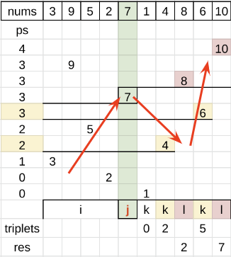

# Prefix Sum

**Author:** votrubac
**Votes:** 8
**Link:** [https://leetcode.com/problems/count-increasing-quadruplets/solutions/3140023/](https://leetcode.com/problems/count-increasing-quadruplets/solutions/3140023/)

---

We fix one number in quadruplet, and solve the problem for that number.

Let's rewrite the problem condition:
- `nums[i] < nums[k] < nums[j] < nums[l]`

as:
- `nums[i] <  nums[j] > nums[k]`
- `nums[i] < nums[k]`
- `nums[j] < nums[l]`

`nums[j]` is peaks, and that's the element we fix.

For elements before `j`, we track elements `nums[i] < nums[j]` using a prefix sum (`ps`) array.
- We can build the prefix sum array after we count all elements before `j`.

After we reach `j`, we count the number of valid triplets `nums[i] <  nums[j] > nums[k]`.
- For `nums[j] > nums[k]`, we use the prefix sum to count `nums[i] < nums[k]`.
- If `nums[j] < nums[k]`, this is the final element in the quadruplet `nums[l]`. 
	- It completes all valid triplets, so we add the current triplet count to the result.

This example shows the calculatoin for `j == 4`:


**C++**
```cpp
long long countQuadruplets(vector<int>& nums) {
    long long res = 0, sz = nums.size(), ps[4001] = {};
    for (int j = 0; j < sz; ++j) {
        int triplets = 0;
        for (int num_i = nums[j] + 1; num_i < sz; ++num_i)
            ++ps[num_i];
        for (int k = j + 1; k < sz; ++k)
            if (nums[k] < nums[j])
                triplets += ps[nums[k]];
            else
                res += triplets;
    }
    return res;
}
```