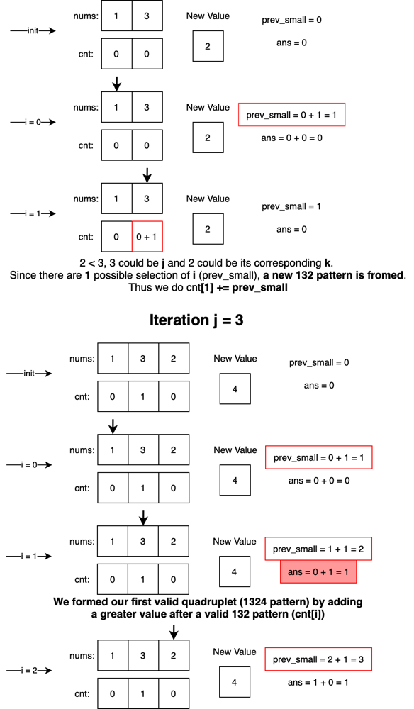

# [C++|Java|Python3] Cleanest Code with Clarification O(n^2)

**Author:** EXBORN
**Votes:** 175
**Link:** [https://leetcode.com/problems/count-increasing-quadruplets/solutions/3111697/](https://leetcode.com/problems/count-increasing-quadruplets/solutions/3111697/)

---

# Intuition

The crux of this problem is to identify and count increasing quadruplets. To simplify the problem, let's break it down to count the **132 triplets** first, then leverage them to count **1324 quadruplets**.

1. **132 Triplet**: A triplet (i, j, k) that satisfies the condition `i < j < k` and `nums[i] < nums[k] < nums[j]`.

2. **1324 Quadruplet**: A quadruplet (i, j, k, l) that meets the criteria `i < j < k < l` and `nums[i] < nums[k] < nums[j] < nums[l]`.

## Approach

We maintain an array `cnt` where `cnt[j]` stores the **count** of 132 triplets that using the current index number as the role `3` (index `j`) to construct 132 triplets. (*For example: if we have a array [1, 3, 2], there is only one 132 triplets in the list, the cnt array should looks like [0, 1, 0].*)

Assume we have already constructed a `cnt` for a prefix subarray of the `nums` array, we can introduce a new value `l` in `num` immidiately after the prefix, then iterate all previous stored `cnt[j]` (132 pattern counts); if `nums[l] > nums[j]`, they can form valid 1324 quadruplet patterns, thus we add `cnt[j]` into total 1324 counts.

To finalize our approach, we will iteratively introduce a new value `l` and works on the prefix array before it to count 1324 patterns. While iterating the index `j`, we also update `cnt[j]` by keeping track of the amount of numbers smaller than the current new value (`l`) in front of `j`, defined as `previous_small`. If `nums[l] < nums[j]`, the new value (`l`) is a potential `k` for `j` to form 132 triplets, and `previous_small` is the number of unique 132 triplets they can form together, so add `previous_small` to `cnt[j]`.

Note that in code, $i$ is actually `j`, $j$ is actually `l`, relate to above explanation.

# Complexity

- Time complexity: $O(n^2)$

- Space complexity: $O(n)$

# Code
```python []
class Solution:
    def countQuadruplets(self, nums: List[int]) -> int:
        n = len(nums)
        cnt = [0] * n
        ans = 0
        for j in range(n):
            prev_small = 0
            for i in range(j):
                if nums[j] > nums[i]:
                    prev_small += 1
                    ans += cnt[i]
                elif nums[j] < nums[i]:
                    cnt[i] += prev_small
        return ans
```
```java []
class Solution {
    public long countQuadruplets(int[] nums) {
        int n = nums.length;
        long[] cnt = new long[n];
        long ans = 0;
        for (int j = 0; j < n; j++) {
            int prev_small = 0;
            for (int i = 0; i < j; i++) {
                if (nums[j] > nums[i]) {
                    prev_small++;
                    ans += cnt[i];
                } else if (nums[j] < nums[i]) {
                    cnt[i] += prev_small;
                }
            }
        }
        return ans;
    }
}
```
```C++ []
class Solution {
public:
    long long countQuadruplets(vector<int>& nums) {
        long long ans=0;
        int n=nums.size();
        long long prev_small=0;
        vector<long long> cnt(n,0);
        for(int i=0 ; i<n  ; i++){
            prev_small=0;
            for(int j=0 ; j<i ; j++){
                if(nums[i]>nums[j]){
                    prev_small++;
                    ans+=cnt[j];
                }
                else if(nums[i]<nums[j]){
                    cnt[j]+=prev_small;
                }
            }
        }
        return ans; 
    }
};
```
```Javascript []
var countQuadruplets = function (nums) {
  const N = nums.length;
  let ans = 0;
  let cnt = Array(N).fill(0);

  for (let j = 0; j < N; j++) {
    let prev_small = 0;
    for (let i = 0; i < j; i++) {
      if (nums[j] > nums[i]) {
        prev_small++;
        ans += cnt[i];
      } else if (nums[j] < nums[i]) {
        cnt[i] += prev_small;
      }
    }
  }
  return ans;
};
```

C++ is contributed by @Manan_Jain_4, Java is contributed by @ibmtp380, Javascript is contributed by @Gang-Li.

# Lets do some Simulation




# Please Vote Up if this helps ;D