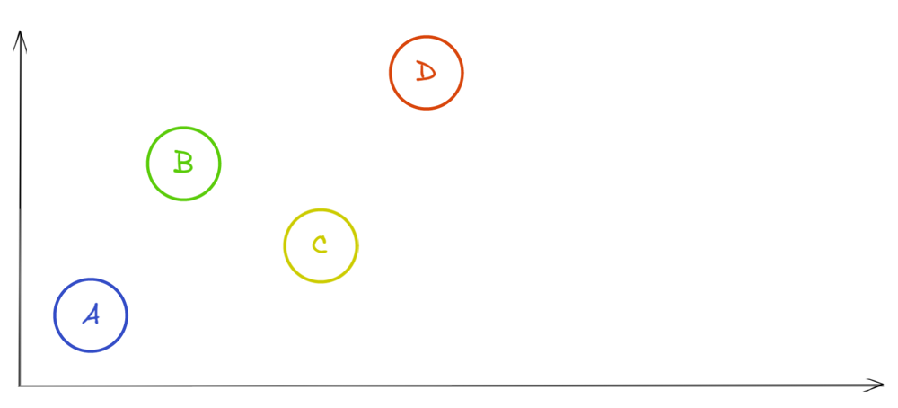
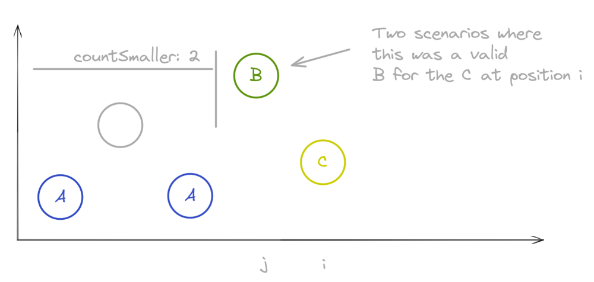
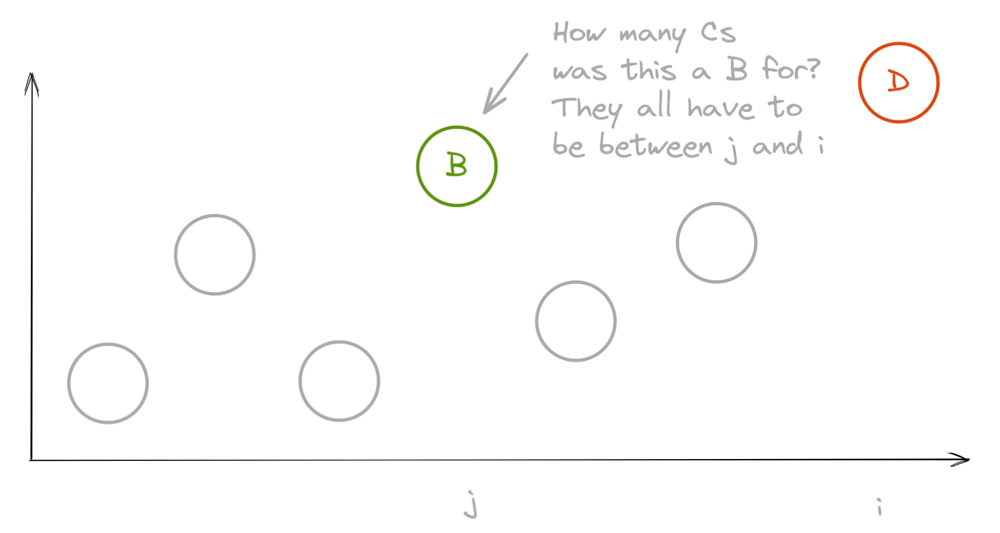

# JavaScript Bottom-Up DP

**Author:** ektegjetost
**Votes:** 6
**Link:** [https://leetcode.com/problems/count-increasing-quadruplets/solutions/3115097/](https://leetcode.com/problems/count-increasing-quadruplets/solutions/3115097/)

---

I was smashing my head against a wall trying to make divide-and-conquer work for this. Should've considered an O(n^2) solution..

We want quadruplets in this arrangement



It's easy to find the A-B relationship in O(n^2)
*To find the A-B-C relationship*
- We have ```C``` at index ```i```
	- Iterate through all the nums ```j``` which come to the left of ```i```
	- Count up the nums that are smaller than ```nums[i]```, these are the ```A```s
	- When we reach a number that's greater than ```nums[i]```
		- We've already counted the numbers smaller than ```C```, and they're all to the left of ```nums[j]```
		- So we've found ```countSmaller``` number of ```A-B-C``` relationships



- The tricky part here is that we can't memoize the number of ```A-B-C``` relationships at index ```i```. If we did, when we try to find the ```C-D``` relationships we won't know how many ```B```s are smaller than ```D```. So instead we'll say that the number at index ```j``` is a ```B``` for ```countSmaller``` number of ```C```s. Then when we look at potential ```D```s, we know that when we see a ```B``` that's smaller than us, all the ```C```s are also to the left of us. 




```javascript
var countQuadruplets = function(nums) {
  const B = new Array(nums.length + 1).fill(0);
  let quadruplets = 0;

  for (let i = 0; i < nums.length; i += 1) {
    let countSmaller = 0;

    for (let j = 0; j < i; j += 1) {
      if (nums[j] < nums[i]) {
        countSmaller += 1;
        quadruplets += B[nums[j]];
      } else {
	    // countSmaller is all the As nums[j] is the B, nums[i] is C
		// so nums[j] is apart of countSmaller A-B-C relationships with nums[i]
        B[nums[j]] += countSmaller;
      }
    }
  }

  return quadruplets
};
```
