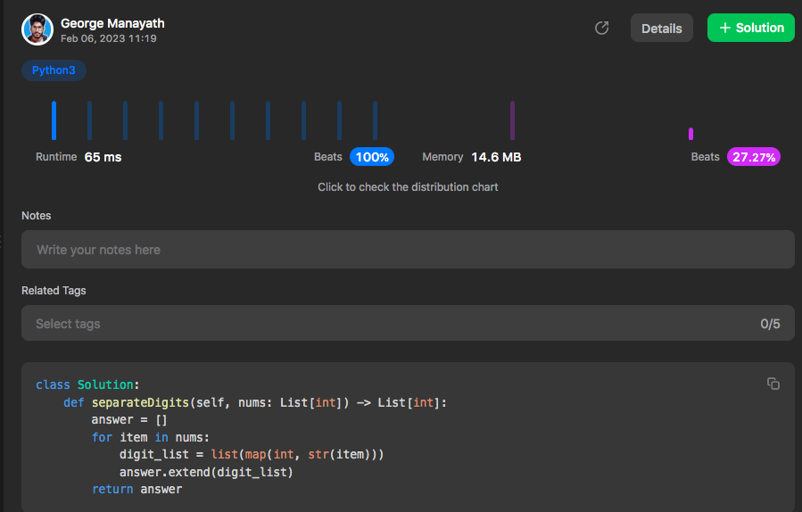

# Python | 100% Faster | Easy Solution✅

**Author:** gmanayath
**Votes:** 9
**Link:** [https://leetcode.com/problems/separate-the-digits-in-an-array/solutions/3149388/](https://leetcode.com/problems/separate-the-digits-in-an-array/solutions/3149388/)

---

# Code\u2705
```
class Solution:
    def separateDigits(self, nums: List[int]) -> List[int]:
        answer = []
        for item in nums:
            digit_list = list(map(int, str(item)))
            answer.extend(digit_list)
        return answer
```

