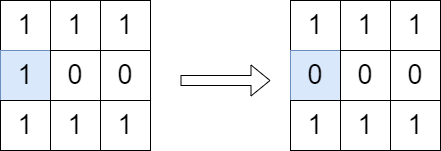

# [2556. Disconnect Path in a Binary Matrix by at Most One Flip](https://leetcode.com/problems/disconnect-path-in-a-binary-matrix-by-at-most-one-flip/)

| Category | Difficulty | Likes | Dislikes |
| :------: | :--------: | :---: | :------: |
| Algorithms | Medium | 631 | 33 |

**Tags:** [`array`](https://leetcode.com/tag/array), [`dynamic-programming`](https://leetcode.com/tag/dynamic-programming), [`depth-first-search`](https://leetcode.com/tag/depth-first-search), [`breadth-first-search`](https://leetcode.com/tag/breadth-first-search), [`matrix`](https://leetcode.com/tag/matrix)

**Companies:** `google`

## Description

You are given a **0-indexed** `m x n` **binary** matrix `grid`. You can move from a cell `(row, col)` to any of the cells `(row + 1, col)` or `(row, col + 1)` that has the value `1`. The matrix is **disconnected** if there is no path from `(0, 0)` to `(m - 1, n - 1)`.

You can flip the value of **at most one** (possibly none) cell. You **cannot flip** the cells `(0, 0)` and `(m - 1, n - 1)`.

Return `true` *if it is possible to make the matrix disconnect or *`false`* otherwise*.

**Note** that flipping a cell changes its value from `0` to `1` or from `1` to `0`.

 

**Example 1:**


```

Input: grid = [[1,1,1],[1,0,0],[1,1,1]]
Output: true
Explanation: We can change the cell shown in the diagram above. There is no path from (0, 0) to (2, 2) in the resulting grid.

```

**Example 2:**


```

Input: grid = [[1,1,1],[1,0,1],[1,1,1]]
Output: false
Explanation: It is not possible to change at most one cell such that there is not path from (0, 0) to (2, 2).

```

 

**Constraints:**

	- `m == grid.length`

	- `n == grid[i].length`

	- `1 <= m, n <= 1000`

	- `1 <= m * n <= 10^5`

	- `grid[i][j]` is either `0` or `1`.

	- `grid[0][0] == grid[m - 1][n - 1] == 1`

---

**Links:** [Submissions](https://leetcode.com/problems/disconnect-path-in-a-binary-matrix-by-at-most-one-flip/) | [Solutions](https://leetcode.com/problems/disconnect-path-in-a-binary-matrix-by-at-most-one-flip/)
