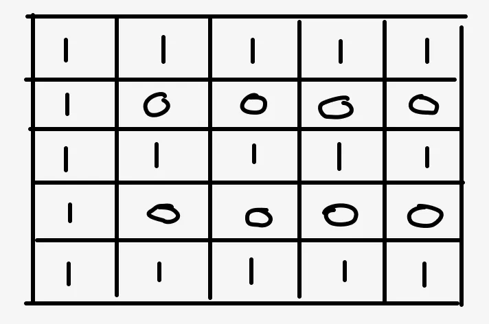
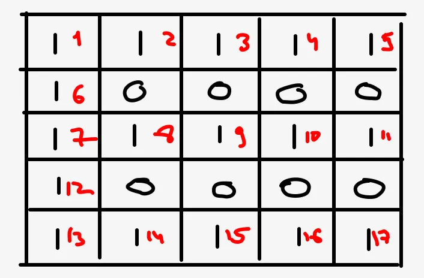

# Explained (M*N) DFS JavaScript Solution

**Author:** svolkovichs
**Votes:** 7
**Link:** [https://leetcode.com/problems/disconnect-path-in-a-binary-matrix-by-at-most-one-flip/solutions/3146474/](https://leetcode.com/problems/disconnect-path-in-a-binary-matrix-by-at-most-one-flip/solutions/3146474/)

---

# Intuition
To make the grid disconnect in one removal there should be a cell in a grid that belongs to every path from (0,0) to (N - 1, M - 1). In this case, setting this cell to 0 will break every path.
# Approach
We can try to build some path from (0, 0) to (N-1, M-1). We can use DFS to do that. If we are not able to build the path - the matrix is already disconnected. If we were able to build some path, we remove it from the matrix by setting every cell of the path, except ends, to 0. Following our intuition, if the was a cell in a grid that belongs to every path it also belongs to the found path, so if we will set it to 0 the matrix should become disconnected. After removal, we try to build the new path from (0, 0) to (N-1, M-1). If the path is found the grid could not be made disconnected in one removal. If not it could.

# Complexity
- Time complexity:
O(M * N) \u2014 in worst case we will visit almost all the grid cells during the DFS. It is not obvious for this case as we can only move right and down in the problem. It could feel like it should be O(m + n) but let look to the following example:

In this case the DFS will spread like this:

We will have to visit > (n*m /2) cels which is equal to O(n*m) complexity.


- Space complexity:
O (M*N) - we need to store all the visited previously cells during the DFS.

# Code
```
/**
 * @param {number[][]} grid
 * @return {boolean}
 */

var isPossibleToCutPath = function(grid) {
    let n = grid.length;
    let m = grid[0].length
    
    // We will store visited cels in set
    let set = new Set();
    // Add start point to visited.
    set.add(`0_0`);
    // Add start point to path.
    let path = [[0,0]];
    // Possible move directiond down and right.
    let moves = [[0,1], [1,0]];
    
    // DFS implementation
    let dfs = (i, j) => {
        if(i === n-1 && j === m - 1) {
            // We reached bottom right corner - matrix connected.
            return true;
        }
        
        // Generate possible moves from current point
        for (let move of moves) {
            let ni = i + move[0];
            let nj = j + move[1];
            let key = `${ni}_${nj}`
            // Next move should be inside the grid bounds
            // Next move value should be 1. We can only move by 1 cells.
            if( ni < n && nj < m && !set.has(key) && grid[ni][nj] === 1) {
                // Remember next move to not visit it twice.
                set.add(key);
                // Add next move to path
                path.push([ni, nj])
                // Run DFS for next move.
                if(dfs(ni, nj)){
                    // If one of next moves reached the (n-1, m-1) the matrix is connected
                    return true;
                }
                // Current cell is not part of any path. Remove it from path.
                path.pop();
            }
        }
        
        return false;
    }
    
    // Run DFS
    if(!dfs(0, 0)){
        // Initial matrix is already disconnected
        return true;
    }
    
    // Matrix is connected. We have some path.
    path.shift(); // remove [0, 0]
    path.pop(); // remove [n-1, m-1]
    
    // Set every cell of found path to 0
    for (let p of path) {
        grid[p[0]][p[1]] = 0;
    }
    
    // Run DFS for updated matrix once again.
    set = new Set();
    set.add(`0_0`);
    return !dfs(0, 0);
};

```

# Improved Solution
We can avoid memorize visited cells in separate structure. We can update them in place in grid by setting it value to 0. (Improvement was inspired by [this](https://leetcode.com/problems/disconnect-path-in-a-binary-matrix-by-at-most-one-flip/solutions/3149979/clear-dfs-javascript-solution-without-additional-memory/) solution)

# Improved Code
```
var isPossibleToCutPath = function(grid) {
    let n = grid.length;
    let m = grid[0].length
    let moves = [[0,1], [1,0]];
    let dfs = (i, j) => {
        if(i === n-1 && j === m - 1) {
            return true;
        }
        
        for (let move of moves) {
            let ni = i + move[0];
            let nj = j + move[1];
            if( ni < n && nj < m && grid[ni][nj] === 1) {
                grid[ni][nj] = 0;
                if(dfs(ni, nj)){
                    return true;
                }
            }
        }
        
        return false;
    }
    
    if(!dfs(0, 0)){
        return true;
    }
    grid[n-1][m-1] = 1;
    return !dfs(0, 0);
};
```
# Improved complexity
- Time complexity still O(N * M)
- Space complexity O(N + M) - the size of call stack to find path in grid.

