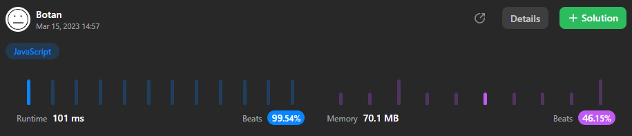

# JavaScript | 99% | O(b + log n) time | O(b) space | Binary Search

**Author:** costa73
**Votes:** 0
**Link:** [https://leetcode.com/problems/maximum-number-of-integers-to-choose-from-a-range-ii/solutions/3300648/](https://leetcode.com/problems/maximum-number-of-integers-to-choose-from-a-range-ii/solutions/3300648/)

---




# Approach

We need to build our solution on a few understandings.

1. The sum of numbers in the range $$[1, n]$$ can be computed in a single operation and equals $$n * (n + 1) / 2$$.
2. The sum of numbers in the range $$[1, n]$$, excluding the `banned` numbers can also be computed in a single operation if we pre-build the prefix sum table of it. E.g. sum of $$[1, 7]$$ equals $$7 * 8 / 2 - prefixSum[7]$$, where `prefixSum[7]` equals to the sum of all $$n$$ in `banned` wheren $$n <= 7$$.
3. We can use binary search to find $$x$$ the range $$[1, n]$$, such that `x * (x + 1) / 2 - prefixSum[x] <= maxSum` and `x` is maximized.
4. The number of non-banned numbers in the range $$[1, x]$$ would be x minus the number of banned numbers smaller or equal to $$x$$, which, if we sorted the `banned` array, can be deducted from the index of the greatest banned element smaller or equal to $$x$$.

In the solution below I build a small prefix sum array of `banned` and do another binary search on it. Alternatively, you can bind an array that contains the prefix sum of all banned numbers in the $$[1, 10^4]$$ range and find it just by the index (trading memory for speed).

```
function maxCount(banned, n, maxSum) {
    // Remove duplicates
    banned = [...new Set(banned)];
    // Sort in ascending order
    banned.sort((a, b) => a - b);
    // Compute the prefix sum of banned
    const prefixSum = getPrefixSum(banned);

    let cnt = 0;
    let left = 1;
    let right = n + 1;

    // Binary search in the range 1 to n
    while (left < right) {
        const pivot = (left + right) >> 1;

        // Find index of the greatest banned number smaller or equal to pivot
        const index = binarySearch(banned, pivot);
        // Get the sum of banned numbers smaller or equal to prefix
        const bannedSum = prefixSum[index] ?? 0;

        // sum of all numbers in the range [1, n], excluding banned numbers
        const sum = pivot * (pivot + 1) / 2 - bannedSum;

        if (sum > maxSum) {
            right = pivot;
        } else {
            cnt = pivot - index - 1;
            left = pivot + 1;
        }
    }

    return cnt;
};

function binarySearch(arr, val) {
    let left = 0;
    let right = arr.length;

    while (left < right) {
        const pivot = (left + right) >> 1;

        if (arr[pivot] === val) return pivot;

        if (arr[pivot] > val) {
            right = pivot;
        } else {
            left = pivot + 1;
        }
    }

    return left - 1;
}

function getPrefixSum(arr) {
    const result = new Array(arr.length);
    result[0] = arr[0];

    for (let i = 1; i in arr; i++) {
        result[i] = result[i - 1] + arr[i];
    }

    return result;
}
```

# Complexity

- Time complexity: $$O(b log b + log b * log n)$$

- Space complexity: $$O(b)$$

*\\* we can also reduce time complexity to just O(b + log n) by using bucket/radix sort, and a full-sized prefix sum table, therefore increasing the space requirements to O(10000)*
