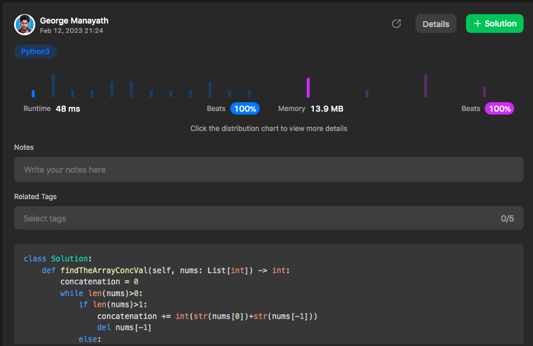

# Python | 100% Faster | Easy Solution✅

**Author:** gmanayath
**Votes:** 8
**Link:** [https://leetcode.com/problems/find-the-array-concatenation-value/solutions/3176707/](https://leetcode.com/problems/find-the-array-concatenation-value/solutions/3176707/)

---

# Code\u2705
```
class Solution:
    def findTheArrayConcVal(self, nums: List[int]) -> int:
        concatenation = 0
        while len(nums)>0:
            if len(nums)>1:
                concatenation += int(str(nums[0])+str(nums[-1]))
                del nums[-1]
            else:
                concatenation += nums[0]
            del nums[0]
        return concatenation
```

