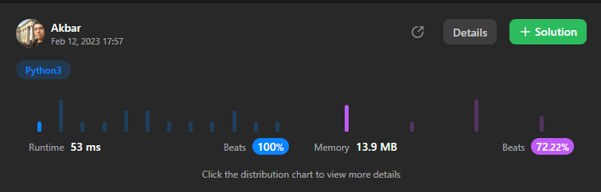

# ✅Python3 || C++✅ Beats 100%

**Author:** abdullayev_akbar
**Votes:** 26
**Link:** [https://leetcode.com/problems/find-the-array-concatenation-value/solutions/3174293/](https://leetcode.com/problems/find-the-array-concatenation-value/solutions/3174293/)

---



# Please UPVOTE \uD83D\uDE0A

## Python3
```
class Solution:
    def findTheArrayConcVal(self, nums: List[int]) -> int:
        ans=0
        if len(nums)%2==1:
            ans=nums[len(nums)//2]
        for i in range(len(nums)//2):
            ans+=int(str(nums[i])+str(nums[len(nums)-1-i]))
        return ans
        
```
## C++
```
class Solution {
public:
    long long findTheArrayConcVal(vector<int>& nums) {
        long long int n=nums.size(),ans=0;
        if(n%2){
            ans=nums[n/2];
        }
        for(int i=0;i<n/2;i++){
            int y=nums[n-1-i],x=nums[i];
            while(y){
                x*=10;
                y/=10;
            }
            x+=nums[n-i-1];
            ans+=x;
        }
        return ans;

    }
};
```

