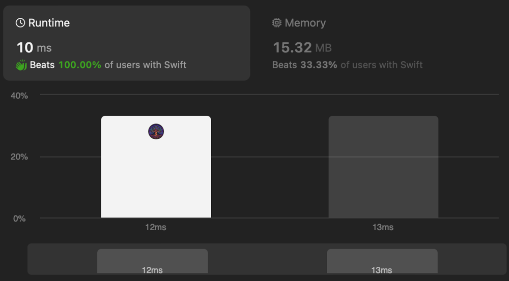

# ✅ Laconic Two Pointers

**Author:** eleev
**Votes:** 1
**Link:** [https://leetcode.com/problems/find-the-array-concatenation-value/solutions/4936206/](https://leetcode.com/problems/find-the-array-concatenation-value/solutions/4936206/)

---



# Solution
```swift
struct Solution {
    @_optimize(speed)
    consuming func findTheArrayConcVal(_ nums: [Int]) -> Int {
        let n = nums.count
        var concat = 0

        for left in nums.indices[..<(n >> 1 + n & 0b1)] {
            let right = n - left - 1
            concat += left == right ? nums[left] : nums[left] ++ nums[right]
        }
        return concat
    }
}

extension FixedWidthInteger {
    func concatenating(with value: Self) -> Self {
        Self.concatenating(self, with: value) + value
    }

    static func concatenating(_ rhs: Self, with lhs: Self) -> Self {
        lhs / 10 == 0 ? rhs * 10  : concatenating(rhs * 10, with: lhs / 10)
    }
}

infix operator ++: AdditionPrecedence

func ++ <T: FixedWidthInteger>(left: T, right: T) -> T {
    left.concatenating(with: right)
}
```