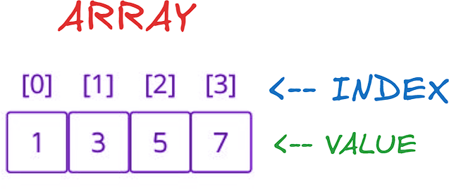

# ✅Beats 100% | Explained Step by Step | List Most Common Array Interview Problems✅

**Author:** Piotr_Maminski
**Votes:** 28
**Link:** [https://leetcode.com/problems/count-the-number-of-fair-pairs/solutions/6040777/](https://leetcode.com/problems/count-the-number-of-fair-pairs/solutions/6040777/)

---

https://youtu.be/TjthKf7Mc_8?si=UZzDfyHTRTDWhG5p


# Two Pointers (C++ 99,5%,Python3 95%,rest 100%)


```python3 []
class Solution:
    def countFairPairs(self, nums: List[int], lower: int, upper: int) -> int:
        nums.sort()
        return self.countPairs(nums, upper) - self.countPairs(nums, lower - 1)
    
    def countPairs(self, nums: List[int], target: int) -> int:
        count = 0
        left, right = 0, len(nums) - 1
        
        while left < right:
            if nums[left] + nums[right] > target:
                right -= 1
            else:
                count += right - left
                left += 1
                
        return count

```
```cpp []
class Solution {
public:
    long long countFairPairs(vector<int>& nums, int lower, int upper) {
        sort(nums.begin(), nums.end());
        return countPairs(nums, upper) - countPairs(nums, lower - 1);
    }
    
private:
    long long countPairs(vector<int>& nums, int target) {
        long long count = 0;
        int left = 0, right = nums.size() - 1;
        
        while (left < right) {
            if (nums[left] + nums[right] > target) right--;
            else {
                count += right - left;
                left++;
            }
        }
        return count;
    }
};

```
```java []
class Solution {
    public long countFairPairs(int[] nums, int lower, int upper) {
        Arrays.sort(nums);
        return countPairs(nums, upper) - countPairs(nums, lower - 1);
    }

    private long countPairs(int[] nums, int target) {
        long count = 0;
        int left = 0, right = nums.length - 1;
        
        while (left < right) {
            if (nums[left] + nums[right] > target) right--;
            else {
                count += right - left;
                left++;
            }
        }
        return count;
    }
}
```
```csharp []
public class Solution {
    public long CountFairPairs(int[] nums, int lower, int upper) {
        Array.Sort(nums);
        return CountPairs(nums, upper) - CountPairs(nums, lower - 1);
    }
    
    private long CountPairs(int[] nums, int target) {
        long count = 0;
        int left = 0, right = nums.Length - 1;
        
        while (left < right) {
            if (nums[left] + nums[right] > target) right--;
            else {
                count += right - left;
                left++;
            }
        }
        return count;
    }
}


```
```golang []
func countFairPairs(nums []int, lower int, upper int) int64 {
    sort.Ints(nums)
    return countPairs(nums, upper) - countPairs(nums, lower - 1)
}

func countPairs(nums []int, target int) int64 {
    var count int64 = 0
    left, right := 0, len(nums) - 1
    
    for left < right {
        if nums[left] + nums[right] > target {
            right--
        } else {
            count += int64(right - left)
            left++
        }
    }
    return count
}

```
```swift []
class Solution {
    func countFairPairs(_ nums: [Int], _ lower: Int, _ upper: Int) -> Int {
        let sortedNums = nums.sorted()
        
        func countPairs(_ target: Int) -> Int {
            var left = 0
            var right = sortedNums.count - 1
            var count = 0
            
            while left < right {
                let currentSum = sortedNums[left] + sortedNums[right]
                if currentSum <= target {
                    count += right - left
                    left += 1
                } else {
                    right -= 1
                }
            }
            return count
        }
        
        return countPairs(upper) - countPairs(lower - 1)
    }
}
```
```javascript [JS]
// JavaScript

var countFairPairs = function(nums, lower, upper) {
    nums.sort((a, b) => a - b);
    return countPairs(nums, upper) - countPairs(nums, lower - 1);
};

function countPairs(nums, target) {
    let count = 0;
    let left = 0;
    let right = nums.length - 1;
    
    while (left < right) {
        if (nums[left] + nums[right] > target) {
            right--;
        } else {
            count += right - left;
            left++;
        }
    }
    
    return count;
}
```
```typescript [TS]
// TypeScript

function countFairPairs(nums: number[], lower: number, upper: number): number {
    nums.sort((a, b) => a - b);
    return countPairs(nums, upper) - countPairs(nums, lower - 1);
}

function countPairs(nums: number[], target: number): number {
    let count = 0;
    let left = 0, right = nums.length - 1;
    
    while (left < right) {
        if (nums[left] + nums[right] > target) right--;
        else {
            count += right - left;
            left++;
        }
    }
    return count;
}

```
```rust []
impl Solution {
    pub fn count_fair_pairs(nums: Vec<i32>, lower: i32, upper: i32) -> i64 {
        let mut sorted_nums = nums.clone();
        sorted_nums.sort();
        Self::count_pairs(&sorted_nums, upper) - Self::count_pairs(&sorted_nums, lower - 1)
    }
    
    fn count_pairs(nums: &Vec<i32>, target: i32) -> i64 {
        let mut count: i64 = 0;
        let mut left = 0;
        let mut right = nums.len() - 1;
        
        while left < right {
            if nums[left] + nums[right] > target {
                right -= 1;
            } else {
                count += (right - left) as i64;
                left += 1;
            }
        }
        count
    }
}

```
```ruby []
def count_fair_pairs(nums, lower, upper)
    nums.sort!
    count_pairs(nums, upper) - count_pairs(nums, lower - 1)
end

def count_pairs(nums, target)
    count = 0
    left = 0
    right = nums.length - 1
    
    while left < right
        if nums[left] + nums[right] > target
            right -= 1
        else
            count += right - left
            left += 1
        end
    end
    count
end
```
- Complexy: Time:O(n log n) & Space:O(1)


# Binary Search (from video)


```python3 []
class Solution:
    def countFairPairs(self, nums: List[int], lower: int, upper: int) -> int:
        def bin_search(l, r, target):
            while l <= r:
                m = (l + r) // 2
                if nums[m] >= target:
                    r = m - 1
                else:
                    l = m + 1
            return r

        nums.sort()
        res = 0
        for i in range(len(nums)):
            low = lower - nums[i]
            up = upper - nums[i]
            res += (
                bin_search(i + 1, len(nums) - 1, up + 1) -
                bin_search(i + 1, len(nums) - 1, low)
            )
        return res
```
```cpp []
class Solution {
private:
    int binSearch(vector<int>& nums, int l, int r, int target) {
        while (l <= r) {
            int m = l + (r - l) / 2;
            if (nums[m] >= target) r = m - 1;
            else l = m + 1;
        }
        return r;
    }
public:
    long long countFairPairs(vector<int>& nums, int lower, int upper) {
        sort(nums.begin(), nums.end());
        long long res = 0;
        for (int i = 0; i < nums.size(); i++) {
            int low = lower - nums[i];
            int up = upper - nums[i];
            res += binSearch(nums, i + 1, nums.size() - 1, up + 1) - 
                   binSearch(nums, i + 1, nums.size() - 1, low);
        }
        return res;
    }
};
```
```java []
class Solution {
    private int binSearch(int[] nums, int l, int r, int target) {
        while (l <= r) {
            int m = l + (r - l) / 2;
            if (nums[m] >= target) r = m - 1;
            else l = m + 1;
        }
        return r;
    }
    
    public long countFairPairs(int[] nums, int lower, int upper) {
        Arrays.sort(nums);
        long res = 0;
        for (int i = 0; i < nums.length; i++) {
            int low = lower - nums[i];
            int up = upper - nums[i];
            res += binSearch(nums, i + 1, nums.length - 1, up + 1) - 
                   binSearch(nums, i + 1, nums.length - 1, low);
        }
        return res;
    }
}

```
```csharp []
public class Solution {
    private int BinSearch(int[] nums, int l, int r, int target) {
        while (l <= r) {
            int m = l + (r - l) / 2;
            if (nums[m] >= target) r = m - 1;
            else l = m + 1;
        }
        return r;
    }
    
    public long CountFairPairs(int[] nums, int lower, int upper) {
        Array.Sort(nums);
        long res = 0;
        for (int i = 0; i < nums.Length; i++) {
            int low = lower - nums[i];
            int up = upper - nums[i];
            res += BinSearch(nums, i + 1, nums.Length - 1, up + 1) - 
                   BinSearch(nums, i + 1, nums.Length - 1, low);
        }
        return res;
    }
}

```
```golang []
func binSearch(nums []int, l, r, target int) int {
    for l <= r {
        m := l + (r-l)/2
        if nums[m] >= target {
            r = m - 1
        } else {
            l = m + 1
        }
    }
    return r
}

func countFairPairs(nums []int, lower int, upper int) int64 {
    sort.Ints(nums)
    var res int64
    for i := 0; i < len(nums); i++ {
        low := lower - nums[i]
        up := upper - nums[i]
        res += int64(binSearch(nums, i+1, len(nums)-1, up+1) - 
                     binSearch(nums, i+1, len(nums)-1, low))
    }
    return res
}

```
```swift []
class Solution {
    private func binSearch(_ nums: [Int], _ l: Int, _ r: Int, _ target: Int) -> Int {
        var left = l
        var right = r
        while left <= right {
            let m = left + (right - left) / 2
            if nums[m] >= target {
                right = m - 1
            } else {
                left = m + 1
            }
        }
        return right
    }
    
    func countFairPairs(_ nums: [Int], _ lower: Int, _ upper: Int) -> Int {
        let sortedNums = nums.sorted()
        var res = 0
        for i in 0..<sortedNums.count {
            let low = lower - sortedNums[i]
            let up = upper - sortedNums[i]
            res += binSearch(sortedNums, i + 1, sortedNums.count - 1, up + 1) - 
                   binSearch(sortedNums, i + 1, sortedNums.count - 1, low)
        }
        return res
    }
}

```
```javascript [JS]
// JavaScript

var countFairPairs = function(nums, lower, upper) {
    const binSearch = (l, r, target) => {
        while (l <= r) {
            const m = Math.floor((l + r) / 2);
            if (nums[m] >= target) {
                r = m - 1;
            } else {
                l = m + 1;
            }
        }
        return r;
    };
    
    nums.sort((a, b) => a - b);
    let res = 0;
    
    for (let i = 0; i < nums.length; i++) {
        const low = lower - nums[i];
        const up = upper - nums[i];
        res += (
            binSearch(i + 1, nums.length - 1, up + 1) -
            binSearch(i + 1, nums.length - 1, low)
        );
    }
    
    return res;
};
```
```typescript [TS]
// TypeScript

function binSearch(nums: number[], l: number, r: number, target: number): number {
    while (l <= r) {
        const m = l + Math.floor((r - l) / 2);
        if (nums[m] >= target) r = m - 1;
        else l = m + 1;
    }
    return r;
}

function countFairPairs(nums: number[], lower: number, upper: number): number {
    nums.sort((a, b) => a - b);
    let res = 0;
    for (let i = 0; i < nums.length; i++) {
        const low = lower - nums[i];
        const up = upper - nums[i];
        res += binSearch(nums, i + 1, nums.length - 1, up + 1) - 
               binSearch(nums, i + 1, nums.length - 1, low);
    }
    return res;
}

```
```rust []
impl Solution {
    fn bin_search(nums: &Vec<i32>, mut l: i32, mut r: i32, target: i32) -> i64 {
        while l <= r {
            let m = l + (r - l) / 2;
            if nums[m as usize] >= target {
                r = m - 1;
            } else {
                l = m + 1;
            }
        }
        r as i64
    }
    
    pub fn count_fair_pairs(mut nums: Vec<i32>, lower: i32, upper: i32) -> i64 {
        nums.sort();
        let mut res = 0i64;
        for i in 0..nums.len() {
            let low = lower - nums[i];
            let up = upper - nums[i];
            res += Self::bin_search(&nums, (i + 1) as i32, (nums.len() - 1) as i32, up + 1) -
                   Self::bin_search(&nums, (i + 1) as i32, (nums.len() - 1) as i32, low);
        }
        res
    }
}
```
```ruby []
def bin_search(nums, l, r, target)
    while l <= r
        m = (l + r) / 2
        if nums[m] >= target
            r = m - 1
        else
            l = m + 1
        end
    end
    r
end

def count_fair_pairs(nums, lower, upper)
    nums.sort!
    res = 0
    nums.each_with_index do |num, i|
        low = lower - num
        up = upper - num
        res += bin_search(nums, i + 1, nums.length - 1, up + 1) - 
               bin_search(nums, i + 1, nums.length - 1, low)
    end
    res
end

```

- Complexy: Time:O(n log n) & Space:O(1)


---
# Video explains it better, but if you prefer text...

## First, What the... is fair pair?

- A pair of numbers that meets the criteria given in the task. That's it.

**Criteria:**

- **i** must be less than **j** (different positions) (indexes)
- The sum of **nums[i]** + **nums[j]** must be between lower and upper bounds (inclusive) (values)




## Think about it in your head, how would you solve it? Purely logically. Seriously, that's actually the most important thing.

- Now you probably better watch a video with binary search approach. If you understood that, I invite you to...


# Two Pointers Aproach

1. Main Function:
```
def countFairPairs(self, nums: List[int], lower: int, upper: int) -> int:
    nums.sort()
    return self.countPairs(nums, upper) - self.countPairs(nums, lower - 1)
```

- First sorts the input array
- Uses the difference between two countPairs calls to get pairs within range
-  pairs <= upper minus pairs <= (lower-1) gives us pairs in [lower, upper]


2. Helper Function:
```
def countPairs(self, nums: List[int], target: int) -> int:
    count = 0
    left, right = 0, len(nums) - 1
    
    while left < right:
        if nums[left] + nums[right] > target:
            right -= 1
        else:
            count += right - left
            left += 1
            
    return count
```
- Uses two-pointer technique (less memory consumption, better optymalization)
- Counts pairs where sum <= target
- When sum is too large, decrments right pointer
- When sum is <= target, all pairs between left and right are valid
- Why helper function? optymalization

Done.


Damn. Upvote is just one click for U >__<


---


# Most common Array Interview Problems
List based on my research (interviews, reddit, github) Probably not 100% accurate but very close to my recruitments. Leetcode Premium is probably more accurate [I don't have]


**Easy:** [[1. Two Sum]](https://leetcode.com/problems/two-sum/solutions/5999466/beats-100-explained-step-by-step-list-most-common-array-inverview) **(common warm-up)** [[121. Best Time to Buy and Sell Stock]](https://leetcode.com/discuss/topic/6027720/solution/) [[88. Merge Sorted Array]](https://leetcode.com/problems/merge-sorted-array/solutions/6031394/beats-100-explained-step-by-step-list-most-common-string-interview-problems) [[27. Remove Element]](https://leetcode.com/problems/remove-element/solutions/6031528/beats-100-explained-step-by-step-list-most-common-array-interview-problems) [[929. Unique Email Addresses]](https://leetcode.com/problems/unique-email-addresses/solutions/6031687/explained-step-by-step-video-list-most-common-array-interview-problems) 


**Medium/Hard:** [[15. 3Sum]](https://leetcode.com/problems/3sum/description/) [[42. Trapping Rain Water]](https://leetcode.com/problems/trapping-rain-water/?envType=problem-list-v2&envId=atbyk0mj) [[56. Merge Intervals]](https://leetcode.com/problems/merge-intervals/description/) [[57. Insert Interval]](https://leetcode.com/problems/insert-interval/description/) [[46. Permutations]](https://leetcode.com/problems/permutations/description/) [[53. Maximum Subarray]](https://leetcode.com/problems/maximum-subarray/description/) [[73. Set Matrix Zeroes]](https://leetcode.com/problems/set-matrix-zeroes/description/) [[284. Peeking Iterator]](https://leetcode.com/problems/peeking-iterator/description/)


####  [Interview Questions and Answers Repository](https://github.com/RooTinfinite/Interview-questions-and-answers)


