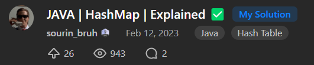
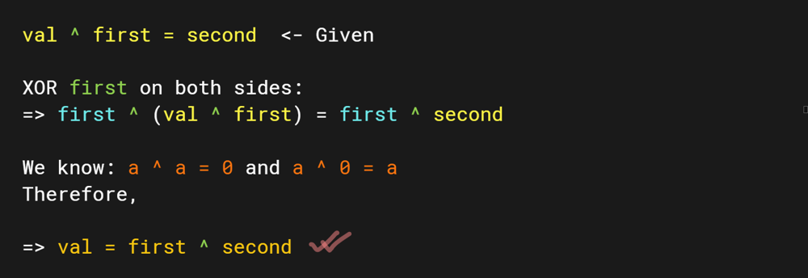

# JAVA | HashMap | Explained ✅

**Author:** sourin_bruh
**Votes:** 3
**Link:** [https://leetcode.com/problems/substring-xor-queries/solutions/3301914/](https://leetcode.com/problems/substring-xor-queries/solutions/3301914/)

---

# Previous post got removed \u2639\uFE0F
---


---
### Explanation:
We will store every number (given by each 32-bit binary substring) possible from `s` and store it in a map along with the start and end indices of that substring (the first occurrence).

Each element in `queries` is an array `[first, second]`.
We need to find every possible substring (their start and end indices) such that 
`val ^ first = second` where `val` is the **decimal value of particular substring**.

We can modify the equation to make our job easier:



We already had stored all possible decimal values from `s` in a map.
Then we will iterate over `queries` and get the value: `queries[i][0] ^ queries[i][1]` i.e. `first ^ second` and check if the value exists in the map. If yes, we put the start and end indices in the answer array otherwise we will put `{-1, -1}`.

---
### Code:
``` 
class Solution {
    public int[][] substringXorQueries(String s, int[][] queries) {
        // We will create a hashmap to store all the possible 
        // decimal values that our given string can offer
        // A number can have at max 32 bits
        // So a we can take a substring of length at max 32 
        // and convert it to a decimal value
        Map<Integer, int[]> map = new HashMap<>();
        for (int i = 0; i < s.length(); i++) {
            // leading 0
            if (s.charAt(i) == '0') {
                // put the 0 along with its start and end (left & right)
                map.putIfAbsent(0, new int[] {i, i});
                continue;   // move on
            }
            
            // otherwise we will create the decimal value
            int num = 0;
            // iterate from here an create decimal value for each binary substring
            for (int j = i; j < s.length() && j < i + 32; j++) {
                num *= 2;   
                num += (s.charAt(j) - '0');
                // put the number in the map along with its start and end 
                map.putIfAbsent(num, new int[] {i, j});
            }

            // we want to keep the minimum left in case of multiple same numbers
            // putIfAbsent() puts the first ever instance found into the map
            // if we encounter same number again, it won't overwrite (like put()) 
            // because we already have the number (key) with its start & end 
        }

        // initialise answer array
        int[][] ans = new int[queries.length][2];
        int i = 0;
        for (int[] q : queries) {
            int val = q[0] ^ q[1];  // get the xor value
            // if the value exists in the map, we put its {left, right} in ans
            // else put {-1, -1} at that place
            ans[i++] = map.getOrDefault(val, new int[] {-1, -1});
        }

        return ans;
    }
}
```
---
### Clean solution:
``` 
class Solution {
    public int[][] substringXorQueries(String s, int[][] queries) {
        Map<Integer, int[]> map = new HashMap<>();
        for (int i = 0; i < s.length(); i++) {
            if (s.charAt(i) == '0') {
                map.putIfAbsent(0, new int[] {i, i});
                continue;  
            }

            int num = 0;
            for (int j = i; j < s.length() && j < i + 32; j++) {
                num *= 2;   
                num += (s.charAt(j) - '0');
                map.putIfAbsent(num, new int[] {i, j});
            }
        }

        int[][] ans = new int[queries.length][2];
        int i = 0;
        for (int[] q : queries) {
            int val = q[0] ^ q[1];  
            ans[i++] = map.getOrDefault(val, new int[] {-1, -1});
        }

        return ans;
    }
}
```
--- 
##### Time complexity: $$O(n * min(n, 32)) + O(n)$$
##### Space complexity: $$O(n ^ 2)$$