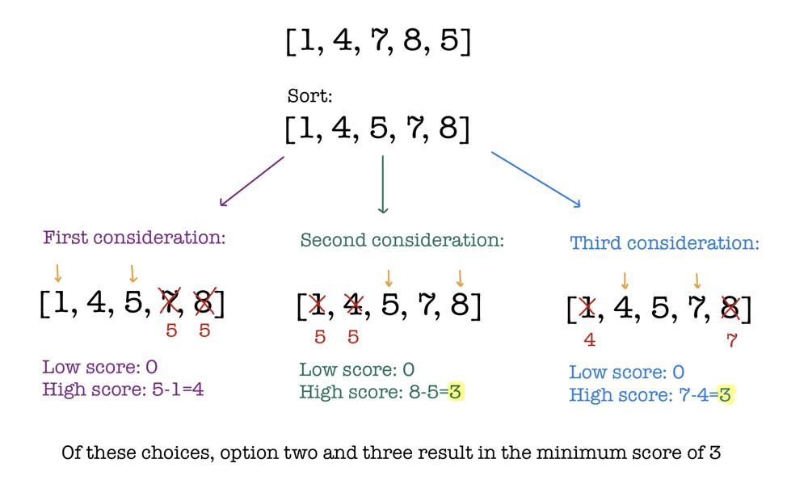

# Simple Diagram Explanation

**Author:** L30XL1U
**Votes:** 53
**Link:** [https://leetcode.com/problems/minimum-score-by-changing-two-elements/solutions/3202969/](https://leetcode.com/problems/minimum-score-by-changing-two-elements/solutions/3202969/)

---

# Idea
- Sort `nums` so that we can easily access maximum and minimum values
- We will always make the low score $$0$$ by creating duplicate values
- Now we have changed the question to finding the minimum maximum value difference by changing two values
- We have three options:
    - Change the two largest values to the third largest value. Third largest value now becomes the max value.
    - Change the two smallest values to the third smallest value. Third smallest value now becomes the min value.
    - Change largest value to second largest value and smallest value to second smallest value. Second largest becomes max value and second smallest becomes min value.
- It must be one of these three options because we have to create duplicates to satisfy the low score constraint and the high score always deals with difference between maximum and minimum.


# Example

- Let us use `nums = [1,4,7,8,5]`




# Code
```
class Solution {
public:
    int minimizeSum(vector<int>& nums) {
        sort(nums.begin(), nums.end());
        int n = nums.size();
        return min(nums[n-1]-nums[2], min(nums[n-2]-nums[1], nums[n-3]-nums[0]));
    }
};
```
- Notice from the code that we do not actually need to change the values, we just need to compare the elements of interest by the three options.
#### If this helped please leave an upvote. Thanks!