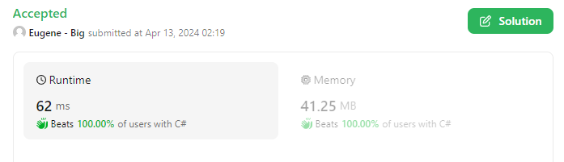

# Squeezed every "bit" out of it, C# recursive solution, with some cheating, beats 100% cases, 62ms

**Author:** bigeugene
**Votes:** 0
**Link:** [https://leetcode.com/problems/count-the-number-of-square-free-subsets/solutions/5015150/](https://leetcode.com/problems/count-the-number-of-square-free-subsets/solutions/5015150/)

---



# Intuition
From 1..30, is a hint, we should use a bit mask. We must check all combinations no matter what. Because we cannot have the same number more than once in the subset, it make sense to group all the same numbers and only use the bit mask once. Then we can multiply combinations by the count.

# Approach

If we reduce the nums array to only numbers that do not have squares in them in the first place, we end up with max array size of 19.

1 is a special case, because you can combine as many 1s as you want and it won't create squares. Handled separately at the end of recursion. And you guys are killing me with 100 ones. It's 2^100 and had to use 128 bit numbers to handle it. Why would you do that?

I have minimized the array to only numbers that exists, to reduce the call stack size and squeeze a bit of performance. It's also easier to debug it with smaller arrays.

# Complexity
- Time complexity:
$$O(n)$$ 

  Disregard constant obviously, 2^19=524,288 iterarions(worst case) theoretical. In practicality, due to conflicts number of iterarions is going to be much smaller.


- Space complexity:
$$O(n)$$

# Code
```
public class Solution {
    const ulong modulo = 1000000007;
    const ulong moduloMax = 100000000000; // Save on division operation
    
    public int SquareFreeSubsets(int[] nums) {
        // Precalculated array with prime bitmask: right to left, bit(0)=2, bit(1)=3, bit(2)=5, bit(3)=7, etc...
        int[] primeBitMasks = new int[] { 0, 1, 2, -1, 4, 3, 8, -1, -1, 5, 16, -1, 32, 9, 6, -1, 64, -1, 128, -1, 10, 17, 256, -1, -1, 33, -1, -1, 512, 7 };

        // Precalculated array with counters, mostly zeroes except the ones that already have square in them and should be ignored, marked with -1
        //                             1, 2, 3,  4, 5, 6, 7,  8, 9,10,11, 12,13,14,15, 16,17, 18,19, 20,21,22,23, 24, 25,26, 27, 28,29,30
        int[] checkCount = new int[] { 0, 0, 0, -1, 0, 0, 0, -1,-1, 0, 0, -1, 0, 0, 0, -1, 0, -1, 0, -1, 0, 0, 0, -1, -1, 0, -1, -1, 0, 0 };

        // Count each number, except the ones that shoud be ignored(-1)
        foreach (int num in nums)
        {
            int i = num - 1;
            if (checkCount[i] != -1) checkCount[i]++;
        }

        // One is a special case and can coexist with each other. We will handle it later and remove it from the total count for now
        int countOnes = checkCount[0];
        checkCount[0] = -1;

        //Create minimalistic arrays with only numbers that exist and can be used
        int count = checkCount.Count(x => x > 0);
        int[] numCount = new int[count];
        int[] bitMasks = new int[count];
        
        for (int i = 0, ind = 0; i < checkCount.Length; i++)
        {
            if (checkCount[i] < 1) continue;

            numCount[ind] = checkCount[i];
            bitMasks[ind] = primeBitMasks[i];
            ind++;
        }

        //Execute recursion from first number
        ulong combinations = countCombinations(0, 0, numCount, bitMasks) % modulo;
        
        // Add missing ones
        if (countOnes > 0)
        {
            //Case 44 with 100 ones, had to use BigInteger=128bit
            ulong oneComb = (ulong)(System.Numerics.BigInteger.Pow(2, countOnes)  % modulo);
            combinations = (ulong)((combinations * oneComb + oneComb - 1) % modulo);
        }
        return (int)((ulong)combinations % modulo);
    }

    private ulong countCombinations(int index, int bitmask, int[] numCount, int[] bitMasks)
    {
        if (index >= numCount.Length) return 0; // Reach array end
        
        // Count combination without the number
        ulong combinations = countCombinations(index + 1, bitmask, numCount, bitMasks);

        // If number won't create square, count combinations with the number as well
        if ((bitmask & bitMasks[index]) == 0)
        {
            ulong combWithNumber = countCombinations(index + 1, bitmask | bitMasks[index], numCount, bitMasks);
            combinations += (combWithNumber + 1) * (ulong)numCount[index];
        }

        if(combinations > moduloMax) // Save on division operation
            combinations %= modulo;

        return combinations;
    }
}
```