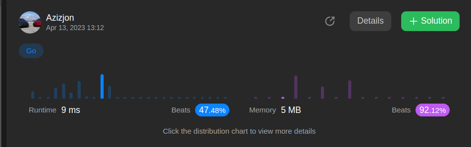
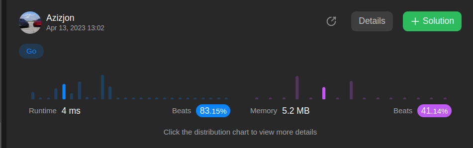

# Go two easy solutions

**Author:** Azizjon003
**Votes:** 3
**Link:** [https://leetcode.com/problems/left-and-right-sum-differences/solutions/3411967/](https://leetcode.com/problems/left-and-right-sum-differences/solutions/3411967/)

---

# Approach 
- Go easy solution
-

-


# Complexity
- Time complexity:82%

- Space complexity:93%

# Code
```go []

func leftRigthDifference(nums []int) []int {
	result := make([]int, len(nums))
	left, right := 0, 0
	for _, num := range nums {
			right += num
	}
	for i, num := range nums {
			right -= num
			result[i] = Abs(left - right)
			left += num
	}
	return result
}

func Abs(x int) int {
	if x < 0 {
			return -x
	}
	return x
}
```
```go []
func leftRigthDifference(nums[]int) []int{
	result := []int{}
	left := 0
	right := 0
	for _, v := range nums{
		right += v
	}
	for _, i := range nums {
		right -= i
		result = append(result, Abs(left - right))
		left += i
	}
	return result
}

func Abs(x int) int {
	if x < 0 {
		return -x
	}
	return x
}
```

