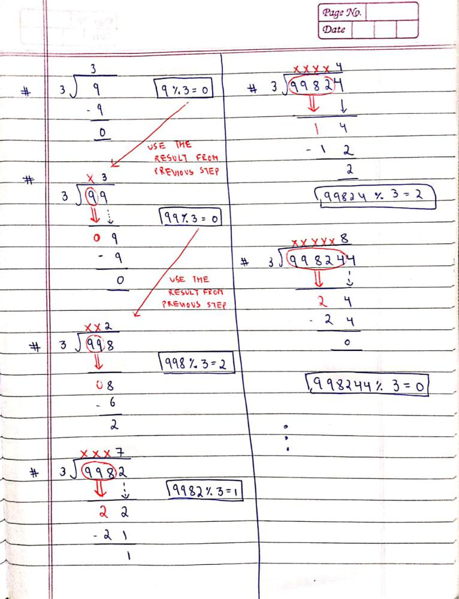

# Stepwise Explanation with images || Easy to understand || Simple division rule

**Author:** MohakHarjani
**Votes:** 139
**Link:** [https://leetcode.com/problems/find-the-divisibility-array-of-a-string/solutions/3230950/](https://leetcode.com/problems/find-the-divisibility-array-of-a-string/solutions/3230950/)

---



```
class Solution {
public:
    vector<int> divisibilityArray(string word, int m) 
    {
        vector<int>ans;
        long long prevRem = 0;
        for (int i = 0; i < word.size(); i++)
        {
            int currDig = word[i] - '0';
            long long newDividend = (prevRem * 10) + currDig;  
			//newDividend = currDig appended to previous remainder
            
            int rem = (newDividend % m);
            if (rem == 0) ans.push_back(1);
            else ans.push_back(0);
            
            prevRem = rem; 
        }
        return ans;   
    }
};
```