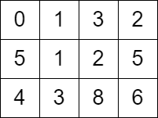

# [2577. Minimum Time to Visit a Cell In a Grid](https://leetcode.com/problems/minimum-time-to-visit-a-cell-in-a-grid/)

| Category | Difficulty | Likes | Dislikes |
| :------: | :--------: | :---: | :------: |
| Algorithms | Hard | 1117 | 44 |

**Tags:** [`array`](https://leetcode.com/tag/array), [`breadth-first-search`](https://leetcode.com/tag/breadth-first-search), [`graph`](https://leetcode.com/tag/graph), [`heap-priority-queue`](https://leetcode.com/tag/heap-priority-queue), [`matrix`](https://leetcode.com/tag/matrix), [`shortest-path`](https://leetcode.com/tag/shortest-path)

**Companies:** `google`, `microsoft`, `atlassian`

## Description

You are given a `m x n` matrix `grid` consisting of non-negative integers where `grid[row][col]` represents the **minimum** time required to be able to visit the cell `(row, col)`, which means you can visit the cell `(row, col)` only when the time you visit it is greater than or equal to `grid[row][col]`.

You are standing in the **top-left** cell of the matrix in the `0^th` second, and you must move to **any** adjacent cell in the four directions: up, down, left, and right. Each move you make takes 1 second.

Return *the **minimum** time required in which you can visit the bottom-right cell of the matrix*. If you cannot visit the bottom-right cell, then return `-1`.

 

**Example 1:**



```

Input: grid = [[0,1,3,2],[5,1,2,5],[4,3,8,6]]
Output: 7
Explanation: One of the paths that we can take is the following:
- at t = 0, we are on the cell (0,0).
- at t = 1, we move to the cell (0,1). It is possible because grid[0][1] &lt;= 1.
- at t = 2, we move to the cell (1,1). It is possible because grid[1][1] &lt;= 2.
- at t = 3, we move to the cell (1,2). It is possible because grid[1][2] &lt;= 3.
- at t = 4, we move to the cell (1,1). It is possible because grid[1][1] &lt;= 4.
- at t = 5, we move to the cell (1,2). It is possible because grid[1][2] &lt;= 5.
- at t = 6, we move to the cell (1,3). It is possible because grid[1][3] &lt;= 6.
- at t = 7, we move to the cell (2,3). It is possible because grid[2][3] &lt;= 7.
The final time is 7. It can be shown that it is the minimum time possible.

```

**Example 2:**


```

Input: grid = [[0,2,4],[3,2,1],[1,0,4]]
Output: -1
Explanation: There is no path from the top left to the bottom-right cell.

```

 

**Constraints:**

	- `m == grid.length`

	- `n == grid[i].length`

	- `2 .spoilerbutton {display:block; border:dashed; padding: 0px 0px; margin:10px 0px; font-size:150%; font-weight: bold; color:#000000; background-color:cyan; outline:0; 
}
.spoiler {overflow:hidden;}
.spoiler > div {-webkit-transition: all 0s ease;-moz-transition: margin 0s ease;-o-transition: all 0s ease;transition: margin 0s ease;}
.spoilerbutton[value="Show Message"] + .spoiler > div {margin-top:-500%;}
.spoilerbutton[value="Hide Message"] + .spoiler {padding:5px;}

---

**Links:** [Submissions](https://leetcode.com/problems/minimum-time-to-visit-a-cell-in-a-grid/) | [Solutions](https://leetcode.com/problems/minimum-time-to-visit-a-cell-in-a-grid/)
