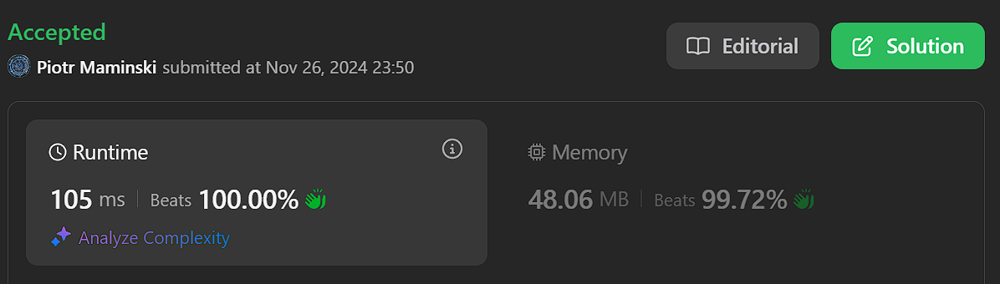
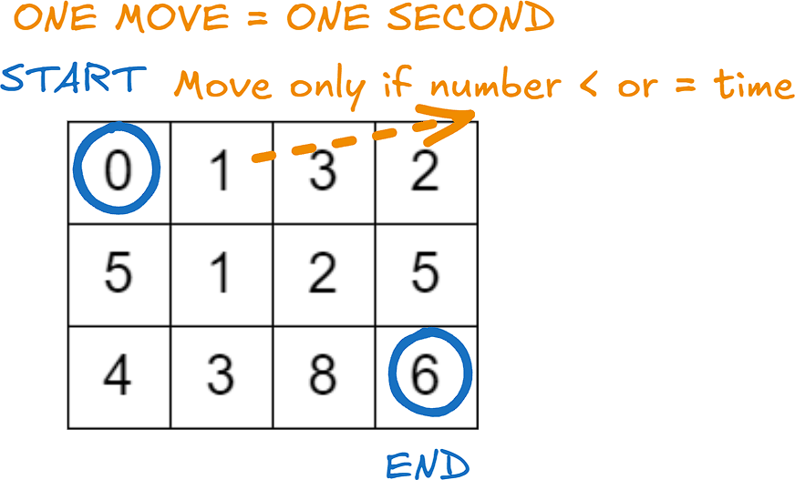
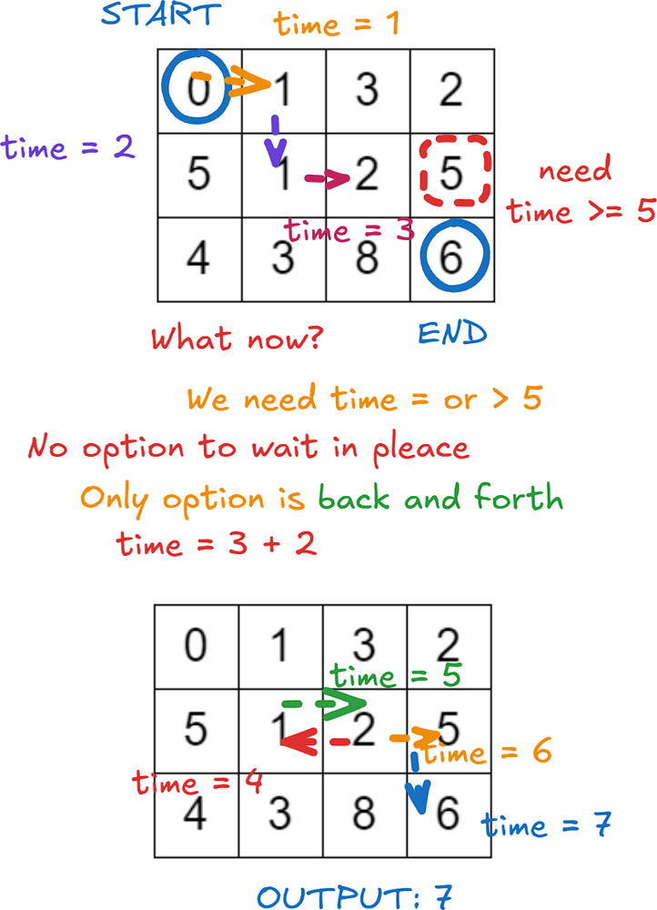
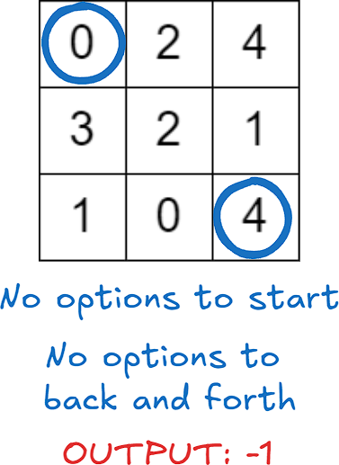

# ✅ Video | Beats 100% | Dijkstra's Algorithm

**Author:** Piotr_Maminski
**Votes:** 43
**Link:** [https://leetcode.com/problems/minimum-time-to-visit-a-cell-in-a-grid/solutions/6083425/](https://leetcode.com/problems/minimum-time-to-visit-a-cell-in-a-grid/solutions/6083425/)

---



https://youtu.be/Kj98r8IgJOQ?si=t5CGvV0eYvsxm6dX

# #1 Mod Dijkstra's Algorithm (Beats 95-100%)
```python3 []
class Solution:
    def minimumTime(self, grid: List[List[int]]) -> int:
        MOVES = ((-1, 0), (0, 1), (1, 0), (0, -1))
        
        if grid[0][1] > 1 and grid[1][0] > 1:
            return -1
            
        rows, cols = len(grid), len(grid[0])
        pq = [(0, 0, 0)]  # time, row(x), col(y)
        seen = [[False] * cols for _ in range(rows)]
        seen[0][0] = True
        
        while pq:
            time, row, col = heappop(pq)
            
            for dr, dc in MOVES:
                newRow, newCol = row + dr, col + dc
                
                if (newRow < 0 or newRow >= rows or 
                    newCol < 0 or newCol >= cols or 
                    seen[newRow][newCol]):
                    continue
                
                newTime = time + 1
                if grid[newRow][newCol] > newTime:
                    newTime += (grid[newRow][newCol] - time) // 2 * 2
                
                if newRow == rows - 1 and newCol == cols - 1:
                    return newTime
                    
                seen[newRow][newCol] = True
                heappush(pq, (newTime, newRow, newCol))
                
        return -1
```
```cpp []
class Solution {
public:
    int minimumTime(vector<vector<int>>& grid) {
        if (grid[0][1] > 1 && grid[1][0] > 1) return -1;
        
        int rows = grid.size();
        int cols = grid[0].size();
        
        priority_queue<pair<int, pair<int, int>>, 
                      vector<pair<int, pair<int, int>>>, 
                      greater<pair<int, pair<int, int>>>> minHeap;
        
        minHeap.push({0, {0, 0}}); // time, row(x), col(y)
        
        vector<vector<int>> seen(rows, vector<int>(cols, 0));
        seen[0][0] = 1;
        
        vector<pair<int, int>> moves = {{0, 1}, {0, -1}, {1, 0}, {-1, 0}};
        
        while (!minHeap.empty()) {
            auto curr = minHeap.top();
            int currTime = curr.first;
            int currRow = curr.second.first;
            int currCol = curr.second.second;
            
            minHeap.pop();
            
            if (currRow == rows - 1 && currCol == cols - 1) 
                return currTime;
            
            for (auto move : moves) {
                int nextRow = move.first + currRow;
                int nextCol = move.second + currCol;
                
                if (nextRow >= 0 && nextCol >= 0 && 
                    nextRow < rows && nextCol < cols && 
                    !seen[nextRow][nextCol]) {
                    
                    int waitTime = ((grid[nextRow][nextCol] - currTime) % 2 == 0) ? 1 : 0;
                    int nextTime = max(currTime + 1, grid[nextRow][nextCol] + waitTime);
                    
                    minHeap.push({nextTime, {nextRow, nextCol}});
                    seen[nextRow][nextCol] = 1;
                }
            }
        }
        return -1;
    }
};
```
```cpp [C++ v2]
class Solution {
public:
    int minimumTime(vector<vector<int>>& grid) {
        if (grid[0][1] > 1 && grid[1][0] > 1) return -1;
        
        int rows = grid.size();
        int cols = grid[0].size();
        int maxPos = rows * cols;
        
        priority_queue<pair<int, int>, 
                      vector<pair<int, int>>, 
                      greater<pair<int, int>>> minHeap;
        
        minHeap.push({0, 0}); // time, encoded position
        
        vector<bool> seen(maxPos, false); 
        seen[0] = true;
        
        const int moves[4][2] = {{0, 1}, {0, -1}, {1, 0}, {-1, 0}};
        
        while (!minHeap.empty()) {
            auto [currTime, pos] = minHeap.top();
            int currRow = pos / cols;
            int currCol = pos % cols;
            
            minHeap.pop();
            
            if (currRow == rows - 1 && currCol == cols - 1) 
                return currTime;
            
            for (const auto& move : moves) {
                int nextRow = move[0] + currRow;
                int nextCol = move[1] + currCol;
                int nextPos = nextRow * cols + nextCol;
                
                if (nextRow >= 0 && nextCol >= 0 && 
                    nextRow < rows && nextCol < cols && 
                    !seen[nextPos]) {
                    
                    int waitTime = ((grid[nextRow][nextCol] - currTime) % 2 == 0) ? 1 : 0;
                    int nextTime = max(currTime + 1, grid[nextRow][nextCol] + waitTime);
                    
                    minHeap.push({nextTime, nextPos});
                    seen[nextPos] = true;
                }
            }
        }
        return -1;
    }
};
```
```java []
class Solution {
    private static final int[][] MOVES = {{-1, 0}, {0, 1}, {1, 0}, {0, -1}};
    
    public int minimumTime(int[][] grid) {
        int rows = grid.length;
        int cols = grid[0].length;
        
        if (grid[0][1] > 1 && grid[1][0] > 1) {
            return -1;
        }
        
        PriorityQueue<int[]> pq = new PriorityQueue<>((a, b) -> a[0] - b[0]); 
        boolean[][] seen = new boolean[rows][cols];
        
        pq.offer(new int[]{0, 0, 0}); // time, row, col
        seen[0][0] = true;
        
        while (!pq.isEmpty()) {
            int[] curr = pq.poll();
            int time = curr[0];
            int row = curr[1];
            int col = curr[2];
            
            for (int[] dir : MOVES) {
                int newRow = row + dir[0];
                int newCol = col + dir[1];
                
                if (newRow < 0 || newRow >= rows || 
                    newCol < 0 || newCol >= cols || 
                    seen[newRow][newCol]) {
                    continue;
                }
                
                int newTime = time + 1;
                if (grid[newRow][newCol] > newTime) {
                    int wait = ((grid[newRow][newCol] - newTime + 1) / 2) * 2;
                    newTime += wait;
                }
                
                if (newRow == rows - 1 && newCol == cols - 1) {
                    return newTime;
                }
                
                seen[newRow][newCol] = true;
                pq.offer(new int[]{newTime, newRow, newCol});
            }
        }
        
        return -1;
    }
}
```
```csharp []
public class Solution {
    private static readonly (int dr, int dc)[] MOVES = { (-1, 0), (0, 1), (1, 0), (0, -1) };
    
    public int MinimumTime(int[][] grid) {
        if (grid[0][1] > 1 && grid[1][0] > 1) {
            return -1;
        }
        
        int rows = grid.Length;
        int cols = grid[0].Length;
        var pq = new PriorityQueue<(int time, int row, int col), int>();
        pq.Enqueue((0, 0, 0), 0); // time, row, col, queue
        
        bool[][] seen = new bool[rows][];
        for (int i = 0; i < rows; i++) {
            seen[i] = new bool[cols];
        }
        seen[0][0] = true;
        
        while (pq.Count > 0) {
            var (time, row, col) = pq.Dequeue();
            
            foreach (var (dr, dc) in MOVES) {
                int newRow = row + dr;
                int newCol = col + dc;
                
                if (newRow < 0 || newRow >= rows || 
                    newCol < 0 || newCol >= cols || 
                    seen[newRow][newCol]) {
                    continue;
                }
                
                int newTime = time + 1;
                if (grid[newRow][newCol] > newTime) {
                    newTime += ((grid[newRow][newCol] - time) / 2) * 2;
                }
                
                if (newRow == rows - 1 && newCol == cols - 1) {
                    return newTime;
                }
                
                seen[newRow][newCol] = true;
                pq.Enqueue((newTime, newRow, newCol), newTime);
            }
        }
        
        return -1;
    }
}
```
```golang []
type Cell struct {
    time, row, col int
}

type PriorityQueue []Cell

func (pq PriorityQueue) Len() int { return len(pq) }
func (pq PriorityQueue) Less(i, j int) bool { return pq[i].time < pq[j].time }
func (pq PriorityQueue) Swap(i, j int) { pq[i], pq[j] = pq[j], pq[i] }
func (pq *PriorityQueue) Push(x interface{}) { *pq = append(*pq, x.(Cell)) }
func (pq *PriorityQueue) Pop() interface{} {
    old := *pq
    n := len(old)
    item := old[n-1]
    *pq = old[0 : n-1]
    return item
}

func minimumTime(grid [][]int) int {
    if grid[0][1] > 1 && grid[1][0] > 1 {
        return -1
    }
    
    rows, cols := len(grid), len(grid[0])
    minHeap := &PriorityQueue{}
    heap.Init(minHeap)
    heap.Push(minHeap, Cell{0, 0, 0}) // time, row, col
    
    seen := make([][]int, rows)
    for i := range seen {
        seen[i] = make([]int, cols)
    }
    seen[0][0] = 1
    
    moves := [][2]int{{0, 1}, {0, -1}, {1, 0}, {-1, 0}}
    
    for minHeap.Len() > 0 {
        curr := heap.Pop(minHeap).(Cell)
        currTime := curr.time
        currRow := curr.row
        currCol := curr.col
        
        if currRow == rows-1 && currCol == cols-1 {
            return currTime
        }
        
        for _, move := range moves {
            nextRow := move[0] + currRow
            nextCol := move[1] + currCol
            
            if nextRow >= 0 && nextCol >= 0 && 
               nextRow < rows && nextCol < cols && 
               seen[nextRow][nextCol] == 0 {
                
                waitTime := 0
                if (grid[nextRow][nextCol]-currTime)%2 == 0 {
                    waitTime = 1
                }
                nextTime := max(currTime+1, grid[nextRow][nextCol]+waitTime)
                
                heap.Push(minHeap, Cell{nextTime, nextRow, nextCol})
                seen[nextRow][nextCol] = 1
            }
        }
    }
    return -1
}

func max(a, b int) int {
    if a > b {
        return a
    }
    return b
}
```
```javascript [JS]
// JavaScript

var minimumTime = function(grid) {
    const MOVES = [[-1, 0], [0, 1], [1, 0], [0, -1]];
    
    if (grid[0][1] > 1 && grid[1][0] > 1) {
        return -1;
    }
    
    const rows = grid.length;
    const cols = grid[0].length;
    const seen = Array(rows).fill().map(() => Array(cols).fill(false));
    seen[0][0] = true;
    
    const pq = new MinPriorityQueue({
        priority: x => x[0]
    });
    pq.enqueue([0, 0, 0]); // time, row, col
    
    while (!pq.isEmpty()) {
        const [time, row, col] = pq.dequeue().element;
        
        for (const [dr, dc] of MOVES) {
            const newRow = row + dr;
            const newCol = col + dc;
            
            if (newRow < 0 || newRow >= rows || 
                newCol < 0 || newCol >= cols || 
                seen[newRow][newCol]) {
                continue;
            }
            
            let newTime = time + 1;
            if (grid[newRow][newCol] > newTime) {
                newTime += Math.floor((grid[newRow][newCol] - time) / 2) * 2;
            }
            
            if (newRow === rows - 1 && newCol === cols - 1) {
                return newTime;
            }
            
            seen[newRow][newCol] = true;
            pq.enqueue([newTime, newRow, newCol]);
        }
    }
    
    return -1;
};
```
```rust []
use std::collections::BinaryHeap;
use std::cmp::Reverse;

impl Solution {
    pub fn minimum_time(grid: Vec<Vec<i32>>) -> i32 {
        let moves = [(-1, 0), (0, 1), (1, 0), (0, -1)];
        
        if grid[0][1] > 1 && grid[1][0] > 1 {
            return -1;
        }
        
        let (rows, cols) = (grid.len(), grid[0].len());
        let mut pq = BinaryHeap::new();
        let mut seen = vec![vec![false; cols]; rows];
        
        pq.push(Reverse((0, 0, 0))); // (time, row, col)
        seen[0][0] = true;
        
        while let Some(Reverse((time, row, col))) = pq.pop() {
            for &(dr, dc) in &moves {
                let new_row = row as i32 + dr;
                let new_col = col as i32 + dc;
                
                if new_row < 0 || new_row >= rows as i32 || 
                   new_col < 0 || new_col >= cols as i32 ||
                   seen[new_row as usize][new_col as usize] {
                    continue;
                }
                
                let mut new_time = time + 1;
                let cell_value = grid[new_row as usize][new_col as usize];
                
                if cell_value > new_time {
                    new_time += ((cell_value - time) / 2) * 2;
                }
                
                if new_row as usize == rows - 1 && new_col as usize == cols - 1 {
                    return new_time;
                }
                
                seen[new_row as usize][new_col as usize] = true;
                pq.push(Reverse((new_time, new_row as usize, new_col as usize)));
            }
        }
        
        -1
    }
}
```
```ruby []
def minimum_time(grid)
    moves = [[-1, 0], [0, 1], [1, 0], [0, -1]]
    
    return -1 if grid[0][1] > 1 && grid[1][0] > 1
    
    rows, cols = grid.length, grid[0].length
    pq = [[0, 0, 0]] # time, row(x), col(y)
    seen = Array.new(rows) { Array.new(cols, false) }
    seen[0][0] = true
    
    while !pq.empty?
        time, row, col = pq.shift
        
        moves.each do |dr, dc|
            new_row, new_col = row + dr, col + dc
            
            next if new_row < 0 || new_row >= rows ||
                   new_col < 0 || new_col >= cols ||
                   seen[new_row][new_col]
            
            new_time = time + 1
            if grid[new_row][new_col] > new_time
                new_time += ((grid[new_row][new_col] - time) / 2) * 2
            end
            
            return new_time if new_row == rows - 1 && new_col == cols - 1
            
            seen[new_row][new_col] = true
            
            insert_idx = pq.bsearch_index { |x| x[0] > new_time } || pq.length
            pq.insert(insert_idx, [new_time, new_row, new_col])
        end
    end
    
    -1
end
```

- Complexity:  Time O(RC * log(RC)) & Space O(RC) [R- rows, C - columns ]

# #2 Mod Dijkstra's Algorithm (from video)


```python3 []
class Solution:
    def minimumTime(self, grid: List[List[int]]) -> int:
        if min(grid[0][1], grid[1][0]) > 1:
            return -1

        min_heap = [(0, 0, 0)]  # (time, r, c)
        ROWS, COLS = len(grid), len(grid[0])
        visit = set()

        while min_heap:
            t, r, c = heapq.heappop(min_heap)
            if (r, c) == (ROWS - 1, COLS - 1):
                return t

            nei = [(r + 1, c), (r - 1, c), (r, c + 1), (r, c - 1)]
            for nr, nc in nei:
                if nr < 0 or nc < 0 or nr == ROWS or nc == COLS or (nr, nc) in visit:
                    continue

                wait = 0
                if abs(grid[nr][nc] - t) % 2 == 0:
                    wait = 1
                n_time = max(grid[nr][nc] + wait, t + 1)
                heapq.heappush(min_heap, (n_time, nr, nc))
                visit.add((nr, nc))
```
```cpp []
class Solution {
public:
    int minimumTime(vector<vector<int>>& grid) {
        if (min(grid[0][1], grid[1][0]) > 1) {
            return -1;
        }
        
        int ROWS = grid.size(), COLS = grid[0].size();
        priority_queue<vector<int>, vector<vector<int>>, greater<>> minHeap;
        minHeap.push({0, 0, 0}); // {time, r, c}
        set<pair<int, int>> visit;
        
        while (!minHeap.empty()) {
            auto curr = minHeap.top();
            minHeap.pop();
            int t = curr[0], r = curr[1], c = curr[2];
            
            if (r == ROWS - 1 && c == COLS - 1) {
                return t;
            }
            
            vector<pair<int, int>> dirs = {{1, 0}, {-1, 0}, {0, 1}, {0, -1}};
            for (auto [dr, dc] : dirs) {
                int nr = r + dr, nc = c + dc;
                if (nr < 0 || nc < 0 || nr == ROWS || nc == COLS || 
                    visit.count({nr, nc})) {
                    continue;
                }
                
                int wait = (abs(grid[nr][nc] - t) % 2 == 0) ? 1 : 0;
                int nTime = max(grid[nr][nc] + wait, t + 1);
                minHeap.push({nTime, nr, nc});
                visit.insert({nr, nc});
            }
        }
        return -1;
    }
};
```
```java []
class Solution {
    public int minimumTime(int[][] grid) {
        if (Math.min(grid[0][1], grid[1][0]) > 1) {
            return -1;
        }
        
        int ROWS = grid.length, COLS = grid[0].length;
        PriorityQueue<int[]> minHeap = new PriorityQueue<>((a, b) -> a[0] - b[0]);
        minHeap.offer(new int[]{0, 0, 0}); // {time, r, c}
        Set<String> visit = new HashSet<>();
        
        while (!minHeap.isEmpty()) {
            int[] curr = minHeap.poll();
            int t = curr[0], r = curr[1], c = curr[2];
            
            if (r == ROWS - 1 && c == COLS - 1) {
                return t;
            }
            
            int[][] dirs = {{1, 0}, {-1, 0}, {0, 1}, {0, -1}};
            for (int[] dir : dirs) {
                int nr = r + dir[0], nc = c + dir[1];
                String key = nr + "," + nc;
                
                if (nr < 0 || nc < 0 || nr == ROWS || nc == COLS || 
                    visit.contains(key)) {
                    continue;
                }
                
                int wait = (Math.abs(grid[nr][nc] - t) % 2 == 0) ? 1 : 0;
                int nTime = Math.max(grid[nr][nc] + wait, t + 1);
                minHeap.offer(new int[]{nTime, nr, nc});
                visit.add(key);
            }
        }
        return -1;
    }
}
```
```csharp []
public class Solution {
    public int MinimumTime(int[][] grid) {
        if (Math.Min(grid[0][1], grid[1][0]) > 1) {
            return -1;
        }
        
        int ROWS = grid.Length, COLS = grid[0].Length;
        var minHeap = new PriorityQueue<(int t, int r, int c), int>();
        minHeap.Enqueue((0, 0, 0), 0); // (time, r, c)
        var visit = new HashSet<string>();
        
        while (minHeap.Count > 0) {
            var (t, r, c) = minHeap.Dequeue();
            
            if (r == ROWS - 1 && c == COLS - 1) {
                return t;
            }
            
            var dirs = new[] { (1, 0), (-1, 0), (0, 1), (0, -1) };
            foreach (var (dr, dc) in dirs) {
                int nr = r + dr, nc = c + dc;
                string key = $"{nr},{nc}";
                
                if (nr < 0 || nc < 0 || nr == ROWS || nc == COLS || 
                    visit.Contains(key)) {
                    continue;
                }
                
                int wait = (Math.Abs(grid[nr][nc] - t) % 2 == 0) ? 1 : 0;
                int nTime = Math.Max(grid[nr][nc] + wait, t + 1);
                minHeap.Enqueue((nTime, nr, nc), nTime);
                visit.Add(key);
            }
        }
        return -1;
    }
}
```
```golang []
package main

import (
    "container/heap"
    "fmt"
)

type MinHeap [][]int

func (h MinHeap) Len() int           { return len(h) }
func (h MinHeap) Less(i, j int) bool { return h[i][0] < h[j][0] }
func (h MinHeap) Swap(i, j int)      { h[i], h[j] = h[j], h[i] }

func (h *MinHeap) Push(x interface{}) {
    *h = append(*h, x.([]int))
}

func (h *MinHeap) Pop() interface{} {
    old := *h
    n := len(old)
    x := old[n-1]
    *h = old[0 : n-1]
    return x
}

func abs(x int) int {
    if x < 0 {
        return -x
    }
    return x
}
func min(a, b int) int {
    if a < b {
        return a
    }
    return b
}

func max(a, b int) int {
    if a > b {
        return a
    }
    return b
}

func minimumTime(grid [][]int) int {
    if min(grid[0][1], grid[1][0]) > 1 {
        return -1
    }
    
    rows, cols := len(grid), len(grid[0])
    minHeap := &MinHeap{}
    heap.Init(minHeap)
    heap.Push(minHeap, []int{0, 0, 0}) // time, r, c
    visited := make(map[string]bool)
    
    dirs := [][]int{{1, 0}, {-1, 0}, {0, 1}, {0, -1}}
    
    for minHeap.Len() > 0 {
        curr := heap.Pop(minHeap).([]int)
        t, r, c := curr[0], curr[1], curr[2]
        
        if r == rows-1 && c == cols-1 {
            return t
        }
        
        for _, dir := range dirs {
            nr, nc := r+dir[0], c+dir[1]
            key := fmt.Sprintf("%d,%d", nr, nc)
            
            if nr < 0 || nc < 0 || nr == rows || nc == cols || visited[key] {
                continue
            }
            
            wait := 0
            if abs(grid[nr][nc]-t)%2 == 0 {
                wait = 1
            }
            nTime := max(grid[nr][nc]+wait, t+1)
            heap.Push(minHeap, []int{nTime, nr, nc})
            visited[key] = true
        }
    }
    return -1
}
```
```javascript [JS]
// JavaScript

var minimumTime = function(grid) {
    if (Math.min(grid[0][1], grid[1][0]) > 1) {
        return -1;
    }
    
    const ROWS = grid.length;
    const COLS = grid[0].length;
    const minHeap = new MinPriorityQueue({ priority: x => x[0] });
    minHeap.enqueue([0, 0, 0]); // [time, r, c]
    const visited = new Set();
    
    const dirs = [[1, 0], [-1, 0], [0, 1], [0, -1]];
    
    while (!minHeap.isEmpty()) {
        const [t, r, c] = minHeap.dequeue().element;
        
        if (r === ROWS - 1 && c === COLS - 1) {
            return t;
        }
        
        for (const [dr, dc] of dirs) {
            const nr = r + dr;
            const nc = c + dc;
            const key = `${nr},${nc}`;
            
            if (nr < 0 || nc < 0 || nr === ROWS || nc === COLS || visited.has(key)) {
                continue;
            }
            
            const wait = Math.abs(grid[nr][nc] - t) % 2 === 0 ? 1 : 0;
            const nTime = Math.max(grid[nr][nc] + wait, t + 1);
            minHeap.enqueue([nTime, nr, nc], nTime);
            visited.add(key);
        }
    }
    return -1;
};
```
```typescript [TS]
// TypeScript

function minimumTime(grid: number[][]): number {
    if (Math.min(grid[0][1], grid[1][0]) > 1) {
        return -1;
    }
    
    const ROWS = grid.length;
    const COLS = grid[0].length;
    const minHeap = new MinPriorityQueue({ priority: x => x[0] });
    minHeap.enqueue([0, 0, 0]); // [time, r, c]
    const visited = new Set<string>();
    
    const dirs = [[1, 0], [-1, 0], [0, 1], [0, -1]];
    
    while (!minHeap.isEmpty()) {
        const [t, r, c] = minHeap.dequeue().element;
        
        if (r === ROWS - 1 && c === COLS - 1) {
            return t;
        }
        
        for (const [dr, dc] of dirs) {
            const nr = r + dr;
            const nc = c + dc;
            const key = `${nr},${nc}`;
            
            if (nr < 0 || nc < 0 || nr === ROWS || nc === COLS || visited.has(key)) {
                continue;
            }
            
            const wait = Math.abs(grid[nr][nc] - t) % 2 === 0 ? 1 : 0;
            const nTime = Math.max(grid[nr][nc] + wait, t + 1);
            minHeap.enqueue([nTime, nr, nc]);
            visited.add(key);
        }
    }
    return -1;
}
```

- Complexity:  Time O(RC * log(RC)) & Space O(RC) [R- rows, C - columns ]


# Explanation


---

## Intuition










## Graph Theory

- (IMO) the best explaining Video on graph from Google engineer.
https://youtu.be/09_LlHjoEiY?si=EKU-b9pAafWX1Wea

####  [Interview Questions and Answers Repository](https://github.com/RooTinfinite/Interview-questions-and-answers)

