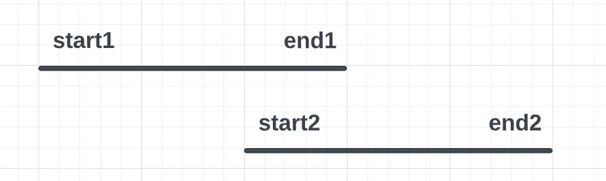
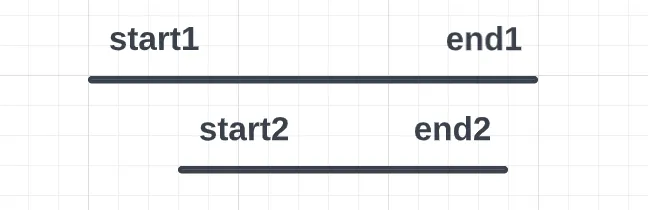
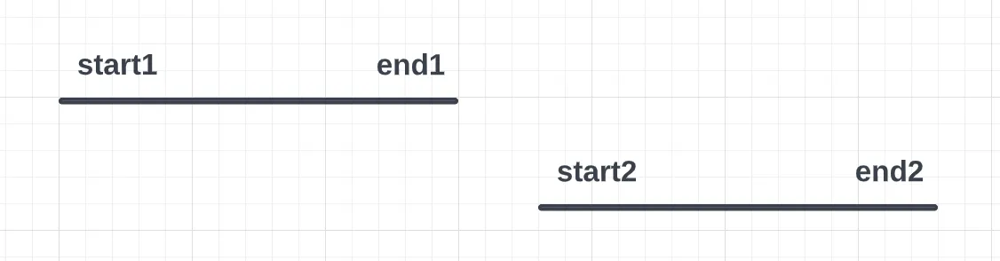

# Sorting solution

**Author:** svolkovichs
**Votes:** 8
**Link:** [https://leetcode.com/problems/count-ways-to-group-overlapping-ranges/solutions/3256252/](https://leetcode.com/problems/count-ways-to-group-overlapping-ranges/solutions/3256252/)

---

# Intuition
It quite obvious that this problem could be divided into two separate problems:

1. Find the number of non overlapping ranges
2. Find number of possible splits for known number of non overlapping ranges.


# Approach
**Find number of overlapping ranges**
Let\u2019s sort array of ranges by their start and consider intervals one by one. Let compare next interval with previously considered. We can face two situations:
1. **start[next] \u2264 end[previous]**

Next interval overlap previous \u2014 we need merge intervals.How can we merge overlapping intervals? There could be two possible cases:
1.1. **end[next] \u2265 end[previous]**

1.2. **end[next]<end[previous]**

To get merged interval boundaries we can use the following formula: **start [merged]=start[previous]** intervals are sorted so start[previous] is always lower, **end[merged] = max(end[next], end[previous])** \u2014 we get the biggest of two ends for new interval. After merging we start compare next interval with merged one.
2. **start[next] > end[previous]** next interval does not overlap previous one we just start using next interval as is to compare with next intervals.


**Calculate number of ways to split ranges**
We calculated the number of not overlapping intervals but now we need calculate the number of possible splits. In fact we need to calculate the number of possible subsequences for merged array. The number of possible subsequences for an array of length N will be equal to 2^N.


# Complexity
- Time complexity:
O(N*Log(N))

- Space complexity:
O(N)

# Code
```
/**
 * @param {number[][]} ranges
 * @return {number}
 */
var countWays = function(ranges) {
    let mod = Math.pow(10, 9) + 7
    ranges.sort((r1, r2) => r1[0] - r2[0])
    
    let res = [ranges[0]]
    for(let next of ranges){
        let prev = res[res.length-1]
        // Compare end of previous with start of next interval
        if(prev[1] >= next[0]){
            // Intervals overlap
            prev[1] = Math.max(prev[1], next[1])
        }else{
            // Intervals not overlap
            res.push(next)
        }
    }
    
    let n = res.length
    
    let sum = 1
    for(let i = 1; i <= n; i++){
        sum = (sum * 2) % mod
    }
    
    return sum
};
```