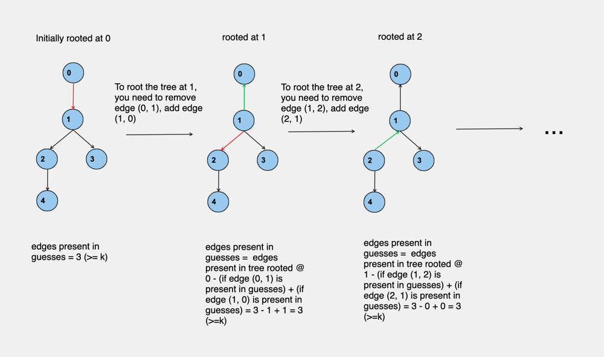

# C++ | DFS | Easy to Understand | O(n) | O(nlogn) | Intuition | Illustration

**Author:** DevChoganwala
**Votes:** 47
**Link:** [https://leetcode.com/problems/count-number-of-possible-root-nodes/solutions/3256127/](https://leetcode.com/problems/count-number-of-possible-root-nodes/solutions/3256127/)

---

## Approach
<hr>

This problem can be divided into following subproblems:

1. If the node is rooted at `0`, are >= `k` edges of the tree present in `guesses`?
2. If the node is rooted at `1`, are >= `k` edges of the tree present in `guesses`?
3. ... for all nodes `n`

How do we do this efficiently?

Say you have a tree rooted at node `0`, and it has child node `1`.
To get the tree rooted at `1`, you only need to reverse the edge `(0, 1)`.

If you have the answer for node `0`, you can simply:
- subtract 1 if edge `(0, 1)` is present in `guesses`.
- Add 1 if edge `(1, 0)` is present in `guesses`.

The below figure illustrates this:



Algorithm:
1. Store the edges in a `map` or `unordered_map`, I am using `map` here.
1. Get the answer if the tree is rooted at node `0`.
2. Start a DFS at node `0` and perform the above described procedure.

Time Complexity: `O(nlogn)`

Note: You can reduce the time complexity to `O(n)` if you hash the edges appropriately, and store in `unordered_map`.

## Code
<hr>

```cpp
class Solution {
public:
    //used to hash edges
    map<pair<int, int>, bool> mp;

    //get answer for node 0
    int get_ans(unordered_map<int, list<int>>& adj, int src, vector<bool>& vis){
        vis[src] = 1;
        int ans = 0;
        for(auto i: adj[src]){
            if(!vis[i]){
                ans += (mp.count({src, i}) + get_ans(adj, i, vis));
            }
        }
        return ans;
    }
    //stores the number of nodes where edges in guesses >= k
    int anss = 0;
    
    void dfs(unordered_map<int, list<int>>& adj, vector<bool>& vis, int k, int src, int ans){
        if(ans >= k) anss++;
        vis[src] = 1;
        for(auto i: adj[src]){
            if(!vis[i]){
                dfs(adj, vis, k, i, ans - mp.count({src, i}) + mp.count({i, src}));
            }
        }
    }
    
    int rootCount(vector<vector<int>>& edges, vector<vector<int>>& guesses, int k) {
        unordered_map<int, list<int>> adj;
        for(auto i: edges){
            adj[i[0]].push_back(i[1]);
            adj[i[1]].push_back(i[0]);
        }
        for(auto i: guesses){
            mp[{i[0], i[1]}] = 1;
        }
        int n = edges.size()+1;
        vector<bool> vis(n, 0);
        int ans = get_ans(adj, 0, vis);
        fill(vis.begin(), vis.end(), 0);
        dfs(adj, vis, k, 0, ans);
        return anss;
    }
};
```


