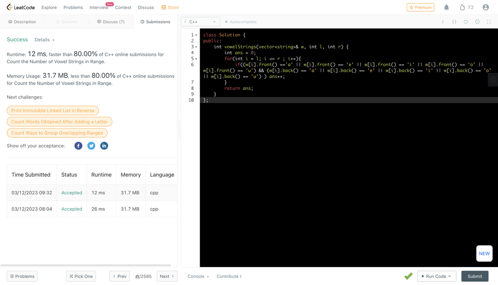

# ✅C++ || Beginner Friendly && Straight Forward || CLEAN CODE

**Author:** abhinav_0107
**Votes:** 4
**Link:** [https://leetcode.com/problems/count-the-number-of-vowel-strings-in-range/solutions/3286382/](https://leetcode.com/problems/count-the-number-of-vowel-strings-in-range/solutions/3286382/)

---

**T->O(r-l) && S->O(1)**

	class Solution {
		public:
			int vowelStrings(vector<string>& w, int l, int r) {
				int ans = 0;
				for(int i = l; i <= r ; i++){
					if((w[i].front() =='a' || w[i].front() == 'e' || w[i].front() == 'i' || w[i].front() == 'o' || w[i].front() == 'u') && (w[i].back() == 'a' || w[i].back() == 'e' || w[i].back() == 'i' || w[i].back() == 'o' || w[i].back() == 'u') ) ans++;
				}
				return ans;
			}
		};