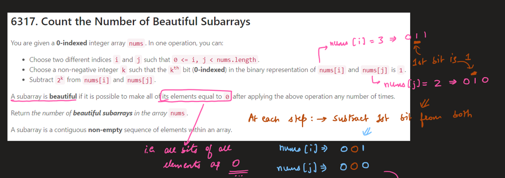
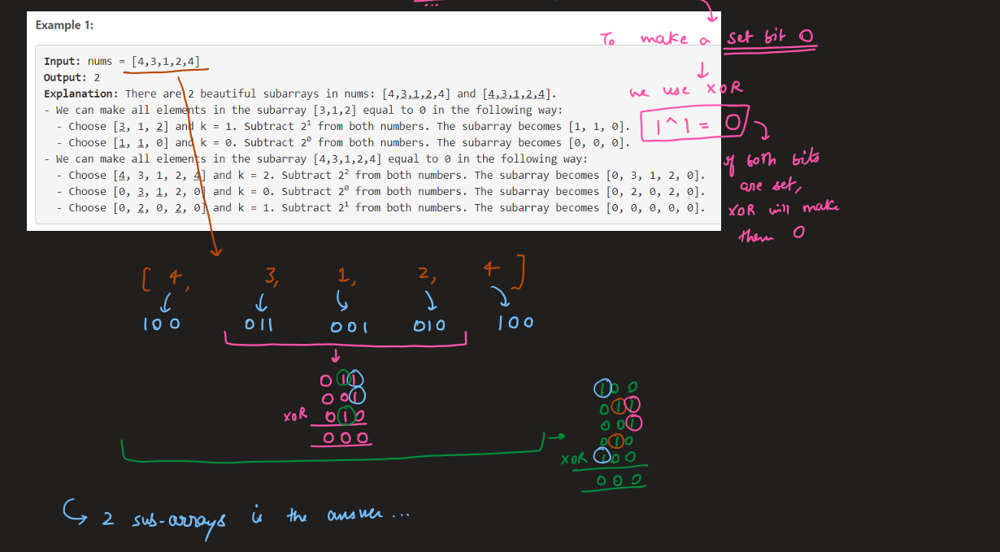
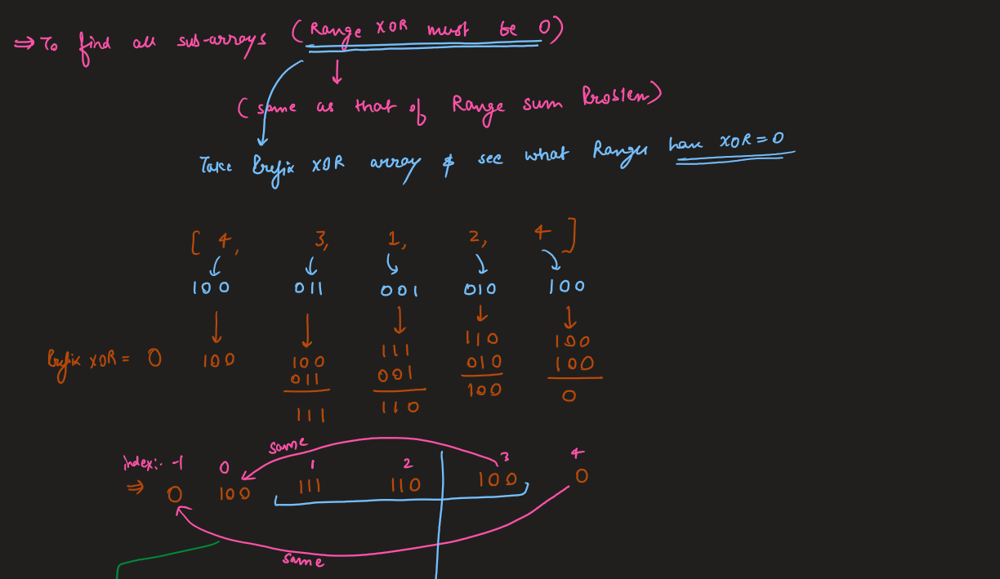
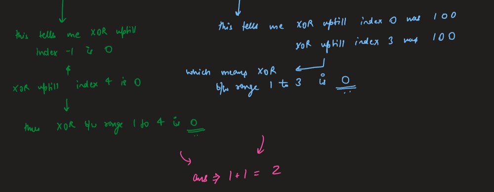
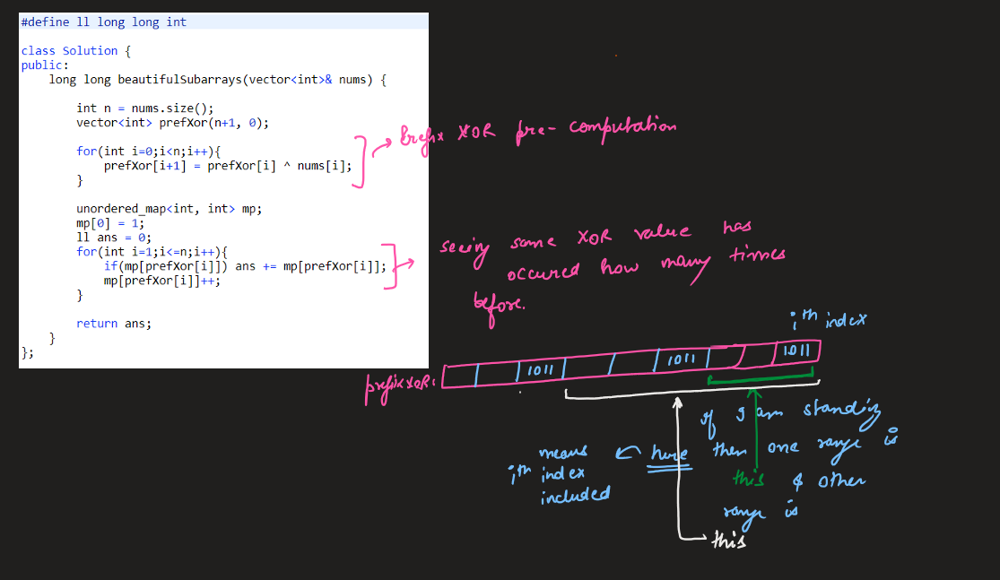

# Image Explanation🏆-[Prefix Xor] - Complete Intuition

**Author:** aryan_0077
**Votes:** 49
**Link:** [https://leetcode.com/problems/count-the-number-of-beautiful-subarrays/solutions/3286489/](https://leetcode.com/problems/count-the-number-of-beautiful-subarrays/solutions/3286489/)

---

# Video Solution
https://youtu.be/8jx35mkivJ8

# Approach & Intution







# Code
```
#define ll long long int

class Solution {
public:
    long long beautifulSubarrays(vector<int>& nums) {
        
        int n = nums.size();
        vector<int> prefXor(n+1, 0);
        
        for(int i=0;i<n;i++){
            prefXor[i+1] = prefXor[i] ^ nums[i];
        }
        
        unordered_map<int, int> mp;
        mp[0] = 1;
        ll ans = 0;
        for(int i=1;i<=n;i++){
            if(mp[prefXor[i]]) ans += mp[prefXor[i]];
            mp[prefXor[i]]++;
        }
        
        return ans;
    }
};
```