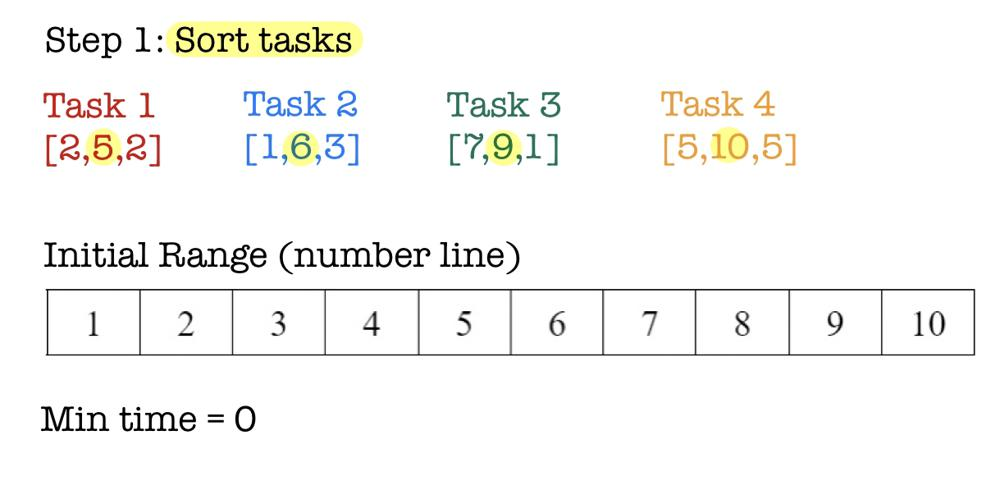
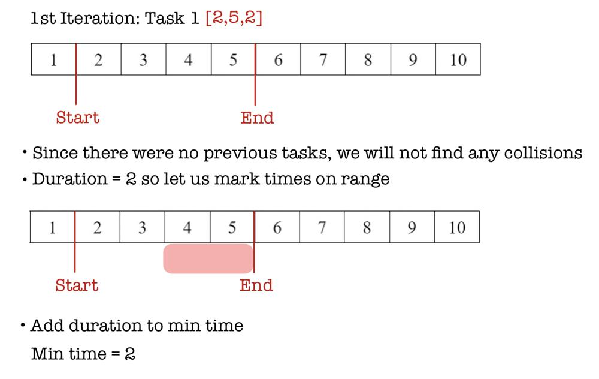
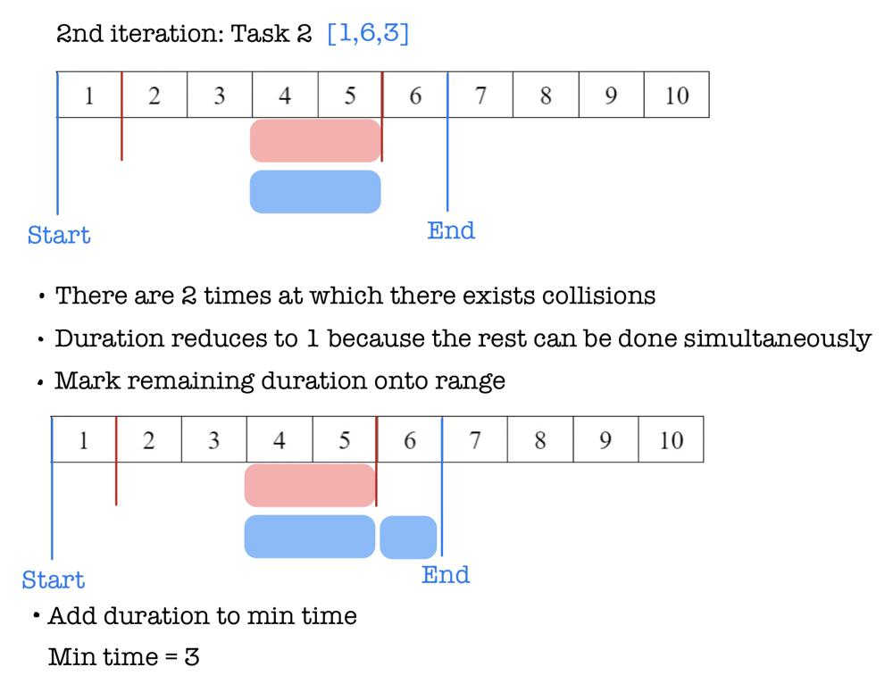
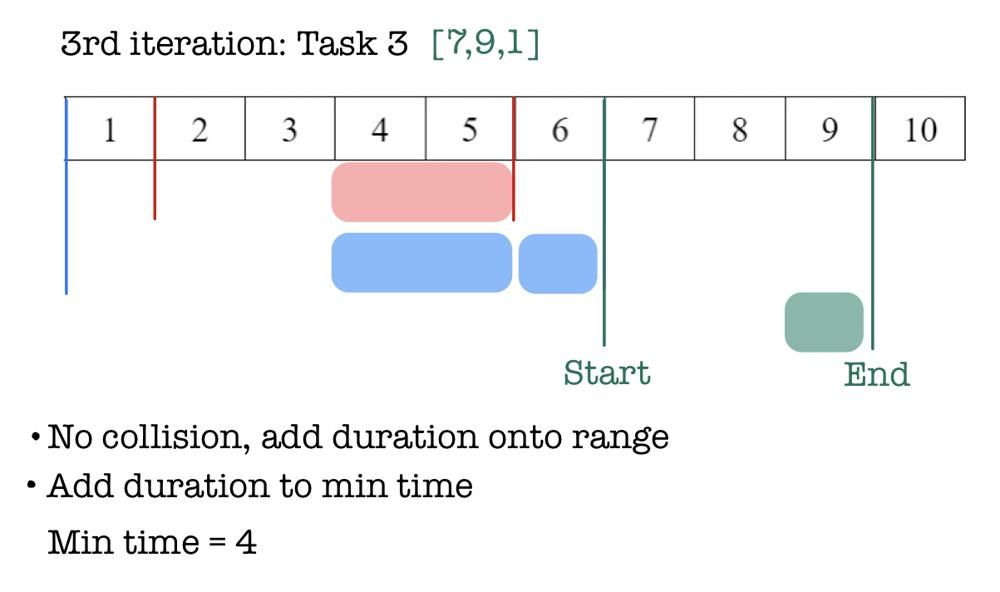
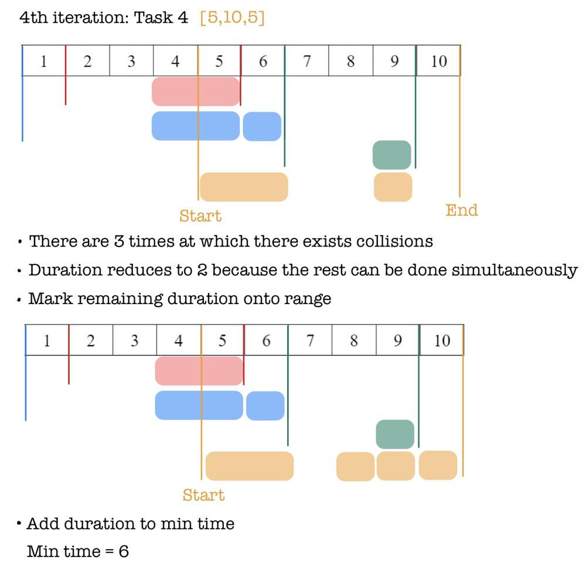
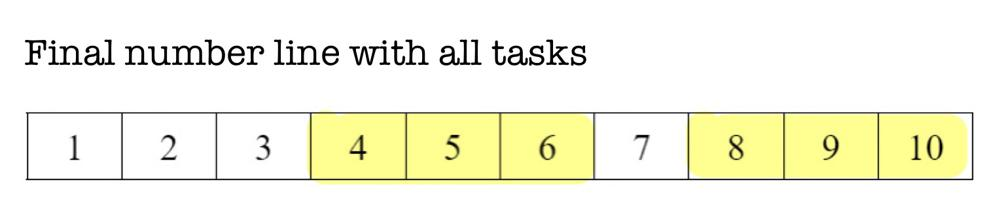

# Simple Diagram Explanation

**Author:** L30XL1U
**Votes:** 65
**Link:** [https://leetcode.com/problems/minimum-time-to-complete-all-tasks/solutions/3287586/](https://leetcode.com/problems/minimum-time-to-complete-all-tasks/solutions/3287586/)

---

# Idea
- The range for `start` and `end` is $$1$$ to $$2000$$ which is sizable to use a number line in the form of a list to represent it. 
- We put all previously ran tasks times onto the number line to know when intersection can occur. 
- Sort tasks by `end` times to maximize possible collisions. 
- Each time a new task collides with a recorded time on the number line, additional time is not needed to perform this task. 
- Remaining duration that does not collide must be added to number line starting from `end`.
# Example
- This is best understood through a simple example. 
- Consider a smaller range from $$1$$ to $$10$$ with the following tasks: `[1,6,3],[7,9,1],[2,5,2],[5,10,5]`





- We mark from `end` to `start` because we sorted by `end` times.
- Any intersection of tasks will be found starting from `end`.
- We only mark spots not previously marked to get max number line coverage. 









# Code
```
int findMinimumTime(vector<vector<int>>& tasks) {
    int res = 0;
    // Determines whether work has been done before 
    int range[2001] = {0};
    // Sort by interval end time 
    sort(tasks.begin(), tasks.end(), [](auto& a, auto& b){return a[1] < b[1];});
    for (auto& t : tasks){
        int start = t[0], end = t[1], d = t[2];
        // If work has been done before, do it simultaneously
        for (int i = start; i <= end; i++){
            if (range[i]){
                d--;
            }
            if (d == 0){
                break;
            }
        }
        // For work that has not been done before 
        while (d){ 
            // duration is less than or equal to interval size
            // so no worry about going out of bound 
            if (range[end] == 0){
                range[end]++;
                d--;
                res++;
            }
            end--;
        }
    }
    return res;
}
```
- **Note:** Sorting by `end` times guarantees that the current interval has checked all possible collisions with the previous interval, whereas sorting by start times does not. Convince yourself by sorting with `start` times and testing it. 
#### Please leave an upvote if this helped! Thanks :)