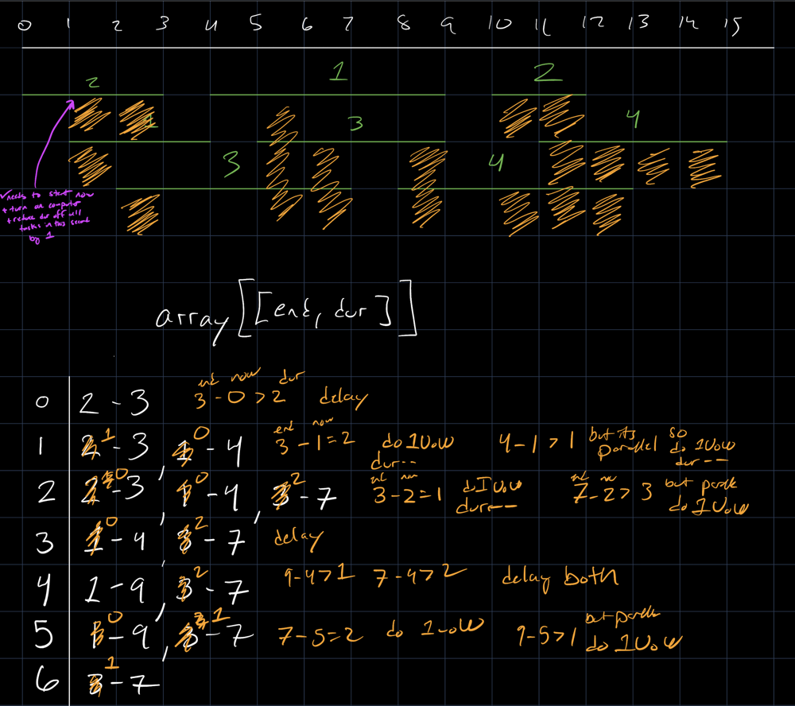

# Intuitive explanation of O(n) time, O(1) space, problem-specific solution

**Author:** sharrief
**Votes:** 0
**Link:** [https://leetcode.com/problems/minimum-time-to-complete-all-tasks/solutions/4514026/](https://leetcode.com/problems/minimum-time-to-complete-all-tasks/solutions/4514026/)

---

# Intro
First off, I am no expert. I wrote this to help guide other up-and-coming developers like myself who are looking for insight on how to address these problems. 

I'm practicing leetcode problems preparing for interviews for my first "real" software dev role. I have a decade-old education that covered CS basics like linear algebra, networks/graph/game theory, and intro to Java. Otherwise I haven't been employed as a SWE, other than the web development taught myself and have been doing independently for about 6 years. So don't take any of this as gospel.

----
# Intuition
My intuition was to draw a timeline, stack the tasks on the timeline from their start to end points, and annotate each task with its duration. Then starting from 0 (or 1, per the problem constraints) on the timeline, I looked at the next task to start. If the task had a duration that was shorter than its length (end - start + 1), then I didn't see a reason to turn on the computer. 

Here is a portion of the original timeline I drew with my own test case. The orange scribbles represent me noting that the computer was on and reduced the time for the task (green line) above the scribble. These are very rough notes, don't look too much into them for a solution, I am just sharing to help show how the problem can be addresses intuitively. (If you're curious, I use the Notability app and an iPad+Apple Pencil)



I pondered on this conclusion some more, since clearly the problem suggests something about running multiple tasks at once. But this parallelization didn't seem to be a forcing function. In my hand-drawn examples, every time I tried to devise a test case where it was more optimal to parallelize, it turned out that I could simply delay running those tasks in parallel until one of them absolutely needed to be started in order to complete before its end time.

# Approach
My first apprach was to build a data structure that mirrored what I drew. So I built and 2D array to represent the timeline, and I processed each task by putting the task object [start, end, dur] into the nested array at every timeline array index that was between the task's start and end times. This is kind of like a counting sort, in that it puts the tasks on the timeline in their natural order and is done in linear time.

I then processed the timeline array. For each task in the timeline array element, I calculated whether the task needed to be started "now" (i.e. at the current timeline index) in order to complete by its end time. If any such task was found, I set a boolean flag "turnOnCopmuter" to true. This flag triggered code which incremented the output number by one, and reduced the remaining duration of all tasks in the same timeline element nested array by one.

After being happy with this solution, and passing all the tests, I revisited my code and found that I could simplify it. My initial intuition was to put the tasks into a timeline array to avoid processing every possible task on each unit of time. But because the problem constraints are lenient - the number of tasks are relatively small and the timeline is short - there is no practical need for this optimization. 

So I got rid of the initial loop that built a timeline array, and instead I used an integer for loop from 1 to the maximum time (2000). In this for loop, I do the same steps as before, but with more consice code.

# Complexity
### Time complexity: O(n)
I see many other solutions that state O(n * log n) runtime where "n" is the length of tasks, and this is due to sorting the tasks. Sorting is useful when you care about the relation that items of a list\xA0have to each other, such as when trying to quickly find a value in that list, or do a calculation that requires simultaneous access to multiple items in the list, or relies upon the sorted order for a calculation. A brute force algorithm that compares each list item to another item can run as slow as O(n^2)

In this situation the tasks are not directly related to each other. They are indirectly related by their place on the timeline. I think some of the other solutions rely on whether one task was started in order to know whether to update other tasks. Since they want to find the other tasks that were in the same unit of time, sorting makes it easy to quickly access those tasks if you have access to the index of the task you just started.

My final solution runs an outer for loop in constant time (2000 iterations). Inside this loop, in the *worst* case, its loops over *every* task to find one that needs to start, then loops over *every* task to decrement its duration by one. So inside the outer loop (which is a constant time loop, not dependent upon the input), there are two loops which both run in O(n) in the worst case, where n is the length of the input tasks array. 

**Thus, the worst case time complexity is linear: O(2000 * 2n) == O(n)**

If the timeline was of arbiratary length, then this solution could be adjusted so that the worst case time complexity would be O(t * n), where t is the length of the timeline.

I presume the other solutions were designed to avoid a O(t * n) time complexity. If you are like me, and looking to practice leetcode problems for interviews, please be aware that some others use leetcode for practicing for competitive programming, and thus their solutions can go beyond what is expected during an interview. In practice, the solution should be no more complex than it needs to be based upon the problem statement.

### Space complexity: O(1)
My initial solution built a timeline array and put each task into this array multiple times. In the worst case this array contained the entire list of tasks at each array index, creating a datastructure that was as many times larger than the input as there were units on the timeline, so O(2000 * n) = O(n)

My final solution doesn't create any datastructures that increase with the size of the input. It uses only fixed-size primitive values for counters, loop iterators, and flags. **So it uses constant space: O(1).**

# Intinitial soltuion
```
function findMinimumTime(tasks: [number,number,number][]): number {
    const timeline: [number,number,number][][] = [];
    let minTime = Number.POSITIVE_INFINITY;
    let maxTime = Number.NEGATIVE_INFINITY;
    let runTime = 0;
    tasks.forEach((task) => {
        const [start, end] = task;
        minTime = Math.min(minTime, start)
        maxTime = Math.max(maxTime, end)
        for (let i = start; i <= end; i++) {
            if (!timeline[i]) timeline[i] = []
            timeline[i].push(task);
        }
    })
    for (let t = minTime; t <= maxTime; t++) {
        const tasks = timeline[t];
        if (!tasks) continue;
        let turnOnComputer = false;
        for (let i = 0; i < tasks.length; i++) {
            const [start, end, dur] = tasks[i];
            if (end + 1 - t <=  dur) {
                turnOnComputer = true;
                break;
            }
        }
        if (turnOnComputer) {
            runTime++;
            tasks.forEach((task) => task[2]--)
        }
    }
    return runTime;
};
```

# Final solution
```
function findMinimumTime(tasks: [number,number,number][]): number {
    let runTime = 0;
    for (let t = 1; t <= 2000; t++) {
        const mustStartTask = tasks.some(([start, end, dur]) => end >= t && end + 1 - dur <= t)
        if (mustStartTask) {
            // if there is a task that must be started now, turn on computer
            runTime++;
            // reduce remaining time for all tasks that can be worked on right now
            tasks
                .filter(([start, end, dur]) => start <= t && t <= end)
                .forEach((task) => task[2]--)
        }
    }
    return runTime;
}
```