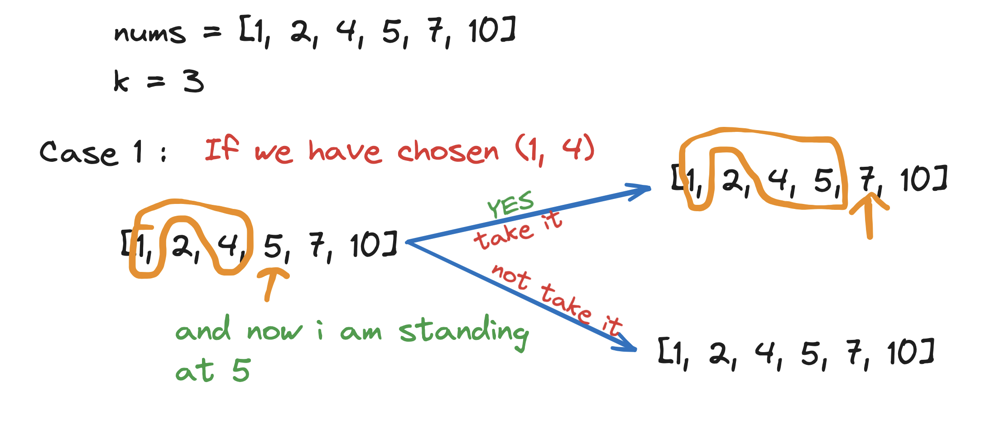
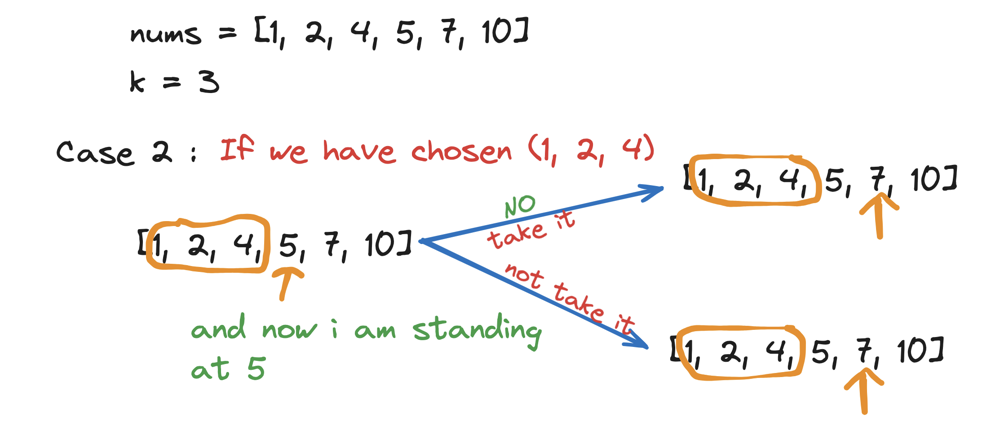
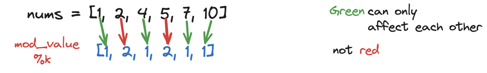
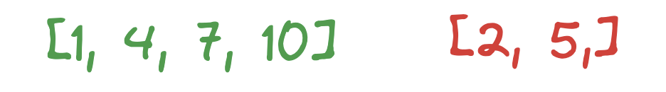
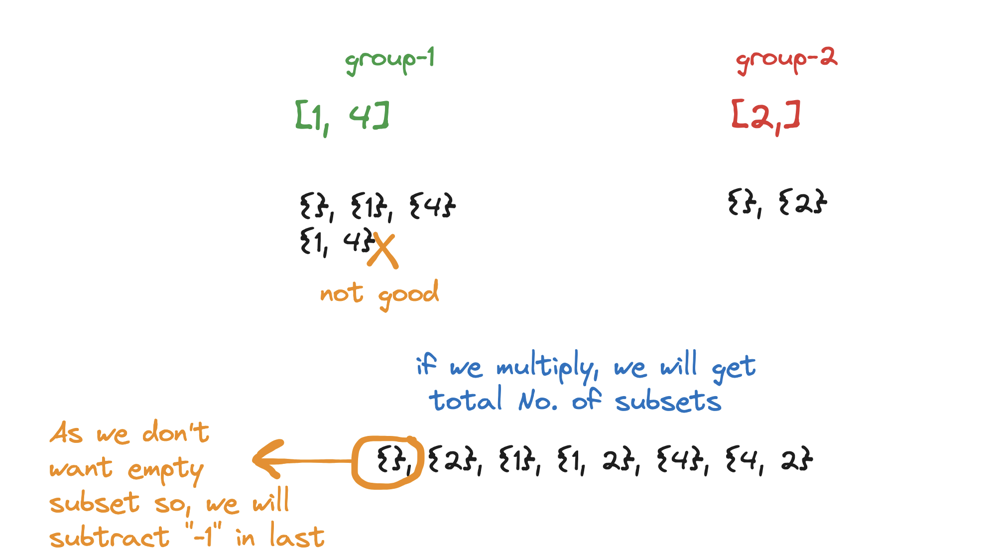
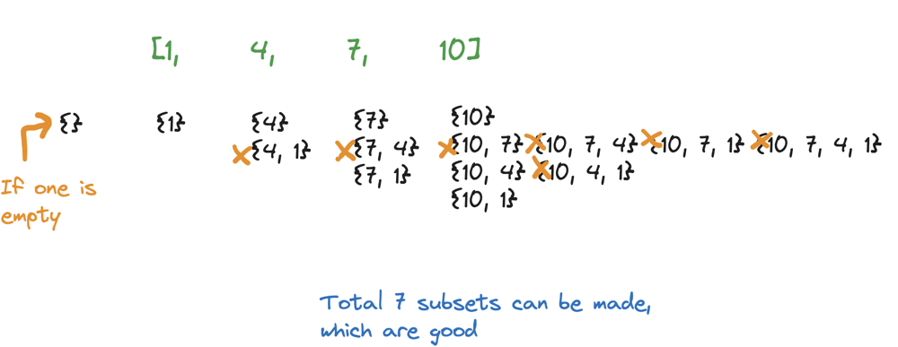
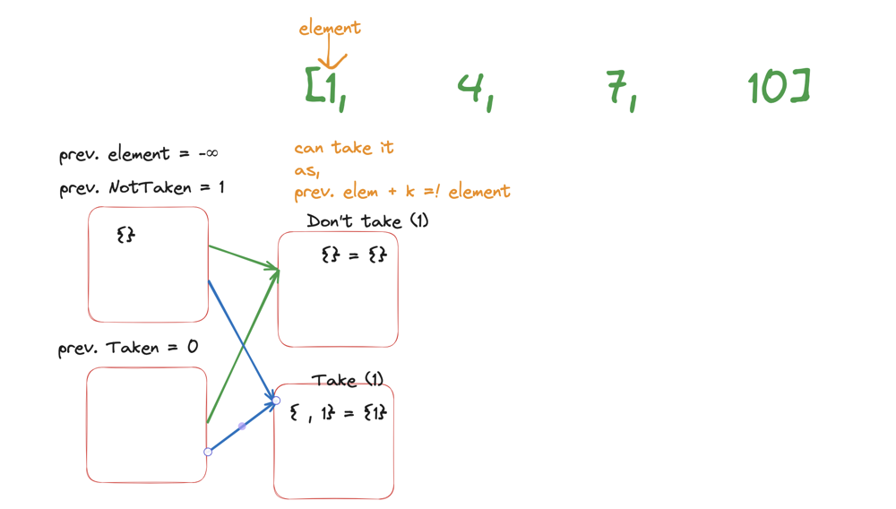
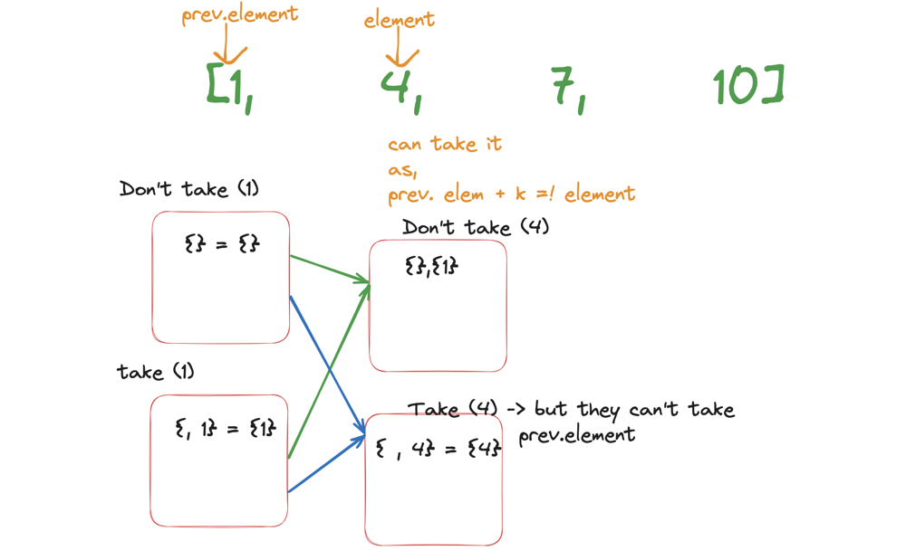
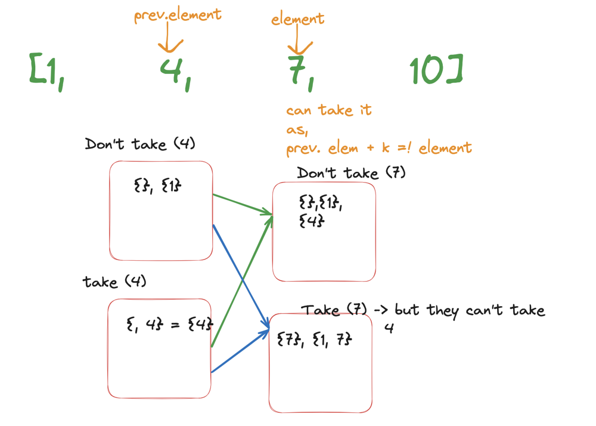

# Highly Detailed Explanation || 2 Methods Explained

**Author:** hi-malik
**Votes:** 102
**Link:** [https://leetcode.com/problems/the-number-of-beautiful-subsets/solutions/5195393/](https://leetcode.com/problems/the-number-of-beautiful-subsets/solutions/5195393/)

---

**Approach - 1**

Let's understand with an example, 
```
Input: nums = [2,4,6], k = 2
Output: 4
```
In this example of nums, we have **2,4,6** how many subsets we can make. To make a subset, either we have to choose an element or not to choose an element!
In this, how many possible subsets are over here.
```
2^3
```
Which means **choose** 2 or **not choose** 2, **choose** 4 or **not choose** 4, **choose** 6 or **not choose** 6
```
2 x 2 x 2 => 8
```
Thus, no of possible subsets are 8

But, **no of beautiful subsets are what?**
Let's see
```
{ } X // We don't want empty
{2} \u2714\uFE0F // It's only one element, doesn't have any other element such that it's difference is 2 i.e. K
{4} \u2714\uFE0F // It's only one element
{6} \u2714\uFE0F // It's only one element
{2, 6} \u2714\uFE0F // We can have, thus the difference isn't equals to K
{2, 4} X // Diff. is equals to K
{4, 6} X // Diff. is equals to K
```

Now, let's look at the constraints, as you see that **nums.length** is very less, i.e. `1 <= nums.length <= 20` means array length is small.
So, firstly I can try **BRUTE-FORCE**, because to make this subsets, I will require O(2^3) times i.e. **O(2^N)**, so my only thing is remain to check that particular subset which I made is good or not, which means a subset is made and how many subsets can be there i.e. `10^6 = O(2^N)` and for each subset we have to check okay, whether it is beautiful or not. And how to check beauty, if element **j - i** these will be 2 pointers, **i** will start from index 0 and **j** will start from index 1, so if **j - i == k** then it's not a beautifull subset and if it's not, then I will check for **i + 2** with the rest of the remaining front elements, unless it will be just O(N^2) to one subset, is it good or not.

Ultimately it will be` O(N^2 + 2^N)` which can work. 

But we can also think of better thing, rather than making a subset and saying if it is good or not. **How about,** only making a good subset!

So, here we will only generate **beautifull subsets**, thus the part we need to check, okay if thats subset beautifull or not! That is just removed. So, it will `O(2^N)`, but **How to actually generate, Only beautifull subsets**. So, firstly we are about to generate a subset, we going to have 2 options. 
Let's say I have make half a subset and I'm landing at an index **i**, now I will think shall I put in my existing subset or not.

When we generate a subset we have 2 options, take it or not! Similarly, when we generate a beautifull subset we have one **additional option** (or can say additional condition), that is it **even possible to take it**. If it is YES, I will take it, if it is NO, then I will not take it.
Som in the subset condition we have, we just add a small condition! And whats that small condition, is it even possible to take it!

**Let's understand with an example,**
```
nums = [1, 2, 4, 5, 7, 10]
k = 3
```

* What I showed is, lets say at any mid condition, which means at any point of time, I was able to get **1 and 4**
* Now, I'm standing at **5**, I have 2 options in mind, can I take it or I can't
* If I take it, I have to ask myself is it even possible to take it, if we take **5** then it shoudn't be colliding with some of the elements inside. As you know, the existing was **1 and 4**, and if we adding **5**, so **5 - 4 = 1**, it's good and **5 - 1 = 4**, it's also good. Which is not equals to **k**. So, we had an option to take it.
* But again we have to check, if it has option to take it or not and it says **YES**, then take it.
* If we not take it, ignore it and move to the next **7**


* Similar, in this case we have two option, firstly we have to ask is it even possile to take it. And it's **NO** , because we have **1, 2, 4** and if we take **5** then **5 - 2 = 3** and this is our **k**, so it means that although we want to take it, but we can't. So just move on to **7**
* And it's not take it, it's exactly same just move to **7**

So, it is just that. In a normal subset condition, which is added one more condition two, if we want take it then this should be possible to take it. And how to check if it is possible to take it or not. It's simple let's say we are at element `a[i] - an element != k` or `[ai] - k != that element`
As if we see in **Case-2** when we choose to take it, `a[i]` i.e. **5** minus `k` i.e. **3** and diff is **2** but the **2** is present and we can check by using unorder hashmap, if it;s present map marked by **one** and if it's not, then marked as **zero**

Now, lets look at it's code :

**Pseudo Code**
```
function dfs(nums, idx, k, mp):
    # Base case: if idx is equal to the size of nums, return 1 (a valid subset is found)
    if idx == size of nums:
        return 1

    # Initialize taken to 0
    taken = 0
    
    # Check if there are no elements in the map that are k units away from nums[idx]
    if mp[nums[idx] - k] is 0 and mp[nums[idx] + k] is 0:
        # Increment the count of nums[idx] in mp
        mp[nums[idx]] += 1
        
        # Recursively call dfs with the next index and add the result to taken
        taken = dfs(nums, idx + 1, k, mp)
        
        # Decrement the count of nums[idx] in mp
        mp[nums[idx]] -= 1
    
    # Recursively call dfs with the next index without taking the current element
    notTaken = dfs(nums, idx + 1, k, mp)
    
    # Return the sum of taken and notTaken
    return taken + notTaken

function beautifulSubsets(nums, k):
    # Initialize mp as a map with default value 0
    mp = map with default value 0
    
    # Call the dfs function starting from index 0
    result = dfs(nums, 0, k, mp)
    
    # Subtract 1 from the result to exclude the empty subset
    return result - 1
```

**C++**
```
class Solution {
public:
    int dfs(vector<int> &nums, int idx, int k, unordered_map<int, int> &mp) {
    if(idx == nums.size()) return 1;

    int taken = 0;
    if(!mp[nums[idx] - k] && !mp[nums[idx] + k]) {
        mp[nums[idx]]++;
        taken = dfs(nums, idx + 1, k, mp);
        mp[nums[idx]]--;
    }
    
    int notTaken = dfs(nums, idx + 1, k, mp);
    
    return taken + notTaken;
    }

    int beautifulSubsets(vector<int> &nums, int k) {
        unordered_map<int, int> mp;
        int ans = dfs(nums, 0, k, mp);
        return ans - 1;
    }
};
```
**JAVA**
```
class Solution {
    public int dfs(int[] nums, int idx, int k, HashMap<Integer, Integer> mp) {
        if (idx == nums.length) return 1;

        int taken = 0;
        if (!mp.containsKey(nums[idx] - k) && !mp.containsKey(nums[idx] + k)) {
            mp.put(nums[idx], mp.getOrDefault(nums[idx], 0) + 1);
            taken = dfs(nums, idx + 1, k, mp);
            mp.put(nums[idx], mp.get(nums[idx]) - 1);
            if (mp.get(nums[idx]) == 0) {
                mp.remove(nums[idx]);
            }
        }
        
        int notTaken = dfs(nums, idx + 1, k, mp);
        
        return taken + notTaken;
    }

    public int beautifulSubsets(int[] nums, int k) {
        HashMap<Integer, Integer> mp = new HashMap<>();
        int ans = dfs(nums, 0, k, mp);
        return ans - 1;
    }
}
```
**PYTHON**
```
class Solution:
    def dfs(self, nums: List[int], idx: int, k: int, mp: defaultdict) -> int:
        if idx == len(nums):
            return 1

        taken = 0
        if mp[nums[idx] - k] == 0 and mp[nums[idx] + k] == 0:
            mp[nums[idx]] += 1
            taken = self.dfs(nums, idx + 1, k, mp)
            mp[nums[idx]] -= 1
        
        notTaken = self.dfs(nums, idx + 1, k, mp)
        
        return taken + notTaken

    def beautifulSubsets(self, nums: List[int], k: int) -> int:
        mp = defaultdict(int)
        ans = self.dfs(nums, 0, k, mp)
        return ans - 1
```

---
Complexity Analysis

---

* **Time Complexity :-** BigO(Nx2^N)

* **Space Complexity :-** BigO(N)

---
---
**Approach - 2**

But did you notice one thing, in the previous example :
```
nums = [1, 2, 4, 5, 7, 10]
```
Our **5** was being hampered by **2** and our **4** was being hampered by **1**, why?
**Because** `4 - k = 1` , `5 - k = 2` , `7 - k = 4` and `10 - k = 7`

So specific elements are hampering are being hampered by specific elements and it's for sure that our no **7** will never be hampered by **5**, it will always be hampered by **4** or something more then that.

Why so, because elements having the same **modulo** with **k**, will affect each other. So, I'm just saying that, element having the same modulo can affect each other, but element having different module with **k** will never affect each other. Because for sure there difference will never be a multiple of **k**

So, we will do one thing. We will just mark what all element have the same modulo with **k**. Firstly we will get the modulo of **k**

* 1 % 3 = 1
* 2 % 3 = 

From the diagram you see, the green once can affect each other, but they will never affect red ones and similarly red ones can affect the red ones only

So, by this we can make 2 groups. Green and Red. Which means okay, the **group-1** will affect each other and **group-2** will affect each other!
By anychance, if I get to know what all no of subsets can be make out of group one and what all subset can be made out of group two, then is it possible to reach to an answer, which means that in total number of subsets


The no of subsets we can make from **group-1** and no of subsets we can make from **group-2**, we can just multiply them and it will come out to be total number of subsets possible, which are **beautifull subsets**

See how,


So, as you see **group-1** can have subsets in total as **2 ^ 2** i.e. **4**, but the beautifull subset in **group-1** it can be :
* empty one {}
* {1}
* {4}
* and also {1, 4}, but this is not beautifull because **4-1 = 3**

So, in total number of beautifull subsets in **group-1 is 3** and number of beautifull subsets in **group-2 is 2**.
So, if we multiply them we will get **6 subsets**, which are `{}, {2}, {1}, {1, 2}, {4}, {4, 2}`, but in the starting as we have known, it can't have empty subset. Thus we will return, **whatsoever after multiplication - 1**

But, the problem occurs, how will you find number of beautifull subsets in one group?
First see, how the beautifull subset looks like in **group-1**




* Firstly, we will have this empty one!
* So, when I'm moving I make sure my **i** path is include and I'll just look at my previous part!
* Now, my **1** and uptill I have just got empty, so **1** is beautifull
* Now, I landed on **4**, what all possibles I can have **4** and **4, 1**. But **4, 1** is not good
* Now, landing at **7**, **7** can have **7**, **7 ,4**  but it's not beautifull and **7, 1**
* Now, once I'm at **10**, we can have **10**, **10, 7** is not good **10, 7, 4** is also not good, **10, 7, 1** is also not good, **10, 7, 4, 1** is also not good because. **10, 7** will never be good
* If we choose **10, 4** it's good, but **10, 4, 1** is not good because **4 - 1**
* and last **10, 1** it's also good one

So in last total as you can see that we had 7 subsets which are good! But in total we have to return 8, because empty one was not included. But final will be 7


So right now so far, if we not have **1**, we will have empty subset. But if we have **1**, we have **1**

If we move fwd. to 4


Now let's move fwd. to 7


and so on and so forth!!! I hope you have understand ladies and gentelmen!

Let's code it UP:

**C++**
```
class Solution {
public:
    int beautifulSubsets(vector<int>& nums, int k) {
        unordered_map<int, vector<int>>mp;
        for (auto el : nums){
            mp[el%k].push_back(el);
        }
        
        int ans = 1;
        for(auto& [mod_cal, v] : mp){
            sort(v.begin(), v.end());
            map<int, int> mp2;
            for (auto el : v) mp2[el]++;
            
            int prev_el = INT_MIN, prevNotTaken = 1, prevTaken = 0, nowNotTaken = 0, nowTaken = 0;
            for(auto& [el, freq] : mp2){
                int poss_subsets = pow(2, freq) - 1;
                if(prev_el+k == el){
                    nowNotTaken = prevNotTaken + prevTaken;
                    nowTaken = prevNotTaken * poss_subsets;
                }
                else{
                    nowNotTaken = prevNotTaken + prevTaken;
                    nowTaken = (prevNotTaken + prevTaken) * poss_subsets;
                }
                
                prevNotTaken = nowNotTaken;
                prevTaken = nowTaken;
                prev_el = el;
            }
            ans *= (nowNotTaken + nowTaken);                 
        }
        return ans - 1;
    }
};
```

---
Complexity Analysis

---

* **Time Complexity :-** BigO(NlogN) + k

* **Space Complexity :-** BigO(N)
