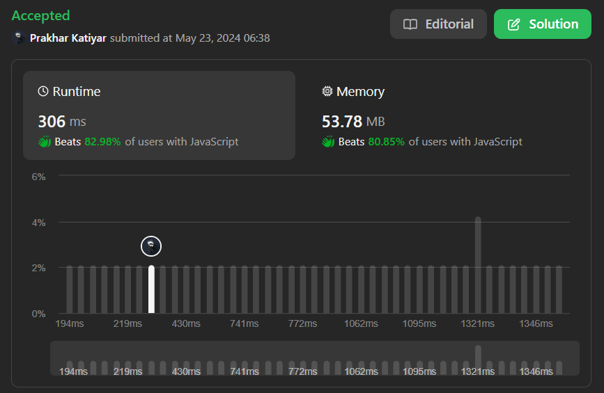
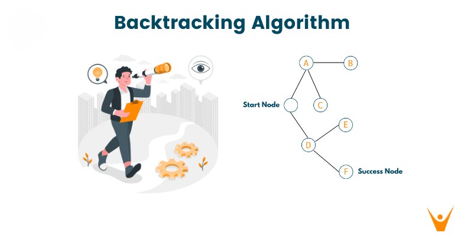

# Only Backtracking 🚀 || concise 🎗️|| newbie friendly 🔥|| 3 lang 🎉 || simple explanation 🧩

**Author:** Prakhar-002
**Votes:** 17
**Link:** [https://leetcode.com/problems/the-number-of-beautiful-subsets/solutions/5195346/](https://leetcode.com/problems/the-number-of-beautiful-subsets/solutions/5195346/)

---

# Screenshot \uD83C\uDF89




---


# Intuition \uD83E\uDD14
<!-- Describe your first thoughts on how to solve this problem. -->
    As we see this is the same problem as we solved yesterday 

    and day before yesterday.

    This perticular problem is saying --> 

    1. We need to give the count of subArray of a given array

    2. by considering the condition that 
    
    3. no such two element present in our sub array 

    4. whose absolute deffrence is equal to the given variable (k)

-------`Considering you all now understand the problem `-------
---

# Approach \uD83D\uDD25  `Let's discuss the approach`
<!-- Describe your approach to solving the problem. -->
    We are going to use our basic fanda of backtracking only ...

    Yes yes only basic fanda \uD83E\uDD73


-----------------------` What is BackTracking  --> `----------------

    Every element have 2 choice either it will come with us
    Or it will go alone in the tree 
    Or you can say we have to choose one path if it gets wrong 
    we can backtrack to any where

    - This contain only 4 steps ...

    1. Add the value    (choose one path)
    2. Go to next step  (go forword on same path)
    3. remove the value (take a one step back)
    4. Go to next step  (choose another path)




`We will use only backtracking but with modification \uD83D\uDE80\uD83D\uDE80\uD83D\uDE80`

    We will add our value only if it will follow our given condition

    Else we will not gonna add that 
    

# UnderStand with code \uD83D\uDCAF
    We will use Only backtracking Approach

    - In which we have 5 works to do

    1. Write the base case and make count variable with part array
    2. Add the value after checking the condition with our isSafe fun
    3. if safe then take first step (add) then one step ahead
    4. Then backtrack our self by one step ( remove the last added)
    5. call for the next step because every single step (element)
        will be our part except null array (Given)


`Step 1.` Make **Global count variable** and **part** and make **our base case**

    Base case will hit if we reach to the last of index from which

    no forword step gonna remain ...

    Base case -->
        IF base case hit our count variable inc by one 

```javascript []

// Global count varibale
let count = 0;

var beautifulSubsets = function (nums, k) {
    count = 0;
    // Part array
    part = [];

    var subSetArr = function (i) {
        //base case
        if (i >= nums.length) {
            count++;
            return;
        }
    }

    subSetArr(0);
    return count - 1;
};
```
```JAVA []

    // Global count varibale
    public int count = 0;

    public void subSetArr(int[] nums, int i, List<Integer> part, int k) {
        if (i >= nums.length) {
            //base case
            count++;
            return;
        }
    }

    public int beautifulSubsets(int[] nums, int k) {
        count = 0;
        // Part array directly pass 
        subSetArr(nums, 0, new ArrayList<>(), k);
        
    }
}
```
```python []
    # Global count varibale
    count = 0
    def beautifulSubsets(self, nums: List[int], k: int) -> int:
        
        self.count = 0
        # Part array
        part = []

        def subSetArr(i):
            #base case
            if i >= len(nums):
                self.count = self.count + 1
                return

```

---


`Step 2 - 3 - 4` **Add if isSafe** and **implement isSafe** and **Go for the next step**

    isSafe function EXPLAIN -->

    1. This function will check is upcoming number from nums array
    2. will be our part of our part array or not
    3. By sub next number to existing element of part array
    4. If it comes equal to GIVEN (k) it will return false els true

```javascript []
var isSafe = function (nums, part, j, k) {
    for (let i = 0; i < part.length; i++) {
        if (Math.abs(nums[j] - part[i]) == k) {
            return false;
        }
    }

    return true;
}

var beautifulSubsets = function (nums, k) {
    // Backtracking if safe to add 
    if (isSafe(nums, part, i, k)) {
        part.push(nums[i]);
        subSetArr(i + 1);
        part.pop();
    }
    subSetArr(i + 1);

};
```
```JAVA []
    public boolean isSafe(int nums[], List<Integer> part, int j, int k) {
        for (int i = 0; i < part.size(); i++) {
            if (Math.abs(nums[j] - part.get(i)) == k) {
                return false;
            }
        }

        return true;
    }

    public void subSetArr(int[] nums, int i, List<Integer> part, int k) {
        // Backtracking if safe to add 
        if (isSafe(nums, part, i, k)) {
            part.add(nums[i]);
            subSetArr(nums, i + 1, part, k);
            part.remove(part.size() - 1);
        }
        subSetArr(nums, i + 1, part, k);
    }
}
```
```python []
    def is_safe(self, nums, part, j, k):
    for n in part:
        if abs(nums[j] - n) == k:
            return False
    return True


    def beautifulSubsets(self, nums: List[int], k: int) -> int:

        def subSetArr(i):
            # Backtracking if safe to add 
            if self.is_safe(nums, part, i, k):
                part.append(nums[i])
                subSetArr(i + 1)
                part.pop()

            subSetArr(i + 1)
            
```

---


`Step 5.` **Call our function** and **return the count**
 
```javascript []

    subSetArr(0);
    return count - 1;
```
```JAVA []
    subSetArr(nums, 0, new ArrayList<>(), k);
    return count - 1;
```
```python []
    subSetArr(0)
    return self.count - 1     
```

---

# Complexity \uD83D\uDE80
- Time complexity: $$O(n * 2^n)$$
<!-- Add your time complexity here, e.g. $$O(n)$$ -->

- Space complexity: $$O(n)$$
<!-- Add your space complexity here, e.g. $$O(n)$$ -->

---


# Code \uD83D\uDC96

```javascript []
var isSafe = function (nums, part, j, k) {
    for (let i = 0; i < part.length; i++) {
        if (Math.abs(nums[j] - part[i]) == k) {
            return false;
        }
    }

    return true;
}
let count = 0;

var beautifulSubsets = function (nums, k) {
    count = 0;
    part = [];

    var subSetArr = function (i) {
        if (i >= nums.length) {
            count++;
            return;
        }
        if (isSafe(nums, part, i, k)) {
            part.push(nums[i]);
            subSetArr(i + 1);
            part.pop();
        }
        subSetArr(i + 1);
    }

    subSetArr(0);
    return count - 1;
};
```
```JAVA []
class Solution {

    public boolean isSafe(int nums[], List<Integer> part, int j, int k) {
        for (int i = 0; i < part.size(); i++) {
            if (Math.abs(nums[j] - part.get(i)) == k) {
                return false;
            }
        }

        return true;
    }

    public int count = 0;

    public void subSetArr(int[] nums, int i, List<Integer> part, int k) {
        if (i >= nums.length) {
            count++;
            return;
        }
        if (isSafe(nums, part, i, k)) {
            part.add(nums[i]);
            subSetArr(nums, i + 1, part, k);
            part.remove(part.size() - 1);
        }
        subSetArr(nums, i + 1, part, k);
    }

    public int beautifulSubsets(int[] nums, int k) {
        count = 0;

        subSetArr(nums, 0, new ArrayList<>(), k);
        return count - 1;
    }
}
```
```python []
class Solution:

    count = 0

    def is_safe(self, nums, part, j, k):
        for n in part:
            if abs(nums[j] - n) == k:
                return False
        return True

    def beautifulSubsets(self, nums: List[int], k: int) -> int:

        self.count = 0
        part = []

        def subSetArr(i):
            if i >= len(nums):
                self.count = self.count + 1
                return

            if self.is_safe(nums, part, i, k):
                part.append(nums[i])
                subSetArr(i + 1)
                part.pop()

            subSetArr(i + 1)

        subSetArr(0)
        return self.count - 1

```
``` JAVA []
// Solution with interface...
class Solution {

    public interface Subsets {
        void subSetArr(int i);
    }

    public boolean isSafe(int nums[], List<Integer> part, int j, int k){
        for (int i = 0; i < part.size(); i++) {
            if(Math.abs(nums[j] - part.get(i)) == k) {
                return false;
            }
        }

        return true;
    }

    public int count = 0;

    public int beautifulSubsets(int[] nums, int k) {
        count = 0;
        List<Integer> part = new ArrayList<>();

        Subsets sol = new Subsets() {
            public void subSetArr(int i) {
                if (i >= nums.length) {
                    count++;
                    return;
                }
                if(isSafe(nums, part, i, k)) {
                    part.add(nums[i]);
                    subSetArr(i + 1);
                    part.remove(part.size() - 1);
                }
                subSetArr(i + 1);
            }
        };

        sol.subSetArr(0);
        return count - 1;
    }
}
```

