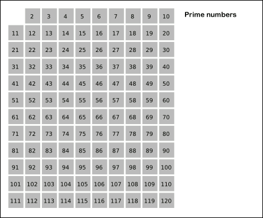
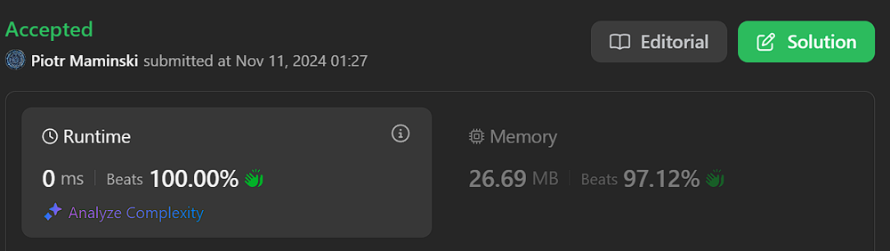
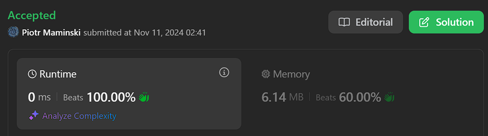

# ✅ Beats 100% | Video best explaining | Greedy Sieve of Eratosthenes/Atkin  | Working 11.11.2024

**Author:** Piotr_Maminski
**Votes:** 85
**Link:** [https://leetcode.com/problems/prime-subtraction-operation/solutions/6031906/](https://leetcode.com/problems/prime-subtraction-operation/solutions/6031906/)

---

## Video (simmilar code, best explaining)
https://youtu.be/G9cp9y45qEs?si=7fo9pADIbOiafVw0

## #1 Greedy Sieve of Eratosthenes (Python 98%, rest 100%)


```python3 [Py3]
# Python3 - shorter version
valid = [True] * 1001
valid[0] = valid[1] = False
for i in range(2, len(valid)):
    if valid[i]:
        for j in range(i * i, len(valid), i):
            valid[j] = False
primes = [i for i in range(len(valid)) if valid[i]]
class Solution:
    def primeSubOperation(self, nums: List[int]) -> bool:
        prev = 0
        for num in nums:
            if num <= prev:
                return False
            i = bisect_left(primes, num - prev) - 1
            if i != -1:
                num -= primes[i]
            prev = num
        return True
```

```python3 []
class Solution:
    def primeSubOperation(self, nums: list[int]) -> bool:
        def getMaxElement(nums):
            return max(nums)
        
        maxElement = getMaxElement(nums)
        
        # Create Sieve of Eratosthenes array to identify prime numbers
        sieve = [True] * (maxElement + 1)
        sieve[1] = False
        
        for i in range(2, int((maxElement + 1) ** 0.5) + 1):
            if sieve[i]:
                for j in range(i * i, maxElement + 1, i):
                    sieve[j] = False
        
        # Check if array can be made strictly increasing by subtracting prime numbers
        currValue = 1
        i = 0
        while i < len(nums):
            difference = nums[i] - currValue
            
            # Return false if current number is already smaller than required value
            if difference < 0:
                return False
            
            # Move to next number if difference is prime or zero
            if sieve[difference] == True or difference == 0:
                i += 1
                currValue += 1
            else:
                currValue += 1
                
        return True
```
```cpp []
class Solution {
public:
    bool primeSubOperation(vector<int>& nums) {
        int maxElement = *max_element(nums.begin(), nums.end());
        
        // Create Sieve of Eratosthenes array to identify prime numbers
        vector<bool> sieve(maxElement + 1, true);
        sieve[1] = false;
        for (int i = 2; i <= sqrt(maxElement + 1); i++) {
            if (sieve[i]) {
                for (int j = i * i; j <= maxElement; j += i) {
                    sieve[j] = false;
                }
            }
        }
        
        // Check if array can be made strictly increasing by subtracting prime numbers
        int currValue = 1;
        int i = 0;
        while (i < nums.size()) {
            int difference = nums[i] - currValue;
            
            if (difference < 0) {
                return false;
            }
            
            if (sieve[difference] == true || difference == 0) {
                i++;
                currValue++;
            } else {
                currValue++;
            }
        }
        return true;
    }
};
```
```java []
class Solution {
    public boolean primeSubOperation(int[] nums) {
        int maxElement = getMaxElement(nums);

        // Create Sieve of Eratosthenes array to identify prime numbers
        boolean[] sieve = new boolean[maxElement + 1];
        fill(sieve, true);
        sieve[1] = false;
        for (int i = 2; i <= Math.sqrt(maxElement + 1); i++) {
            if (sieve[i]) {
                for (int j = i * i; j <= maxElement; j += i) {
                    sieve[j] = false;
                }
            }
        }

        // Check if array can be made strictly increasing by subtracting prime numbers
        int currValue = 1;
        int i = 0;
        while (i < nums.length) {
            int difference = nums[i] - currValue;

            // Return false if current number is already smaller than required value
            if (difference < 0) {
                return false;
            }

            // Move to next number if difference is prime or zero
            if (sieve[difference] == true || difference == 0) {
                i++;
                currValue++;
            } else {
                currValue++;
            }
        }
        return true;
    }

    // Helper method to find maximum element in array
    private int getMaxElement(int[] nums) {
        int max = -1;
        for (int num : nums) {
            if (num > max) {
                max = num;
            }
        }
        return max;
    }

    // Helper method to initialize boolean array
    private void fill(boolean[] arr, boolean value) {
        for (int i = 0; i < arr.length; i++) {
            arr[i] = value;
        }
    }
}
```
```csharp []
public class Solution {
    public bool PrimeSubOperation(int[] nums) {
        int maxElement = nums.Max();

        // Create Sieve of Eratosthenes array to identify prime numbers
        bool[] sieve = new bool[maxElement + 1];
        Array.Fill(sieve, true);
        sieve[1] = false;

        for (int p = 2; p <= Math.Sqrt(maxElement + 1); p++) {
            if (sieve[p]) {
                for (int j = p * p; j <= maxElement; j += p) {
                    sieve[j] = false;
                }
            }
        }

        // Check if array can be made strictly increasing by subtracting prime numbers
        int currValue = 1;
        int i = 0;
        while (i < nums.Length) {
            int difference = nums[i] - currValue;

            // Return false if current number is already smaller than required value
            if (difference < 0) {
                return false;
            }

            // Move to next number if difference is prime or zero
            if (sieve[difference] == true || difference == 0) {
                i++;
                currValue++;
            } else {
                currValue++;
            }
        }
        return true;
    }
}
```
```golang []
func primeSubOperation(nums []int) bool {
    maxElement := getMaxElement(nums) //ALT: slices.Max(nums)
    
    // Create Sieve of Eratosthenes array to identify prime numbers
    sieve := make([]bool, maxElement+1)
    fill(sieve, true)
    sieve[1] = false
    
    for i := 2; i <= int(math.Sqrt(float64(maxElement+1))); i++ {
        if sieve[i] {
            for j := i * i; j <= maxElement; j += i {
                sieve[j] = false
            }
        }
    }
    
    // Check if array can be made strictly increasing by subtracting prime numbers
    currValue := 1
    i := 0
    for i < len(nums) {
        difference := nums[i] - currValue
        
        // Return false if current number is already smaller than required value
        if difference < 0 {
            return false
        }
        
        // Move to next number if difference is prime or zero
        if sieve[difference] == true || difference == 0 {
            i++
            currValue++
        } else {
            currValue++
        }
    }
    return true
}

// Helper function to find maximum element in array
func getMaxElement(nums []int) int {
    max := -1
    for _, num := range nums {
        if num > max {
            max = num
        }
    }
    return max
}

// Helper function to initialize boolean array
func fill(arr []bool, value bool) {
    for i := range arr {
        arr[i] = value
    }
}


```
```swift []
// another solution
class Solution {
    func primeSubOperation(_ nums: [Int]) -> Bool {
        var numbers = nums
        
        // Generate primes up to 1000
        var sieve = Array(repeating: true, count: 1001)
        sieve[0] = false
        sieve[1] = false
        
        for i in 2...Int(sqrt(Double(1000))) {
            if sieve[i] {
                var j = i * i
                while j <= 1000 {
                    sieve[j] = false
                    j += i
                }
            }
        }
        
        // Process from left to right
        for i in 0..<numbers.count {
            let target = i == 0 ? 0 : numbers[i-1]
            if numbers[i] <= target {
                return false
            }
            
            // Find largest prime to subtract while keeping array strictly increasing
            for p in (1...numbers[i]).reversed() where sieve[p] {
                let newVal = numbers[i] - p
                if newVal > target {
                    numbers[i] = newVal
                    break
                }
            }
        }
        
        return true
    }
}
```
```javascript [JS]
// JavaScript

var primeSubOperation = function(nums) {
    const getMaxElement = (nums) => {
        let max = -1;
        for (let num of nums) {
            if (num > max) {
                max = num;
            }
        }
        return max;
    };
    
    const fill = (arr, value) => {
        for (let i = 0; i < arr.length; i++) {
            arr[i] = value;
        }
    };
    
    const maxElement = getMaxElement(nums);
    
    // Create Sieve of Eratosthenes array
    const sieve = new Array(maxElement + 1);
    fill(sieve, true);
    sieve[1] = false;
    
    for (let i = 2; i <= Math.sqrt(maxElement + 1); i++) {
        if (sieve[i]) {
            for (let j = i * i; j <= maxElement; j += i) {
                sieve[j] = false;
            }
        }
    }
    
    // Check if array can be made strictly increasing
    let currValue = 1;
    let i = 0;
    
    while (i < nums.length) {
        const difference = nums[i] - currValue;
        
        if (difference < 0) {
            return false;
        }
        
        if (sieve[difference] === true || difference === 0) {
            i++;
            currValue++;
        } else {
            currValue++;
        }
    }
    
    return true;
};
```
```typescript [TS]
// TypeScript

function primeSubOperation(nums: number[]): boolean {
    const getMaxElement = (nums: number[]): number => {
        let max = -1;
        for (const num of nums) {
            if (num > max) {
                max = num;
            }
        }
        return max;
    };

    const fill = (arr: boolean[], value: boolean): void => {
        for (let i = 0; i < arr.length; i++) {
            arr[i] = value;
        }
    };

    const maxElement = getMaxElement(nums);

    // Create Sieve of Eratosthenes array
    const sieve: boolean[] = new Array(maxElement + 1);
    fill(sieve, true);
    sieve[1] = false;
    for (let i = 2; i <= Math.sqrt(maxElement + 1); i++) {
        if (sieve[i]) {
            for (let j = i * i; j <= maxElement; j += i) {
                sieve[j] = false;
            }
        }
    }

    // Check if array can be made strictly increasing
    let currValue = 1;
    let i = 0;
    while (i < nums.length) {
        const difference = nums[i] - currValue;

        if (difference < 0) {
            return false;
        }

        if (sieve[difference] === true || difference === 0) {
            i++;
            currValue++;
        } else {
            currValue++;
        }
    }
    return true;
}
```
```rust []
impl Solution {
    pub fn prime_sub_operation(nums: Vec<i32>) -> bool {
        let max_element = Self::get_max_element(&nums);
        
        // Create Sieve of Eratosthenes array to identify prime numbers
        let mut sieve = vec![true; (max_element + 1) as usize];
        sieve[1] = false;
        
        let sqrt = (((max_element + 1) as f64).sqrt()) as i32;
        for i in 2..=sqrt {
            if sieve[i as usize] {
                let mut j = i * i;
                while j <= max_element {
                    sieve[j as usize] = false;
                    j += i;
                }
            }
        }

        // Check if array can be made strictly increasing by subtracting prime numbers
        let mut curr_value = 1;
        let mut i = 0;
        
        while i < nums.len() {
            let difference = nums[i] - curr_value;

            // Return false if current number is already smaller than required value
            if difference < 0 {
                return false;
            }

            // Move to next number if difference is prime or zero
            if difference == 0 || sieve[difference as usize] {
                i += 1;
                curr_value += 1;
            } else {
                curr_value += 1;
            }
        }
        true
    }

    // Helper method to find maximum element in array
    fn get_max_element(nums: &[i32]) -> i32 {
        *nums.iter().max().unwrap_or(&-1)
    }
}
```
```ruby []
def prime_sub_operation(nums)
    max_element = get_max_element(nums)
    
    # Create Sieve of Eratosthenes array
    sieve = Array.new(max_element + 1, true)
    sieve[1] = false
    
    (2..Math.sqrt(max_element + 1).to_i).each do |i|
        if sieve[i]
            (i * i).step(max_element, i) do |j|
                sieve[j] = false
            end
        end
    end
    
    curr_value = 1
    i = 0
    
    while i < nums.length
        difference = nums[i] - curr_value
        
        return false if difference < 0
        
        if sieve[difference] == true || difference == 0
            i += 1
            curr_value += 1
        else
            curr_value += 1
        end
    end
    
    true
end

def get_max_element(nums)
    nums.max
end
```

- Complexy: Time O(n * log(log(n))) Space O(n) 

# #2 Pre-Prime List (All Beats 100% Oms)


```python3 []
primes = [2, 3, 5, 7, 11, 13, 17, 19, 23, 29, 31, 37, 41, 43, 47, 53, 59, 61, 67, 71, 73, 79, 83, 89, 97, 101, 103, 107, 109, 113, 127, 131, 137, 139, 149, 151, 157, 163, 167, 173, 179, 181, 191, 193, 197, 199, 211, 223, 227, 229, 233, 239, 241, 251, 257, 263, 269, 271, 277, 281, 283, 293, 307, 311, 313, 317, 331, 337, 347, 349, 353, 359, 367, 373, 379, 383, 389, 397, 401, 409, 419, 421, 431, 433, 439, 443, 449, 457, 461, 463, 467, 479, 487, 491, 499, 503, 509, 521, 523, 541, 547, 557, 563, 569, 571, 577, 587, 593, 599, 601, 607, 613, 617, 619, 631, 641, 643, 647, 653, 659, 661, 673, 677, 683, 691, 701, 709, 719, 727, 733, 739, 743, 751, 757, 761, 769, 773, 787, 797, 809, 811, 821, 823, 827, 829, 839, 853, 857, 859, 863, 877, 881, 883, 887, 907, 911, 919, 929, 937, 941, 947, 953, 967, 971, 977, 983, 991, 997, 1009, 1013, 1019, 1021]

class Solution:
    def primeSubOperation(self, nums: List[int]) -> bool:
        prev = 0
        for num in nums:
            if num <= prev:
                return False
            i = bisect_left(primes, num - prev) - 1
            if i != -1:
                num -= primes[i]
            prev = num
        return True

```
```cpp []
class Solution {
public:
    vector<int> primes = {2, 3, 5, 7, 11, 13, 17, 19, 23, 29, 31, 37, 41, 43, 47, 53, 59, 61, 67, 71, 73, 79, 83, 89, 97, 101, 103, 107, 109, 113, 127, 131, 137, 139, 149, 151, 157, 163, 167, 173, 179, 181, 191, 193, 197, 199, 211, 223, 227, 229, 233, 239, 241, 251, 257, 263, 269, 271, 277, 281, 283, 293, 307, 311, 313, 317, 331, 337, 347, 349, 353, 359, 367, 373, 379, 383, 389, 397, 401, 409, 419, 421, 431, 433, 439, 443, 449, 457, 461, 463, 467, 479, 487, 491, 499, 503, 509, 521, 523, 541, 547, 557, 563, 569, 571, 577, 587, 593, 599, 601, 607, 613, 617, 619, 631, 641, 643, 647, 653, 659, 661, 673, 677, 683, 691, 701, 709, 719, 727, 733, 739, 743, 751, 757, 761, 769, 773, 787, 797, 809, 811, 821, 823, 827, 829, 839, 853, 857, 859, 863, 877, 881, 883, 887, 907, 911, 919, 929, 937, 941, 947, 953, 967, 971, 977, 983, 991, 997, 1009, 1013, 1019, 1021};
    
    bool primeSubOperation(vector<int>& nums) {
        int prev = 0;
        for (int num : nums) {
            if (num <= prev) {
                return false;
            }
            auto it = lower_bound(primes.begin(), primes.end(), num - prev);
            int i = it - primes.begin() - 1;
            if (i != -1) {
                num -= primes[i];
            }
            prev = num;
        }
        return true;
    }
};

```
```java []
class Solution {
    private static final int[] primes = {2, 3, 5, 7, 11, 13, 17, 19, 23, 29, 31, 37, 41, 43, 47, 53, 59, 61, 67, 71, 73, 79, 83, 89, 97, 101, 103, 107, 109, 113, 127, 131, 137, 139, 149, 151, 157, 163, 167, 173, 179, 181, 191, 193, 197, 199, 211, 223, 227, 229, 233, 239, 241, 251, 257, 263, 269, 271, 277, 281, 283, 293, 307, 311, 313, 317, 331, 337, 347, 349, 353, 359, 367, 373, 379, 383, 389, 397, 401, 409, 419, 421, 431, 433, 439, 443, 449, 457, 461, 463, 467, 479, 487, 491, 499, 503, 509, 521, 523, 541, 547, 557, 563, 569, 571, 577, 587, 593, 599, 601, 607, 613, 617, 619, 631, 641, 643, 647, 653, 659, 661, 673, 677, 683, 691, 701, 709, 719, 727, 733, 739, 743, 751, 757, 761, 769, 773, 787, 797, 809, 811, 821, 823, 827, 829, 839, 853, 857, 859, 863, 877, 881, 883, 887, 907, 911, 919, 929, 937, 941, 947, 953, 967, 971, 977, 983, 991, 997, 1009, 1013, 1019, 1021};
    
    public boolean primeSubOperation(int[] nums) {
        int prev = 0;
        for (int num : nums) {
            if (num <= prev) {
                return false;
            }
            int i = bisectLeft(primes, num - prev) - 1;
            if (i != -1) {
                num -= primes[i];
            }
            prev = num;
        }
        return true;
    }
    
    private int bisectLeft(int[] arr, int target) {
        int left = 0;
        int right = arr.length;
        while (left < right) {
            int mid = left + (right - left) / 2;
            if (arr[mid] < target) {
                left = mid + 1;
            } else {
                right = mid;
            }
        }
        return left;
    }
}

```
```csharp []
public class Solution {
    private static readonly HashSet<int> primes = new HashSet<int> { 
        2, 3, 5, 7, 11, 13, 17, 19, 23, 29, 31, 37, 41, 43, 47, 53, 59, 61, 67, 71, 73, 79, 83, 89, 97, 101, 
        103, 107, 109, 113, 127, 131, 137, 139, 149, 151, 157, 163, 167, 173, 179, 181, 191, 193, 197, 199, 
        211, 223, 227, 229, 233, 239, 241, 251, 257, 263, 269, 271, 277, 281, 283, 293, 307, 311, 313, 317, 
        331, 337, 347, 349, 353, 359, 367, 373, 379, 383, 389, 397, 401, 409, 419, 421, 431, 433, 439, 443, 
        449, 457, 461, 463, 467, 479, 487, 491, 499, 503, 509, 521, 523, 541, 547, 557, 563, 569, 571, 577, 
        587, 593, 599, 601, 607, 613, 617, 619, 631, 641, 643, 647, 653, 659, 661, 673, 677, 683, 691, 701, 
        709, 719, 727, 733, 739, 743, 751, 757, 761, 769, 773, 787, 797, 809, 811, 821, 823, 827, 829, 839, 
        853, 857, 859, 863, 877, 881, 883, 887, 907, 911, 919, 929, 937, 941, 947, 953, 967, 971, 977, 983, 
        991, 997, 1009, 1013, 1019, 1021
    };

    public bool PrimeSubOperation(int[] nums) {
        int currValue = 1;
        int i = 0;
        
        while (i < nums.Length) {
            int difference = nums[i] - currValue;

            if (difference < 0) {
                return false;
            }

            if (primes.Contains(difference) || difference == 0) {
                i++;
                currValue++;
            } else {
                currValue++;
            }
        }
        return true;
    }
}
```
```golang []
func primeSubOperation(nums []int) bool {
    primes := []int{2, 3, 5, 7, 11, 13, 17, 19, 23, 29, 31, 37, 41, 43, 47, 53, 59, 61, 67, 71, 73, 79, 83, 89, 97, 101, 103, 107, 109, 113, 127, 131, 137, 139, 149, 151, 157, 163, 167, 173, 179, 181, 191, 193, 197, 199, 211, 223, 227, 229, 233, 239, 241, 251, 257, 263, 269, 271, 277, 281, 283, 293, 307, 311, 313, 317, 331, 337, 347, 349, 353, 359, 367, 373, 379, 383, 389, 397, 401, 409, 419, 421, 431, 433, 439, 443, 449, 457, 461, 463, 467, 479, 487, 491, 499, 503, 509, 521, 523, 541, 547, 557, 563, 569, 571, 577, 587, 593, 599, 601, 607, 613, 617, 619, 631, 641, 643, 647, 653, 659, 661, 673, 677, 683, 691, 701, 709, 719, 727, 733, 739, 743, 751, 757, 761, 769, 773, 787, 797, 809, 811, 821, 823, 827, 829, 839, 853, 857, 859, 863, 877, 881, 883, 887, 907, 911, 919, 929, 937, 941, 947, 953, 967, 971, 977, 983, 991, 997, 1009, 1013, 1019, 1021}
    currValue := 1
    i := 0
    for i < len(nums) {
        difference := nums[i] - currValue
        
        if difference < 0 {
            return false
        }
        
        isPrime := difference == 0 
        if !isPrime {
            for _, prime := range primes {
                if prime == difference {
                    isPrime = true
                    break
                }
                if prime > difference {
                    break
                }
            }
        }
        
        if isPrime {
            i++
            currValue++
        } else {
            currValue++
        }
    }
    return true
}
```
```swift []
class Solution {
    func primeSubOperation(_ nums: [Int]) -> Bool {
        let primes = [2, 3, 5, 7, 11, 13, 17, 19, 23, 29, 31, 37, 41, 43, 47, 53, 59, 61, 67, 71, 73, 79, 83, 89, 97, 101, 103, 107, 109, 113, 127, 131, 137, 139, 149, 151, 157, 163, 167, 173, 179, 181, 191, 193, 197, 199, 211, 223, 227, 229, 233, 239, 241, 251, 257, 263, 269, 271, 277, 281, 283, 293, 307, 311, 313, 317, 331, 337, 347, 349, 353, 359, 367, 373, 379, 383, 389, 397, 401, 409, 419, 421, 431, 433, 439, 443, 449, 457, 461, 463, 467, 479, 487, 491, 499, 503, 509, 521, 523, 541, 547, 557, 563, 569, 571, 577, 587, 593, 599, 601, 607, 613, 617, 619, 631, 641, 643, 647, 653, 659, 661, 673, 677, 683, 691, 701, 709, 719, 727, 733, 739, 743, 751, 757, 761, 769, 773, 787, 797, 809, 811, 821, 823, 827, 829, 839, 853, 857, 859, 863, 877, 881, 883, 887, 907, 911, 919, 929, 937, 941, 947, 953, 967, 971, 977, 983, 991, 997, 1009, 1013, 1019, 1021]
        var numbers = nums

        for i in 0..<numbers.count {
            let target = i == 0 ? 0 : numbers[i-1]
            if numbers[i] <= target {
                return false
            }
            
            for p in primes.reversed() where p < numbers[i] {
                let newVal = numbers[i] - p
                if newVal > target {
                    numbers[i] = newVal
                    break
                }
            }
        }
        return true
    }
}
```
```javascript [JS]
// JavaScript

var primeSubOperation = function(nums) {
    const primes = [2, 3, 5, 7, 11, 13, 17, 19, 23, 29, 31, 37, 41, 43, 47, 53, 59, 61, 67, 71, 73, 79, 83, 89, 97, 101, 103, 107, 109, 113, 127, 131, 137, 139, 149, 151, 157, 163, 167, 173, 179, 181, 191, 193, 197, 199, 211, 223, 227, 229, 233, 239, 241, 251, 257, 263, 269, 271, 277, 281, 283, 293, 307, 311, 313, 317, 331, 337, 347, 349, 353, 359, 367, 373, 379, 383, 389, 397, 401, 409, 419, 421, 431, 433, 439, 443, 449, 457, 461, 463, 467, 479, 487, 491, 499, 503, 509, 521, 523, 541, 547, 557, 563, 569, 571, 577, 587, 593, 599, 601, 607, 613, 617, 619, 631, 641, 643, 647, 653, 659, 661, 673, 677, 683, 691, 701, 709, 719, 727, 733, 739, 743, 751, 757, 761, 769, 773, 787, 797, 809, 811, 821, 823, 827, 829, 839, 853, 857, 859, 863, 877, 881, 883, 887, 907, 911, 919, 929, 937, 941, 947, 953, 967, 971, 977, 983, 991, 997, 1009, 1013, 1019, 1021];
    
    let currValue = 1;
    let i = 0;
    
    while (i < nums.length) {
        const difference = nums[i] - currValue;
        
        if (difference < 0) {
            return false;
        }
        
        if (difference === 0 || primes.includes(difference)) {
            i++;
            currValue++;
        } else {
            currValue++;
        }
    }
    
    return true;
};
```
```typescript [TS]
// TypeScript

function primeSubOperation(nums: number[]): boolean {
    const primes = [2, 3, 5, 7, 11, 13, 17, 19, 23, 29, 31, 37, 41, 43, 47, 53, 59, 61, 67, 71, 73, 79, 83, 89, 97, 101, 103, 107, 109, 113, 127, 131, 137, 139, 149, 151, 157, 163, 167, 173, 179, 181, 191, 193, 197, 199, 211, 223, 227, 229, 233, 239, 241, 251, 257, 263, 269, 271, 277, 281, 283, 293, 307, 311, 313, 317, 331, 337, 347, 349, 353, 359, 367, 373, 379, 383, 389, 397, 401, 409, 419, 421, 431, 433, 439, 443, 449, 457, 461, 463, 467, 479, 487, 491, 499, 503, 509, 521, 523, 541, 547, 557, 563, 569, 571, 577, 587, 593, 599, 601, 607, 613, 617, 619, 631, 641, 643, 647, 653, 659, 661, 673, 677, 683, 691, 701, 709, 719, 727, 733, 739, 743, 751, 757, 761, 769, 773, 787, 797, 809, 811, 821, 823, 827, 829, 839, 853, 857, 859, 863, 877, 881, 883, 887, 907, 911, 919, 929, 937, 941, 947, 953, 967, 971, 977, 983, 991, 997, 1009, 1013, 1019, 1021];

    let currValue = 1;
    let i = 0;
    while (i < nums.length) {
        const difference = nums[i] - currValue;

        if (difference < 0) {
            return false;
        }

        if (difference === 0 || primes.includes(difference)) {
            i++;
            currValue++;
        } else {
            currValue++;
        }
    }
    return true;
}
```
```rust []
impl Solution {
    pub fn prime_sub_operation(nums: Vec<i32>) -> bool {
        let primes = vec![2, 3, 5, 7, 11, 13, 17, 19, 23, 29, 31, 37, 41, 43, 47, 53, 59, 61, 67, 71, 73, 79, 83, 89, 97, 101, 103, 107, 109, 113, 127, 131, 137, 139, 149, 151, 157, 163, 167, 173, 179, 181, 191, 193, 197, 199, 211, 223, 227, 229, 233, 239, 241, 251, 257, 263, 269, 271, 277, 281, 283, 293, 307, 311, 313, 317, 331, 337, 347, 349, 353, 359, 367, 373, 379, 383, 389, 397, 401, 409, 419, 421, 431, 433, 439, 443, 449, 457, 461, 463, 467, 479, 487, 491, 499, 503, 509, 521, 523, 541, 547, 557, 563, 569, 571, 577, 587, 593, 599, 601, 607, 613, 617, 619, 631, 641, 643, 647, 653, 659, 661, 673, 677, 683, 691, 701, 709, 719, 727, 733, 739, 743, 751, 757, 761, 769, 773, 787, 797, 809, 811, 821, 823, 827, 829, 839, 853, 857, 859, 863, 877, 881, 883, 887, 907, 911, 919, 929, 937, 941, 947, 953, 967, 971, 977, 983, 991, 997, 1009, 1013, 1019, 1021];
        
        let mut prev = 0;
        for num in nums.iter() {
            let mut curr = *num;
            
            for &prime in primes.iter().rev() {
                if prime < curr && curr - prime > prev {
                    curr -= prime;
                    break;
                }
            }
            
            if curr <= prev {
                return false;
            }
            prev = curr;
        }
        true
    }
}
```
```ruby []
def prime_sub_operation(nums)
    primes = [2, 3, 5, 7, 11, 13, 17, 19, 23, 29, 31, 37, 41, 43, 47, 53, 59, 61, 67, 71, 73, 79, 83, 89, 97, 101, 103, 107, 109, 113, 127, 131, 137, 139, 149, 151, 157, 163, 167, 173, 179, 181, 191, 193, 197, 199, 211, 223, 227, 229, 233, 239, 241, 251, 257, 263, 269, 271, 277, 281, 283, 293, 307, 311, 313, 317, 331, 337, 347, 349, 353, 359, 367, 373, 379, 383, 389, 397, 401, 409, 419, 421, 431, 433, 439, 443, 449, 457, 461, 463, 467, 479, 487, 491, 499, 503, 509, 521, 523, 541, 547, 557, 563, 569, 571, 577, 587, 593, 599, 601, 607, 613, 617, 619, 631, 641, 643, 647, 653, 659, 661, 673, 677, 683, 691, 701, 709, 719, 727, 733, 739, 743, 751, 757, 761, 769, 773, 787, 797, 809, 811, 821, 823, 827, 829, 839, 853, 857, 859, 863, 877, 881, 883, 887, 907, 911, 919, 929, 937, 941, 947, 953, 967, 971, 977, 983, 991, 997, 1009, 1013, 1019, 1021]
    
    curr_value = 1
    i = 0
    
    while i < nums.length
        difference = nums[i] - curr_value
        
        return false if difference < 0
        
        if difference == 0 || primes.include?(difference)
            i += 1
            curr_value += 1
        else
            curr_value += 1
        end
    end
    
    true
end
```

- Complexy: Time O(n * log p) & Space O(1) 

# Sieve of Atkin (Beats 100%, 0ms, 23MB [[test]](https://leetcode.com/problems/prime-subtraction-operation/submissions/1449266115))

```cpp []
class Solution {
public:
    bool primeSubOperation(vector<int>& nums) {
        int maxElement = *max_element(nums.begin(), nums.end());
        
        // Sieve of Atkin
        vector<bool> sieve(maxElement + 1, false);
        if (maxElement > 2) sieve[2] = true;
        if (maxElement > 3) sieve[3] = true;
        
        for (int x = 1; x * x <= maxElement; x++) {
            for (int y = 1; y * y <= maxElement; y++) {
                int n = (4 * x * x) + (y * y);
                if (n <= maxElement && (n % 12 == 1 || n % 12 == 5)) {
                    sieve[n] = !sieve[n];
                }
                
                n = (3 * x * x) + (y * y);
                if (n <= maxElement && n % 12 == 7) {
                    sieve[n] = !sieve[n];
                }
                
                n = (3 * x * x) - (y * y);
                if (x > y && n <= maxElement && n % 12 == 11) {
                    sieve[n] = !sieve[n];
                }
            }
        }
        
        for (int i = 5; i * i <= maxElement; i++) {
            if (sieve[i]) {
                for (int j = i * i; j <= maxElement; j += i * i) {
                    sieve[j] = false;
                }
            }
        }
        
        int currValue = 1;
        int i = 0;
        while (i < nums.size()) {
            int difference = nums[i] - currValue;
            
            if (difference < 0) {
                return false;
            }
            
            if (sieve[difference] == true || difference == 0) {
                i++;
                currValue++;
            } else {
                currValue++;
            }
        }
        return true;
    }
};


```
- Complexy: Time (O(n/log log n) & Space O(n)


# Explanation

---
watch video first


1. Prime Number Generation:
- Uses the [Sieve of Eratosthenes ](https://en.wikipedia.org/wiki/Sieve_of_Eratosthenes) algorithm to generate prime numbers up to the maximum element in the input array
- alternative is [Sieve of Atkin](https://en.wikipedia.org/wiki/Sieve_of_Atkin) or just list of [Prime Numbers](https://en.wikipedia.org/wiki/List_of_prime_numbers) (probably won't pass the interview) but probably won't require you to memorize Sieve, idk.
- List of Prime numbers 1-1024 if you dont like Eratosthenes and AOL Atkin :
```
2, 3, 5, 7, 11, 13, 17, 19, 23, 29, 31, 37, 41, 43, 47, 53, 59, 61, 67, 71, 73, 79, 83, 89, 97, 101, 103, 107, 109, 113, 127, 131, 137, 139, 149, 151, 157, 163, 167, 173, 179, 181, 191, 193, 197, 199, 211, 223, 227, 229, 233, 239, 241, 251, 257, 263, 269, 271, 277, 281, 283, 293, 307, 311, 313, 317, 331, 337, 347, 349, 353, 359, 367, 373, 379, 383, 389, 397, 401, 409, 419, 421, 431, 433, 439, 443, 449, 457, 461, 463, 467, 479, 487, 491, 499, 503, 509, 521, 523, 541, 547, 557, 563, 569, 571, 577, 587, 593, 599, 601, 607, 613, 617, 619, 631, 641, 643, 647, 653, 659, 661, 673, 677, 683, 691, 701, 709, 719, 727, 733, 739, 743, 751, 757, 761, 769, 773, 787, 797, 809, 811, 821, 823, 827, 829, 839, 853, 857, 859, 863, 877, 881, 883, 887, 907, 911, 919, 929, 937, 941, 947, 953, 967, 971, 977, 983, 991, 997, 1009, 1013, 1019, 1021
```

- Creates a boolean array `sieve` where **True** indicates prime numbers
- Efficiently marks non-prime numbers as False




2. Array Transformation Check:
- Iterates through the array while maintaining a `currValue` that represents the minimum required value for strict increase
- For each number, calculates the difference between current number and required value
- Makes decisions based on the difference:
    - If difference < 0: Returns **False** as we can't make it increasing
    - If difference is prime or 0: Moves to next number
    - If difference is not prime: Increases required value and tries again

Done. 

---


# Most common Array Interview Problems
List based on my research (interviews, reddit, github) Probably not 100% accurate but very close to my recruitments. Leetcode Premium is probably more accurate [I don't have]


**Easy:** [[1. Two Sum]](https://leetcode.com/problems/two-sum/solutions/5999466/beats-100-explained-step-by-step-list-most-common-array-inverview) **(common warm-up)** [[121. Best Time to Buy and Sell Stock]](https://leetcode.com/discuss/topic/6027720/solution/) [[88. Merge Sorted Array]](https://leetcode.com/problems/merge-sorted-array/solutions/6031394/beats-100-explained-step-by-step-list-most-common-string-interview-problems) [[27. Remove Element]](https://leetcode.com/problems/remove-element/solutions/6031528/beats-100-explained-step-by-step-list-most-common-array-interview-problems) [[929. Unique Email Addresses]](https://leetcode.com/problems/unique-email-addresses/solutions/6031687/explained-step-by-step-video-list-most-common-array-interview-problems) 


**Medium/Hard:** [[15. 3Sum]](https://leetcode.com/problems/3sum/description/) [[42. Trapping Rain Water]](https://leetcode.com/problems/trapping-rain-water/?envType=problem-list-v2&envId=atbyk0mj) [[56. Merge Intervals]](https://leetcode.com/problems/merge-intervals/description/) [[57. Insert Interval]](https://leetcode.com/problems/insert-interval/description/) [[46. Permutations]](https://leetcode.com/problems/permutations/description/) [[53. Maximum Subarray]](https://leetcode.com/problems/maximum-subarray/description/) [[73. Set Matrix Zeroes]](https://leetcode.com/problems/set-matrix-zeroes/description/) [[284. Peeking Iterator]](https://leetcode.com/problems/peeking-iterator/description/)


####  [Interview Questions and Answers Repository](https://github.com/RooTinfinite/Interview-questions-and-answers)


#### [List of problems with sieve method by An-Wen Deng](https://leetcode.com/problem-list/ouv5dkh1/)






