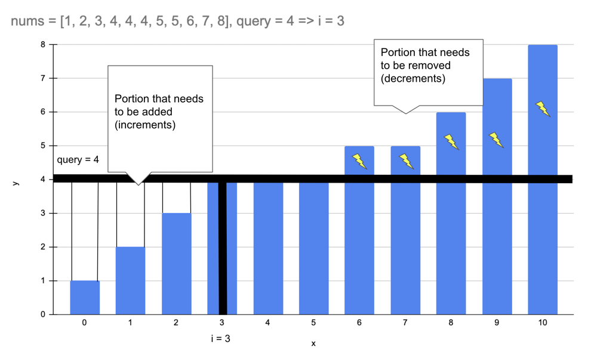

# [C++, Java, Python3] Prefix Sums + Binary Search

**Author:** tojuna
**Votes:** 107
**Link:** [https://leetcode.com/problems/minimum-operations-to-make-all-array-elements-equal/solutions/3341928/](https://leetcode.com/problems/minimum-operations-to-make-all-array-elements-equal/solutions/3341928/)

---

# Intuition
* If there are `j` numbers in `nums` that are smaller than `query[i]`, you need to find `query[i] * j - sum(j numbers smaller than query[i])` to find increments required in `nums`
* If there are `k` numbers in `nums` that are greater than `query[i]`, you need to find `sum(k numbers larger than query[i]) - query[i] * k` to find decrements required in `nums`
* Sum of above two values is `ans[i]`



# Approach
* To find smaller numbers than `query[i]` we can sort the array and use binary search
* Binary search over sorted `nums` to find index of `query[i]`
* Then use prefix sums to find sum of number in smaller and larger segments
* `prefix[n] - prefix[i]` is sum of numbers greater than or equal to `query[i]`
* `prefix[i]` is sum of numbers smaller than `query[i]`
* `query[i] * i - prefix[i]` is increments required
*  `prefix[n] - prefix[i] - query[i] * (n - i)` is decrements required
* Total = `query[i] * i - prefix[i] + prefix[n] - prefix[i] - query[i] * (n - i)`
* Can be simplified to `query[i] * (2 * i - n) + prefix[n] - 2 * prefix[i]`

# Complexity
- Time complexity: `O((n + m) * log(n))`

- Space complexity: `O(n)`

# Code
**Python3**:
```
def minOperations(self, nums: List[int], queries: List[int]) -> List[int]:
    nums.sort()
    ans, n, prefix = [], len(nums), [0] + list(accumulate(nums))
    for x in queries:
        i = bisect_left(nums, x)
        ans.append(x * (2 * i - n) + prefix[n] - 2 * prefix[i])
    return ans
```
```
def minOperations(self, nums: List[int], queries: List[int]) -> List[int]:
    nums.sort()
    prefix = [0] + list(accumulate(nums))
    for x in queries:
        i = bisect_left(nums, x)
        yield x * (2 * i - len(nums)) + prefix[-1] - 2 * prefix[i]
```
**C++**:
```
vector<long long> minOperations(vector<int>& nums, vector<int>& queries) {
    sort(nums.begin(), nums.end());
    int n = nums.size();
    vector<long long> ans, prefix(n + 1);
    for (int i = 0; i < n; i++)
        prefix[i + 1] = prefix[i] + (long long) nums[i];
    for (int& x : queries) {
        int i = lower_bound(nums.begin(), nums.end(), x) - nums.begin();
        ans.push_back(1LL * x * (2 * i - n) + prefix[n] - 2 * prefix[i]);
    }
    return ans;
}
```

**Java**:
```
public List<Long> minOperations(int[] nums, int[] queries) {
    Arrays.sort(nums);
    List<Long> ans = new ArrayList<>();
    int n = nums.length;
    long[] prefix = new long[n + 1];
    for (int i = 1; i <= n; i++)
        prefix[i] = prefix[i - 1] + nums[i - 1];
    for (int x: queries) {
        int i = bisect_left(nums, x);
        ans.add(1L * x * (2 * i - n) + prefix[n] - 2 * prefix[i]);
    }
    return ans;
}
private int bisect_left(int[] nums, int x) {
    int lo = 0, hi = nums.length;
    while (lo < hi) {
        int mid = lo + (hi - lo) / 2;
        if (nums[mid] < x) lo = mid + 1;
        else hi = mid;
    }
    return lo;
}
```

**Java using Arrays.binarySearch**:
```
public List<Long> minOperations(int[] nums, int[] queries) {
    Arrays.sort(nums);
    List<Long> ans = new ArrayList<>();
    int n = nums.length;
    long[] prefix = new long[n + 1];
    for (int i = 1; i <= n; i++)
        prefix[i] = prefix[i - 1] + nums[i - 1];
    for (int x: queries) {
        int i = Arrays.binarySearch(nums, x);
        if (i < 0) i = -(i + 1); // convert negative index to insertion point
        ans.add(1L * x * (2 * i - n) + prefix[n] - 2 * prefix[i]);
    }
    return ans;
}
```
*Good to know*: In Java, Arrays.binarySearch returns a negative index when the target element is not found in the array. The negative index returned is equal to -(insertion point) - 1, where the insertion point is the index at which the target element would be inserted into the array to maintain the sorted order.

For example, suppose we have an array arr = {1, 3, 5, 7, 9} and we want to search for the element 4. The Arrays.binarySearch(arr, 4) method would return -3. To convert this to the insertion point, we take the absolute value of the negative index and subtract 1: insertion point = |-(-3)| - 1 = 2.

Therefore, the insertion point for the element 4 in the sorted array arr would be at index 2, which is the position where we would need to insert 4 to maintain the sorted order.

**More binary search problems:**
[Minimum Time to Repair Cars](https://leetcode.com/problems/minimum-time-to-repair-cars/solutions/3311975/c-java-python3-binary-search-1-liner/)
[Minimum Time to Complete Trips](https://leetcode.com/problems/minimum-time-to-complete-trips/solutions/1802415/python3-java-c-binary-search-1-liner/)
[Kth Missing Positive Number](https://leetcode.com/problems/kth-missing-positive-number/solutions/3262163/c-java-python3-1-line-ologn/)
[Maximum Tastiness of Candy Basket](https://leetcode.com/problems/maximum-tastiness-of-candy-basket/solutions/2947983/c-java-python-binary-search-and-sorting/)
[Number of Flowers in Full Bloom](https://leetcode.com/problems/number-of-flowers-in-full-bloom/solutions/1976804/python3-2-lines-sort-and-binary-search/)