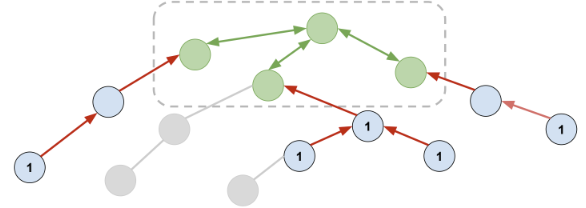

# Trim Leaves

**Author:** votrubac
**Votes:** 56
**Link:** [https://leetcode.com/problems/collect-coins-in-a-tree/solutions/3345266/](https://leetcode.com/problems/collect-coins-in-a-tree/solutions/3345266/)

---

We can trim leaves from the tree using BFS. We trim all leaves before trimming a branch, using counter `cnt` to track remaining edges.

If a branch does not have coins, we can trim it freely (gray edges).

However, once we see a coin for the first time, we can trim up to 2 levels of leaves (red edges).



In the end, we will have a subtree that we cannot trim anymore, containing `m` nodes.

Because it's a tree (and not a graph), this subtree will have `m - 1` edges (green in the picture above).

It does not matter how we choose a starting node - it will take `2 * (m - 1)` steps to visit all nodes and get back.

**C++**
```cpp
int collectTheCoins(vector<int>& coins, vector<vector<int>>& edges) {
    int sz = coins.size();
    vector<vector<int>> al(sz);
    for (const auto &e : edges) {
        al[e[0]].push_back(e[1]);
        al[e[1]].push_back(e[0]);
    }
    vector<int> cnt(sz), steps(sz, 30000), q;
    for (int i = 0; i < sz; ++i) {
        cnt[i] = al[i].size();
        if (cnt[i] == 1)
            q.push_back(i);
    }
    while (!q.empty()) {
        auto i = q.back(); q.pop_back();
        if (--steps[i]) {
            --sz;
            for (int j : al[i]) {
                steps[j] = min(steps[j], min(steps[i], coins[i] ? 2 : 30000));
                if (--cnt[j] == 1)
                    q.push_back(j);
            }
        }
    }
    return 2 * max(0, sz - 1);
}
```