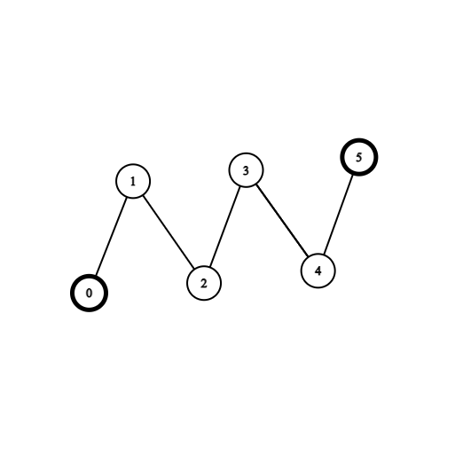

# ✔💯DAY 361 || 100% || [JAVA/C++/PYTHON]  || EXPLAINED ||  MOST UPVOTED || MEME

**Author:** ManojKumarPatnaik
**Votes:** 50
**Link:** [https://leetcode.com/problems/collect-coins-in-a-tree/solutions/3347482/](https://leetcode.com/problems/collect-coins-in-a-tree/solutions/3347482/)

---


# Please Upvote as it really motivates me


# Intuition
<!-- Describe your first thoughts on how to solve this problem. -->
##### \u2022	The goal of this code is to find the minimum number of edges that need to be removed from a given undirected tree such that the resulting graph is a forest (a collection of disjoint trees).

##### \u2022	To achieve this, the code first builds the tree from the given edges by creating an adjacency list representation of the graph.

##### \u2022	Next, the code identifies all the leaves of the tree that have zero coins. A leaf node is a node that has only one neighbor. If a node is a leaf and has zero coins, then it is removed from the tree by removing the edge that connects it to its parent node. This process is repeated until all leaf nodes with zero coins are removed from the tree.

##### \u2022	After removing all such nodes, the tree may still have leaves. The code then removes these leaves one by one, starting with the leaves that are farthest from the root of the tree. The code keeps track of all the leaf nodes that are removed during this process.

##### \u2022	Finally, the code counts the number of edges that remain in the tree after all leaf nodes with zero coins and all other leaf nodes have been removed. This count represents the minimum number of edges that need to be removed from the original tree to obtain a forest.

##### \u2022	The intuition behind this algorithm is to identify the nodes that are less valuable (i.e., nodes with zero coins) and remove them first. This helps in reducing the number of edges that need to be removed from the original tree to obtain a forest. After removing the less valuable nodes, the code then removes the remaining leaf nodes one by one, starting with the leaves that are farthest from the root of the tree. This helps in minimizing the number of edges that need to be removed by preserving the structure of the tree as much as possible.


# Approach

Here is a step-by-step explanation of the approach used in this code:
##### 1. Initialize the variables: The code starts by initializing the variables. The variable n represents the number of nodes in the tree (equal to the length of the coins array). The variable tree is an array of Sets, where each element represents the neighbors of a node. The variable leaf is an ArrayList that will be used to store the leaf nodes of the tree.
##### 2.	Build the tree from the edges: The input graph is represented as an array of coins and a 2D array of edges. The edges are used to build an adjacency list representation of the graph. This is done by iterating through the edges array and adding the corresponding edges to the tree array.
##### 3.	Find the leaves with zero coins: A leaf node is a node with only one neighbor. The code iterates through all nodes in the graph and checks if a node has only one neighbor and it has zero coins. If this is the case, the node is removed from the graph by removing the edge connecting it to its neighbor. This process is repeated until all leaf nodes that have zero coins are removed from the graph. The remaining leaf nodes are added to the leaf list.
##### 4.	Remove the leaves one by one: The code iteratively removes leaf nodes one by one, starting with the leaves that are farthest from the root of the tree. This is done by iterating through the leaf list and checking if a leaf node has only one neighbor. If it does, the node is removed from the graph by removing the edge connecting it to its neighbor. If the neighbor of the removed node is now a leaf node, it is added to a temporary list temp.
##### 5.	Count the remaining edges in the tree: After removing all leaf nodes, the code counts the number of edges that remain in the graph. This is done by iterating through the tree array and counting the size of each Set (i.e., the number of neighbors of each node). The sum of these sizes represents the minimum number of edges that need to be removed to disconnect the graph and make it into a forest.

##### Overall, the approach used in this code is to identify and remove the least valuable nodes (i.e., nodes with zero coins) first, and then iteratively remove the remaining leaf nodes while preserving the structure of the tree as much as possible. This helps in minimizing the number of edges that need to be removed to obtain a forest.


# Code
```java []
public int collectTheCoins(int[] coins, int[][] edges) {
    int n = coins.length; 
    Set<Integer>[] tree = new HashSet[n]; 
    for (int i = 0; i < n; ++i) {
        tree[i] = new HashSet(); 
    }
    
    // Build the tree from the edges
    for (int[] e : edges) {
        tree[e[0]].add(e[1]); 
        tree[e[1]].add(e[0]); 
    }
    
    // Find the leaves with zero coins
    List<Integer> leaf = new ArrayList(); 
    for (int i = 0; i < n; ++i) {
        int u = i; 
        while (tree[u].size() == 1 && coins[u] == 0) {
            int v = tree[u].iterator().next(); 
            tree[u].remove(v); 
            tree[v].remove(u); 
            u = v; 
        }
        if (tree[u].size() == 1) {
            leaf.add(u); 
        }
    }
    
    // Remove the leaves one by one
    for (int sz = 2; sz > 0; --sz) {
        List<Integer> temp = new ArrayList(); 
        for (int u : leaf) {
            if (tree[u].size() == 1) {
                int v = tree[u].iterator().next(); 
                tree[u].remove(v); 
                tree[v].remove(u); 
                if (tree[v].size() == 1) {
                    temp.add(v); 
                }
            }
        }
        leaf = temp; 
    }
    
    // Count the remaining edges in the tree
    int ans = 0; 
    for (int i = 0; i < n; ++i) {
        ans += tree[i].size(); 
    }
    
    return ans; 
}
```
```c++ []
int collectTheCoins(vector<int>& coins, vector<vector<int>>& edges) {
    int n = coins.size();
    vector<unordered_set<int>> tree(n);
    
    // Build the tree from the edges
    for (auto& e : edges) {
        tree[e[0]].insert(e[1]);
        tree[e[1]].insert(e[0]);
    }
    
    // Find the leaves with zero coins
    vector<int> leaf;
    for (int i = 0; i < n; ++i) {
        int u = i;
        while (tree[u].size() == 1 && coins[u] == 0) {
            int v = *(tree[u].begin());
            tree[u].erase(v);
            tree[v].erase(u);
            u = v;
        }
        if (tree[u].size() == 1) {
            leaf.push_back(u);
        }
    }
    
    // Remove the leaves one by one
    for (int sz = 2; sz > 0; --sz) {
        vector<int> temp;
        for (int u : leaf) {
            if (tree[u].size() == 1) {
                int v = *(tree[u].begin());
                tree[u].erase(v);
                tree[v].erase(u);
                if (tree[v].size() == 1) {
                    temp.push_back(v);
                }
            }
        }
        leaf = temp;
    }
    
    // Count the remaining edges in the tree
    int ans = 0;
    for (int i = 0; i < n; ++i) {
        ans += tree[i].size();
    }
    
    return ans;
}
```
```python []
def collectTheCoins(coins: List[int], edges: List[List[int]]) -> int:
    n = len(coins)
    tree = [set() for _ in range(n)]
    
    # Build the tree from the edges
    for e in edges:
        tree[e[0]].add(e[1])
        tree[e[1]].add(e[0])
    
    # Find the leaves with zero coins
    leaf = []
    for i in range(n):
        u = i
        while len(tree[u]) == 1 and coins[u] == 0:
            v = tree[u].pop()
            tree[v].remove(u)
            u = v
        if len(tree[u]) == 1:
            leaf.append(u)
    
    # Remove the leaves one by one
    for sz in range(2, 0, -1):
        temp = []
        for u in leaf:
            if len(tree[u]) == 1:
                v = tree[u].pop()
                tree[v].remove(u)
                if len(tree[v]) == 1:
                    temp.append(v)
        leaf = temp
    
    # Count the remaining edges in the tree
    ans = 0
    for i in range(n):
        ans += len(tree[i])
    
    return ans
```

# Complexity
Here's the time complexity and space complexity analysis of the algorithm:
# Time complexity:
##### \u2022	Building the tree from the edges takes O(N), where N is the number of nodes in the tree.
##### \u2022		Finding the leaves with zero coins takes O(N+2E) in the worst case, because we may have to iterate through all nodes and their neighbors multiple times to remove zero-coin leaves.
##### \u2022		Removing the leaves one by one takes O(N), because each leaf is removed only once.
##### \u2022		Counting the remaining edges in the tree takes O(N), because we have to iterate through all nodes and their neighbors once.
Therefore, the total time complexity of the algorithm is O(N+2E), dominated by the step of finding the leaves with zero coins.
Space complexity:
##### \u2022		Building the tree array takes O(N) space.
##### \u2022		The leaf list can have up to N elements, so it takes O(N) space.
##### \u2022	The temp list used during leaf removal can also have up to N elements, so it takes O(N) space.
Therefore, the total space complexity of the algorithm is O(N).
In summary, the algorithm has quadratic time complexity and linear space complexity.
#   UPVOTE PLEASE
# 2nd way
```java []
class Solution {
    public int collectTheCoins(int[] coins, int[][] edges) {
        int n = coins.length;
        List<Integer>[] g = new List[n];
        // Initialize adjacency list
        for (int i = 0; i < n; i++) g[i] = new ArrayList<>();

        // create a degree to for topological iteration
        int[] deg = new int[n];
        for (int[] edge : edges) {
            deg[edge[0]]++;
            deg[edge[1]]++;
            g[edge[0]].add(edge[1]);
            g[edge[1]].add(edge[0]);
        }

        // remove non-coin leaf node first
        Queue<Integer> q = new ArrayDeque<>();
        for (int i = 0; i < n; i++)
            if (deg[i] == 1 && coins[i] == 0)
                q.add(i);

        // total amount of edges in the graph
        int totalEdges = n - 1;
        while (!q.isEmpty()) {
            // remove the current edge
            int d = q.poll();
            totalEdges -= 1;
            // update neighbor degree
            for (int neigh : g[d]) {
                deg[neigh]--;
                if (deg[neigh] == 1 && coins[neigh] == 0) {
                    q.add(neigh);
                }
            }
        }
        // we have remove all non-coin leaves, now remove two degree of coins
        for (int i = 0; i < n; i++)
            if (deg[i] == 1 && coins[i] == 1)
                q.add(i);

        totalEdges -= q.size();
        for (int x : q) for (int neigh : g[x])
            if (--deg[neigh] == 1)
                totalEdges -= 1;

        // we might have negative case if there is no coin, check edge cases
        return Math.max(totalEdges * 2, 0);
    }

}
```
```python []
def _build_tree(edges: list[list[int]]) -> list[list[int]]:
    tree = [[] for _ in range(len(edges) + 1)]

    for vertex, adjacent in edges:
        tree[vertex].append(adjacent)
        tree[adjacent].append(vertex)

    return tree


class Solution:
    def collectTheCoins(self, coins: list[int], edges: list[list[int]]) -> int:
        tree = _build_tree(edges)
        degree = list(map(len, tree))

        queue = collections.deque()

        for vertex in range(len(tree)):
            if degree[vertex] == 1:
                if coins[vertex]:
                    queue.append((vertex, True))
                else:
                    queue.appendleft((vertex, True))

        count_pruned = 0

        while queue:
            vertex, is_leaf = queue.popleft()
            count_pruned += 1

            for adjacent in tree[vertex]:
                degree[adjacent] -= 1

                if is_leaf and degree[adjacent] == 1:
                    if coins[vertex]:
                        queue.append((adjacent, False))
                    elif coins[adjacent]:
                        queue.append((adjacent, True))
                    else:
                        queue.appendleft((adjacent, True))

        return 2 * max(0, len(edges) - count_pruned)
```
```c++ []
#ifndef out
#define out(...)
#endif
template<class Tp, class Up = typename std::remove_reference<Tp>::type>
constexpr auto Max(Tp &&a, const Up &b) -> decltype(a < b && (a = b, true)) { return a < b && (a = b, true); }

const int N = 3e4 + 5;
struct Edge {
    Edge *next;
    int to;
} container[N * 2];

void add(int from, int to, vector<Edge *> &next, int &top) {
    next[from] = &(container[top++] = Edge{
            .next = next[from],
            .to   = to,
    });
}

int dfs1(
        int cur, int f, int depth,
        const vector<Edge *> &next,
        const vector<int> &coins,
        int &root) {
    int ret = coins[cur] ? depth : -1;
    for (auto p = next[cur]; p; p = p->next) {
        int to = p->to;
        if (to != f) {
            Max(ret, dfs1(to, cur, depth + 1, next, coins, root));
            if (root >= 0) break;
            if (ret >= 0 && ret - depth >= 2) {
                root = cur;
                break;
            }
        }
    }
    return ret;
}

pair<int, int> dfs2(
        int cur, int f, int depth,
        const vector<Edge *> &next,
        const vector<int> &coins) {
    int max_depth = coins[cur] ? depth : -1;
    int sum = 0;
    for (auto p = next[cur]; p; p = p->next) {
        int to = p->to;
        if (to != f) {
            auto [dp, s] = dfs2(to, cur, depth + 1, next, coins);
            Max(max_depth, dp);
            if (dp >= 0 && dp - depth > 2) {
                sum += 1 + s;
            }
        }
    }
    return {max_depth, sum};
}

class Solution {
public:
    static int collectTheCoins(const vector<int> &coins, const vector<vector<int>> &edges) {
        size_t n = coins.size();
        assert(n == edges.size() + 1);
        vector<Edge *> next(n);
        int top = 0;
        for (auto &&e: edges) {
            int x = e[0], y = e[1];
            add(x, y, next, top);
            add(y, x, next, top);
        }
        vector<int> mark;
        int root = -1;
        dfs1(0, -1, 0, next, coins, root);
        if (root < 0) return 0;
        out(root);
        return dfs2(root, -1, 0, next, coins).second * 2;
    }
};
```


# Please Upvote\uD83D\uDC4D\uD83D\uDC4D
Thanks for visiting my solution.\uD83D\uDE0A Keep Learning
Please give my solution an upvote! \uD83D\uDC4D
It's a simple way to show your appreciation and
keep me motivated. Thank you! \uD83D\uDE0A
