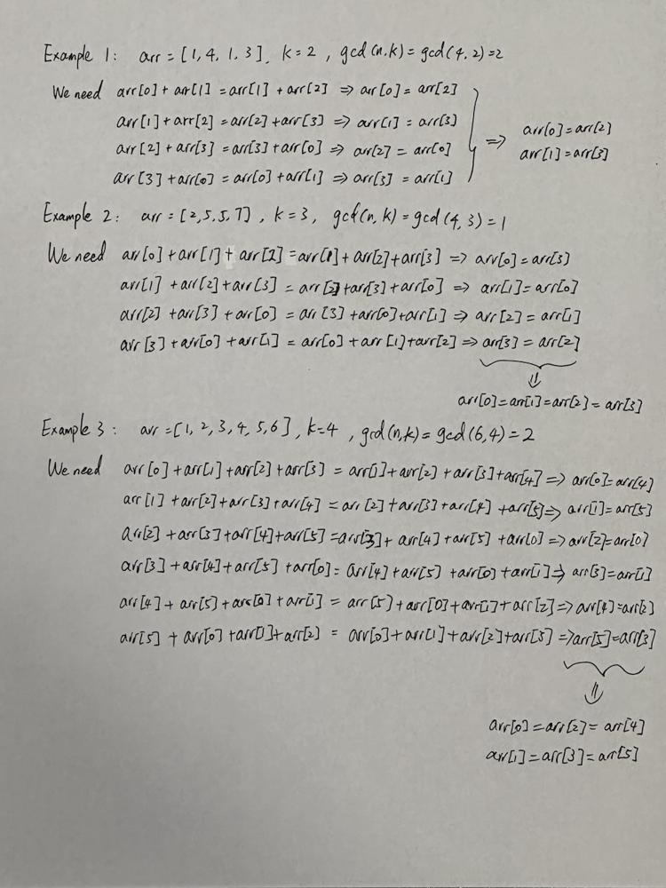

# [Python3] Find Median of Each GCD-Defined Subarray (w/ Examples)

**Author:** xil899
**Votes:** 69
**Link:** [https://leetcode.com/problems/make-k-subarray-sums-equal/solutions/3366442/](https://leetcode.com/problems/make-k-subarray-sums-equal/solutions/3366442/)

---

# First Thought
Any na\xEFve checking algorithm would not work here as both `k` and `n (= arr.length)` could be up to $$10^5$$.

So, how can we come up with a better algorithm with improved time complexity?

# Key Intuition
Let\u2019s first look at a toy example by assuming `k = 3`. Because the problem requires the sum of each subarray of length `k` to be equal, we then need to have `arr[0] + arr[1] + arr[2] = arr[1] + arr[2] + arr[3]`, which implies that `arr[0] = arr[3]`. Essentially, this is saying that every `k`-th element of `arr` needs to be equal after all operations.

There is one caveat yet to make the argument complete: In this problem `arr` is not only a regular array but also a circular array. Suppose `n = 6` and `k = 4`, we need to have every `gcd(n, k) = gcd(6, 4) = 2`-th element of `arr` to be equal after all operations.

# Representative Examples


# Approach
First, we compute the greatest common divisor of `n` and `k`, denoted as `gcd`. For every `gcd`-th element of `arr`, we store it in a temporary array `tmp`, such that the problem reduces to finding the minimum number operations to make all elements in each of `tmp` equal.

For this sub-problem, we can sort the subarray `tmp` and find its median, which contributes to the final `ans` after operations.

# Complexity
- Time complexity: $$O(nlogn)$$, could be improved to $$O(n)$$ on average;

- Space complexity: $$O(n)$$.

**Please upvote if you find this solution helpful. Thanks!**

# Code
```
class Solution:
    def makeSubKSumEqual(self, arr: List[int], k: int) -> int:
        n = len(arr)
        gcd = math.gcd(n, k)
        ans = 0
        for i in range(gcd):
            tmp = sorted([arr[j] for j in range(i, n, gcd)])
            median = tmp[len(tmp) // 2]
            ans += sum(abs(num - median) for num in tmp)
        return ans
```

# Follow-up (Bonus)
We can potentially improve the average time complexity by applying quick-select to each of the subarray problem in finding the median.