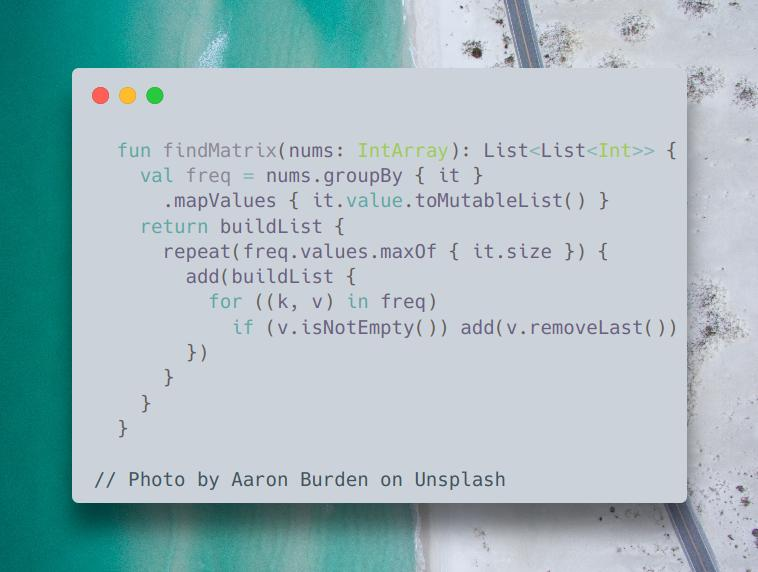

# Kotlin

**Author:** SamoylenkoDmitry
**Votes:** 3
**Link:** [https://leetcode.com/problems/convert-an-array-into-a-2d-array-with-conditions/solutions/4491339/](https://leetcode.com/problems/convert-an-array-into-a-2d-array-with-conditions/solutions/4491339/)

---


https://youtu.be/Itn5jEpPZ4k
#### Join me on Telegram

https://t.me/leetcode_daily_unstoppable/459

#### Problem TLDR

Convert numbers array into array of unique number-rows.

#### Intuition

Let's count each kind of numbers, then use each unique number to build the rows.

#### Approach

Kotlin's API can be helpful:
* groupBy
* mapValues
* buildList

#### Complexity

- Time complexity:
$$O(uf)$$ where, u - number of uniq elements, f - max frequency. Worst case O(n^2): `1 2 3 4 1 1 1 1`, u = n / 2, f = n / 2. This can be improved to O(n) by removing the empty collections from `freq`.

- Space complexity:
$$O(n)$$

#### Code

```kotlin

  fun findMatrix(nums: IntArray): List<List<Int>> {
    val freq = nums.groupBy { it }
      .mapValues { it.value.toMutableList() }
    return buildList {
      repeat(freq.values.maxOf { it.size }) {
        add(buildList {
          for ((k, v) in freq) 
            if (v.isNotEmpty()) add(v.removeLast())
        })
      }
    }
  }

```