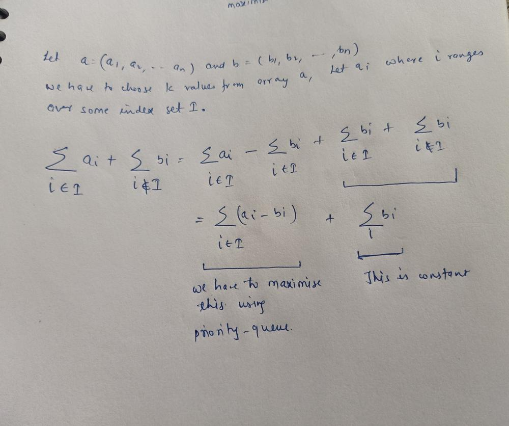

# Easy C++ Priority Queue Solution

**Author:** asrawat2001
**Votes:** 156
**Link:** [https://leetcode.com/problems/mice-and-cheese/solutions/3368300/](https://leetcode.com/problems/mice-and-cheese/solutions/3368300/)

---

# Intuition

<!-- Describe your first thoughts on how to solve this problem. -->


# Code
```
class Solution {
public:
    int miceAndCheese(vector<int>&r1, vector<int>& r2, int k) {
       priority_queue<int>pq;
        long long int ans=0;
        for(int i=0;i<r1.size();i++){
           pq.push(r1[i]-r2[i]);
            ans+=r2[i];
        }
        while(k!=0){
          ans+=pq.top();
            pq.pop();
            k--;
        }
        return ans;
    }
};
```