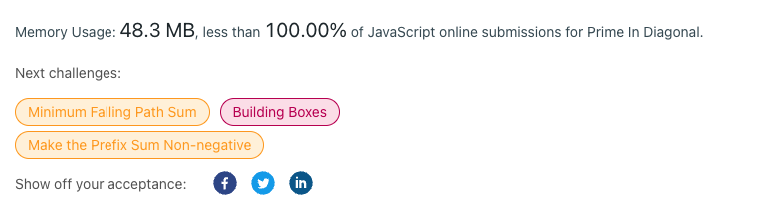

# ❇ prime-in-diagonal👌 🏆O(1)❤️ Javascript❤️ Memory👀100.00%🕕 Meaningful Vars✍️ 🔴🔥 ✅ 👉 💪🙏

**Author:** anurag-sindhu
**Votes:** 2
**Link:** [https://leetcode.com/problems/prime-in-diagonal/solutions/4125925/](https://leetcode.com/problems/prime-in-diagonal/solutions/4125925/)

---

Time Complexity: O(N)
Space Complexity: O(1)
```
function isPrime(num) {
    for (let index = 2; index < parseInt(num / 2); index++) {
        if (num % index === 0) {
            return false;
        }
    }
    return true;
}

var diagonalPrime = function(nums) {
    let maxPrimeNumber = 0;
    for (let index = 0; index < nums.length; index++) {
        const currentNum = nums[index][index];
        if (currentNum === 1) {
            continue;
        }
        if (isPrime(currentNum)) {
            if (maxPrimeNumber < currentNum) {
                maxPrimeNumber = currentNum;
            }
        }
    }

    for (let index = 0; index < nums.length; index++) {
        const columnIndex = nums.length - 1 - index;
        const currentNum = nums[index][columnIndex];
        if (currentNum === 1) {
            continue;
        }
        if (nums.length % 2 !== 0) {
            if (index !== columnIndex) {
                if (isPrime(currentNum)) {
                    if (maxPrimeNumber < currentNum) {
                        maxPrimeNumber = currentNum;
                    }
                }
            }
        } else {
            if (isPrime(currentNum)) {
                if (maxPrimeNumber < currentNum) {
                    maxPrimeNumber = currentNum;
                }
            }
        }
    }
    return maxPrimeNumber;
};
```


