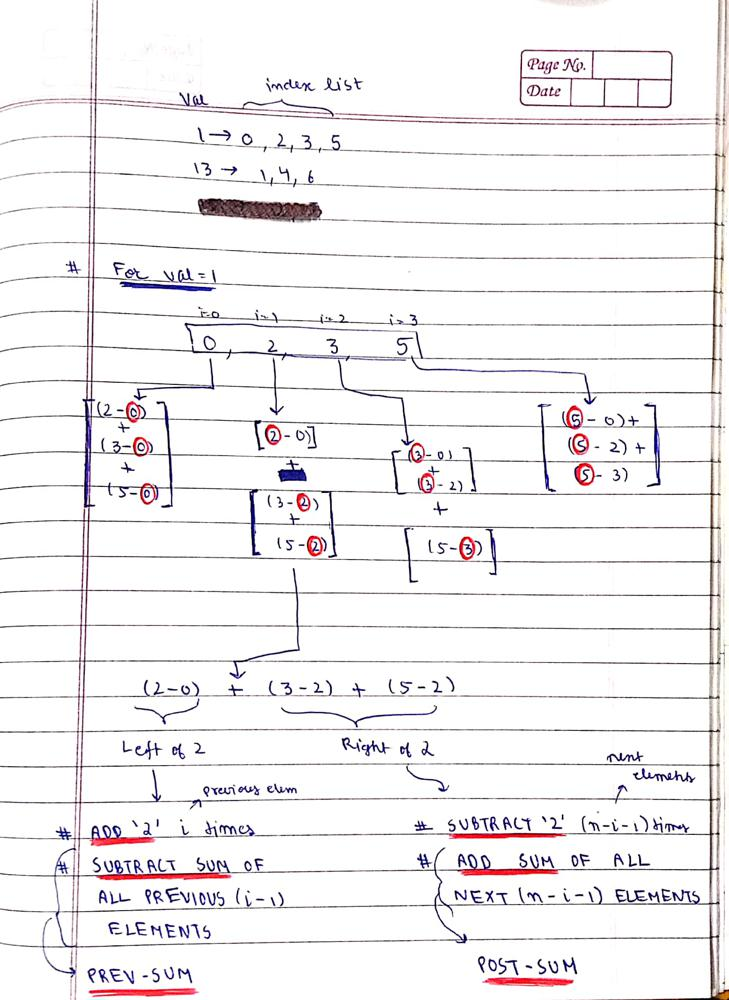

# Explained with images || Easy to understand

**Author:** MohakHarjani
**Votes:** 108
**Link:** [https://leetcode.com/problems/sum-of-distances/solutions/3395726/](https://leetcode.com/problems/sum-of-distances/solutions/3395726/)

---




```
class Solution {
public:
    vector<long long> distance(vector<int>& nums) 
    {
        int n = nums.size();
        vector<long long>ans(n);
        unordered_map<int, vector<int>>mp;
        for (int i = 0; i < n; i++) mp[nums[i]].push_back(i);
        for (auto it : mp)
        {
            int num = it.first;
            vector<int>& indexes = it.second;
            //======================================================
            long long totalSum = 0;
            for (int index : indexes) totalSum += (long long)index;
            
            long long preSum = 0;
            for (int i = 0; i < indexes.size(); i++)
            {
                int index = indexes[i];
                long long postSum = totalSum - preSum - index;
                
                ans[index] += (index * (long long)i);
                ans[index] -= (preSum);
                ans[index] -= (index * (long long)(indexes.size() - i - 1));
                ans[index] += (postSum);
                
                preSum += index;
            }
            //======================================================
        }
        return ans;
        
        
    }
};
```