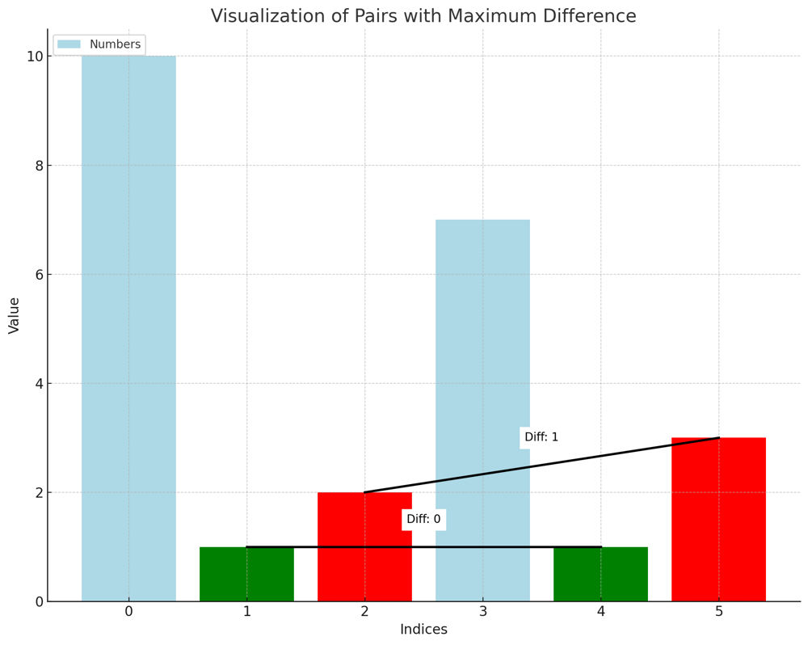
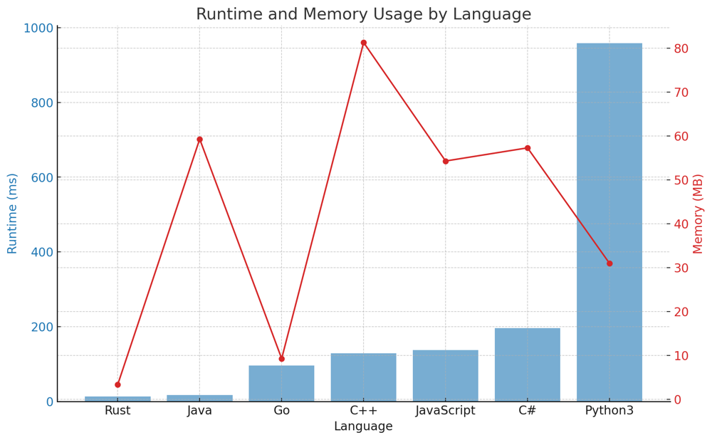

# ✅ 100% Binary Search & Greedy [VIDEO] in O(n log m) - Optimal Solution

**Author:** vanAmsen
**Votes:** 106
**Link:** [https://leetcode.com/problems/minimize-the-maximum-difference-of-pairs/solutions/3883965/](https://leetcode.com/problems/minimize-the-maximum-difference-of-pairs/solutions/3883965/)

---

# Problem Understanding

The problem asks us to find the minimum possible value of the maximum difference between any two pairs from an array, given that we can only form a limited number of pairs. The challenge is to find this minimum possible maximum difference.

For instance, given the array [10,1,2,7,1,3] and the ability to form 2 pairs, the minimum possible maximum difference is 1.




- The green pair formed by indices 1 and 4 has a difference of 0.
- The red pair formed by indices 2 and 5 has a difference of 1.

The maximum difference among these pairs is 1, consistent with the expected output.

---

# Live Coding & Explenation
https://youtu.be/Ulfzvhy8F5E

- [in Rust \uD83E\uDD80](https://youtu.be/E11wgsLbq-w)
- [in Python \uD83D\uDC0D](https://youtu.be/Ulfzvhy8F5E)

# Approach

To address this problem, we utilize a blend of binary search and a greedy method. Our primary objective is to pinpoint the smallest possible maximum difference between pairs.

## Binary Search on Maximum Difference

Instead of trying to find pairs directly, we'll conduct a binary search on the potential range of maximum differences. The range we'll be searching within spans from 0 to the difference between the largest and smallest values in the sorted array.

For every potential maximum difference, denoted as $$ \	ext{mid} $$, we'll implement a greedy strategy to determine if we can create the requisite number of pairs.

## Greedy Pairing

Given a maximum difference $$ \	ext{mid} $$, we traverse the sorted array and attempt to form pairs in a greedy manner. Whenever two consecutive numbers in the array have a difference that is equal to or less than $$ \	ext{mid} $$, we pair them together. If, by the end of our traversal, we have been able to form the required number of pairs, it signifies that our $$ \	ext{mid} $$ value is feasible.

## Code Breakdown

1. **Helper Function**: 
    ```python
    def can_form_pairs(mid):
        ...
    ```
    This function checks if we can form $$ p $$ pairs where the difference between each pair is less than or equal to $$ \	ext{mid} $$. 
   
    - We start by initializing counters: `count` for the number of pairs formed and `i` for the current index in `nums`.
    - We then iterate over the numbers in `nums` and try to form pairs greedily.
    - If the difference between two consecutive numbers (at index `i` and `i+1`) is less than or equal to `mid`, we count it as a pair and skip the next number.
    - If we can form exactly `p` pairs with a difference less than or equal to `mid`, the function returns `True`; otherwise, it returns `False`.

2. **Main Logic**:
    ```python
    nums.sort()
    low, high = 0, nums[-1] - nums[0]
    ...
    return low
    ```
    Here, we are implementing the binary search:
    
    - First, we sort the array `nums`.
    - We define our search space with `low` being 0 and `high` being the difference between the maximum and minimum values in `nums`.
    - During each iteration of the binary search, we calculate the mid-point and check if we can form the required pairs using our helper function `can_form_pairs(mid)`.
    - If we can form the required pairs, our current `mid` value is feasible, so we might be able to find an even smaller maximum difference. Therefore, we update `high` to `mid`.
    - If not, our `mid` value is too small, so we update `low` to `mid + 1`.
    - Finally, we return `low`, which will be the smallest maximum difference for which we can form the required number of pairs.


## Rationale:

The strength of this approach lies in its ability to seamlessly and efficiently traverse the search space of potential maximum differences. By combining binary search with a greedy pairing strategy, we can identify the smallest maximum difference that allows us to form the desired number of pairs.

---

# Complexity

- **Time Complexity**: O(n log m), where $$ n $$ is the length of the array and $$ m $$ is the difference between the maximum and minimum values in the array. Sorting the array takes O(n log n) and the binary search process, combined with the greedy check, takes O(n log m).
  
- **Space Complexity**: O(1). We only use a constant amount of space for our variables.

# Performance

| Language   | Runtime (ms) | Runtime Beat (%) | Memory (MB) | Memory Beat (%) |
|------------|--------------|------------------|-------------|-----------------|
| Rust       | 14           | 100%             | 3.4         | 100%            |
| Java       | 17           | 95%              | 59.3        | 35.63%          |
| Go         | 96           | 100%             | 9.3         | 60%             |
| C++        | 129          | 94.77%           | 81.3        | 9.61%           |
| JavaScript | 138          | 90.91%           | 54.3        | 90.91%          |
| C#         | 196          | 75%              | 57.3        | 50%             |
| Python3    | 958          | 87.74%           | 31          | 78.6%           |




# Code

```Python []
class Solution:
    def minimizeMax(self, nums: List[int], p: int) -> int:
        
        def can_form_pairs(mid):
            count = 0
            i = 0
            while i < len(nums) - 1 and count < p:
                if nums[i+1] - nums[i] <= mid:
                    count += 1
                    i += 2
                else:
                    i += 1
            return count >= p
        
        nums.sort()
        left, right = 0, nums[-1] - nums[0]
        
        while left < right:
            mid = (left + right) // 2
            if can_form_pairs(mid):
                right = mid
            else:
                left = mid + 1
                
        return left
```
``` C++ []
class Solution {
public:
    int minimizeMax(std::vector<int>& nums, int p) {
        std::sort(nums.begin(), nums.end());
        
        int left = 0, right = nums.back() - nums.front();
        
        while (left < right) {
            int mid = (left + right) / 2;
            if (can_form_pairs(nums, mid, p)) {
                right = mid;
            } else {
                left = mid + 1;
            }
        }
        
        return left;
    }
    
private:
    bool can_form_pairs(const std::vector<int>& nums, int mid, int p) {
        int count = 0;
        for (int i = 0; i < nums.size() - 1 && count < p;) {
            if (nums[i+1] - nums[i] <= mid) {
                count++;
                i += 2;
            } else {
                i++;
            }
        }
        return count >= p;
    }
};
```
``` Rust []
impl Solution {
    pub fn minimize_max(mut nums: Vec<i32>, p: i32) -> i32 {
        nums.sort();
        
        let mut left = 0;
        let mut right = nums[nums.len() - 1] - nums[0];
        
        while left < right {
            let mid = (left + right) / 2;
            if Solution::can_form_pairs(&nums, mid, p) {
                right = mid;
            } else {
                left = mid + 1;
            }
        }
        
        left
    }

    fn can_form_pairs(nums: &Vec<i32>, mid: i32, p: i32) -> bool {
        let mut count = 0;
        let mut i = 0;
        while i < nums.len() - 1 && count < p {
            if nums[i+1] - nums[i] <= mid {
                count += 1;
                i += 2;
            } else {
                i += 1;
            }
        }
        count >= p
    }
}
```
``` Go []
func minimizeMax(nums []int, p int) int {
	sort.Ints(nums)
	
	left, right := 0, nums[len(nums)-1] - nums[0]
	
	for left < right {
		mid := (left + right) / 2
		if canFormPairs(nums, mid, p) {
			right = mid
		} else {
			left = mid + 1
		}
	}
	
	return left
}

func canFormPairs(nums []int, mid int, p int) bool {
	count := 0
	for i := 0; i < len(nums) - 1 && count < p; {
		if nums[i+1] - nums[i] <= mid {
			count++
			i += 2
		} else {
			i++
		}
	}
	return count >= p
}
```
``` Java []
public class Solution {
    public int minimizeMax(int[] nums, int p) {
        Arrays.sort(nums);
        
        int left = 0, right = nums[nums.length - 1] - nums[0];
        
        while (left < right) {
            int mid = (left + right) / 2;
            if (can_form_pairs(nums, mid, p)) {
                right = mid;
            } else {
                left = mid + 1;
            }
        }
        
        return left;
    }
    
    private boolean can_form_pairs(int[] nums, int mid, int p) {
        int count = 0;
        for (int i = 0; i < nums.length - 1 && count < p;) {
            if (nums[i+1] - nums[i] <= mid) {
                count++;
                i += 2;
            } else {
                i++;
            }
        }
        return count >= p;
    }
}
```
``` C# []
public class Solution {
    public int MinimizeMax(int[] nums, int p) {
        Array.Sort(nums);
        
        int left = 0, right = nums[nums.Length - 1] - nums[0];
        
        while (left < right) {
            int mid = (left + right) / 2;
            if (CanFormPairs(nums, mid, p)) {
                right = mid;
            } else {
                left = mid + 1;
            }
        }
        
        return left;
    }
    
    private bool CanFormPairs(int[] nums, int mid, int p) {
        int count = 0;
        for (int i = 0; i < nums.Length - 1 && count < p;) {
            if (nums[i+1] - nums[i] <= mid) {
                count++;
                i += 2;
            } else {
                i++;
            }
        }
        return count >= p;
    }
}
```
``` JavaScript []
/**
 * @param {number[]} nums
 * @param {number} p
 * @return {number}
 */
var minimizeMax = function minimizeMax(nums, p) {
    nums.sort((a, b) => a - b);
    
    let left = 0, right = nums[nums.length - 1] - nums[0];
    
    while (left < right) {
        let mid = Math.floor((left + right) / 2);
        if (canFormPairs(nums, mid, p)) {
            right = mid;
        } else {
            left = mid + 1;
        }
    }
    
    return left;
}

function canFormPairs(nums, mid, p) {
    let count = 0;
    for (let i = 0; i < nums.length - 1 && count < p;) {
        if (nums[i+1] - nums[i] <= mid) {
            count++;
            i += 2;
        } else {
            i++;
        }
    }
    return count >= p;
}
```

# Live Coding & Explenation in Rust 
https://youtu.be/E11wgsLbq-w