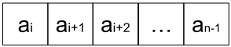
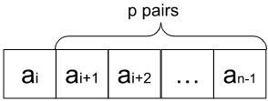
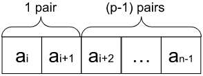
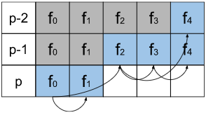

# I❤️Kotlin | Recursion+DP Explained | Non-Binary Search Approach

**Author:** user3488KQ
**Votes:** 33
**Link:** [https://leetcode.com/problems/minimize-the-maximum-difference-of-pairs/solutions/3406380/](https://leetcode.com/problems/minimize-the-maximum-difference-of-pairs/solutions/3406380/)

---

# Can this task be solved without Binary Search?

I see a lot of Binary Search based solutions to this problem. It should be mentioned that the Binary search is good enough, but I'd like to share with you a different approach, just to show that there is another way of solution.  It is based on recursion with dynamic programming.

I'm trying to be pretty detailed, so please, feel free to skip any sections if you think that they are pretty obvious.

# Why Do We Sort the Input Numbers?

According to the problem we have to find all pairs with the minimum difference. Let's assume we have an array of 3 elements: `[a, b, c]` and it's given that `a < b < c`. Let's show that `b` is a best pair for `a` than `c` is. As we know, `b < c`, and we can subtract `a` from both sides of `<` and this won't change the inequality: `(b - a) < (c - a)`. And that's true for any `a`, `b`, and `c`.

So it means that the best pair for an element is another element standing next to it in the sorted array. All pairs we are looking for are pairs like `(nums[i], nums[i+1])` in a sorted array `nums`.

# Some Boring Math

Let's assume there is a function $$f_{nums}(i, p)$$ which returns the minimum maximum difference among all `p` pairs in ascending sorted array `nums` starting from the index `i`.

In general case we have an array of values:




To calculate the value of $f$ we have two options:
## Option 1: Skip the First Element


To skip the element $ a_i $ and find `p` pairs in a sub-array starting the index `i+1`:
$ f_{nums}(i, p) = f_{nums}(i + 1, p) $
## Option 2: Use the First Element

If we use pair of $(a_i, a_{i+1})$ then the difference of this pair is $|a_{i+1} - a_i|$, but it has also been given that `nums` is an ascending sorted array, so $a_i < a_{i+1}$ for any $i$, and we can omit the $|x|$ operation: $(a_{i+1} - a_i)$.
After we fitted one pair into the array, we have $ p - 1 $ pairs left and we can't use $a_i$ and $a_{i+1}$ anymore. The value of function $f$ for the rest of elements would be equal to $f_{nums}(i + 2, p - 1)$.
As we have to find the max value of all pairs:
$$ f_{nums}(i, p) = max((a_{i+1} - a_i), f_{nums}(i + 2, p - 1)) $$
## Combining The Options
From these two options we have to choose the smallest value, because if we choose the biggest one that would mean that among the fitted pairs, there is a pair with not the smallest difference. And this brings us to a final recursive definition of $f$:
$ f_{nums}(i, p) = min(f_{nums}(i + 1, p), max((a_{i+1} - a_i), f_{nums}(i + 2, p - 1))) $
So our goal is to calculate the value of $f_{nums}(0, p)$.

# Approach

So, let's finally implement the formula. To calculate the value of $f$ of array `(0 .. nums)` we need to know the value of $f$ for the two sub-arrays.
It can be suggested to put the calculation upside down, and calculate $f(i, 1)$ for each `i` in range of `0 .. nums.length - 2`. Then get $f(i, 2)$ for each `i` in range of `0 .. nums.length - 4`, and so on util we reach `p`. And, since to calculate the value at `i` we need to know the value at `i + 1`, so it would make sense to run the calculations from the most right element down to the left one.

For case `p=1` it's just a minimal difference of all neighborhood elements:
```
val f1 = IntArray(nums.size)
// The last value is simply a difference of two last elements in num
f1[nums.size - 2] = nums[nums.size - 1] - nums[nums.size - 2]
for (i in nums.size - 3 downTo 0) {
    f1[i] = minOf(f1[i + 1], nums[i + 1] - nums[i])
}
```
Now, when we have all values of $f(i, 1)$, we can calculate the values for `p=2`. Because it's required at least 4 elements to fit 2 pairs, the iteration is started from the 4th element from the right
```
val f2 = IntArray(nums.size)
// The last value is simply a difference of two last elements in num
f2[nums.size - 4] = nums[nums.size - 1] - nums[nums.size - 2]
for (i in nums.size - 5 downTo 0) {
    f2[i] = minOf(f2[i + 1], maxOf(nums[i + 1] - nums[i], f1[i + 2]))
}
```

And so on. There are two optimizations that should be mentioned.

## Memory Optimization
As it could be seen from the original formula, to calculate `f2` we need values from `f1` only, and for `f3` we need `f2` only, so there is no need to keep all unnecessary arrays in the memory, instead we could have two and swap them on each iteration:


```
var results = IntArray(nums.size)
var prevResults = IntArray(nums.size)

for (pairs in 1 .. p) {
    // Do the calculations here

    // Swap the results, so we can use curResults again.
    val tmp = prevResults
    prevResults = results
    results = tmp
}

return prevResults.first()
```

## Time Optimization
There is one more optimization to reduce computation time. At the end of the computation the result is holded by `f[0]` cell. To calculate the value we need to know just `f[1]` on the same step and `f[2]` from the previous iteration. Take a look at the schema below:



As you can see, we don't actually use the values from cells with gray background to calculate the result. In other words, instead of looping down to `0` we may stop the loop early.

```
for (pairs in 1 .. p) {
    val range = (nums.size - 2 * pairs) downTo (2 * (p -  pairs))
    // Do the calculations here
}
```
# Complexity
- Time complexity:
  $O(np - p^2)$, where `n` is a number of elements in `nums`, and `p` is a number os pairs.
    We do the array sorting and $p$ iterations by $(n - 2p)$ steps, which give us $ O(n logn + p(n - 2p)) $ before reduction.

- Space complexity:
  $$O(n)$$, where `n` is a number of elements in `nums`. We use two arrays of size `n` to store result on the current and previous iteration.

# Code
```
class Solution {
    fun minimizeMax(nums: IntArray, p: Int): Int {
        var results = IntArray(nums.size)
        // Add one extra element to fit Int.MAX_VALUE on the first iteration. See below.
        var prevResults = IntArray(nums.size + 1)

        nums.sort()
        for (pairs in 1 .. p) {
            val range = nums.size - 2 * pairs downTo 2 * (p -  pairs)
            // This is a small hack to avoid minOf(results[i + 1], ...) return incorrect result
            // on the first iteration.
            results[range.first + 1] = Int.MAX_VALUE
            for (i in range) {
                results[i] = minOf(results[i + 1], maxOf(nums[i + 1] - nums[i], prevResults[i + 2]))
            }
            // Swap the buffers
            val tmp = prevResults
            prevResults = results
            results = tmp
        }

        return prevResults.first()
    }
}
```
# Bonus: Binary Search
I'd also be happy to add one more binary search implementation the way it could be written in Kotlin:
```
class Solution {
    fun IntArray.binarySearch(target: (Int) -> Int): Int {
        var left = 0
        var right = last() - first()
        while (left < right) {
            ((left + right) / 2).also {
                if (target(it) >= 0) {
                    right = it
                } else {
                    left = it + 1
                }
            }
        }
        return left
    }

    fun minimizeMax(nums: IntArray, p: Int): Int {
      p == 0 && return 0

      return nums.apply { sort() }.binarySearch {
          var foundPairs = 0
          var i = 1
          do {
              if (nums[i] - nums[i - 1] <= it) {
                  ++foundPairs
                  ++i
              }
          } while (++i < nums.size && foundPairs < p)
          foundPairs - p
      }
    }
}
```
