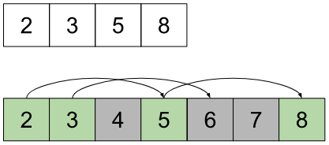
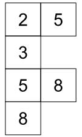
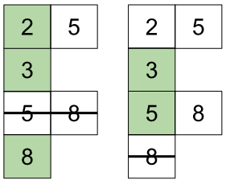
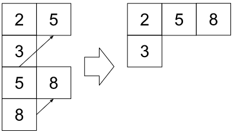
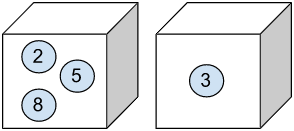

# I❤️Kotlin | DP & Why to Group? | Illustrated Explanation

**Author:** user3488KQ
**Votes:** 20
**Link:** [https://leetcode.com/problems/count-the-number-of-k-free-subsets/solutions/3414351/](https://leetcode.com/problems/count-the-number-of-k-free-subsets/solutions/3414351/)

---

# So Why Do We Group Values?

I tried to write this solution for people like me, who don\u2019t clearly understand yet why we split the input array into sub-sequences of arithmetic progression.

## A Simple Example

Let\u2019s start from a small example. Assuming we have `nums=[5, 3, 8, 2]` and `k=3`. To create a k-Free subset we have to define which pairs of numbers can\u2019t be put into the same subset together. 
If we sort the input array and put the values on the progression with a step 1 one can notice that for any $a$ there is only one value $a+k$ that can\u2019t be placed in a subset together. To picture it let\u2019s put all such pairs together:



The values with a gray background are out of our input array. To make the picture more clear, let's re-arrange the paired and non-paried elements to the following structure:



This structure can already be used to build k-Free subsets. To do so you have to move from top to the bottom and select elements from the left column. If there is a paired element on the right, you have to skip it during your movement to the bottom. For example, if you put `2` to the subset, you still may choose `3` or `8`, but you can\u2019t choose `5`. If you select `5` then `8` should be skipped, and so on. 




How to calculate the number of all possible subsets we can build? To simplify the calculation it is suggested to merge all pairs into chains. As you may see, the chain we got is an arithmetic progression with step `k`. 



You may think of each chain as of a box filled with numbered balls.




By taking one ball from each box you can build a k-Free subset: `[2, 3]`, `[5, 3]`,`[8, 3]`. You may even take no balls from any box and still get a valid subset: `[2]`, `[5]`, `[8]`, `[3]`, `[]`. Or you may take more than one ball at once, but if you take a ball numbered `x`, you have to put aside the ball `x+k` from the box before taking another one from this box again.

So I hope at this stage it becomes clear why we need such tricky subsets to calculate the result.

# Moving to a Generalization

Let\u2019s assume there is a function $f(n)$ that returns a number of all possible subsets we can pull from a box with $n$ balls inside. If there are $k$ boxes then the total number of possible subsets will be the following: $ f(n_1) * f(n_2) * \u2026 * f(n_k) $, where $n_k$ is a number of balls in a k-th box.

Let\u2019s show that $f(n)$ is a Fibonacci function. 

If the bucket is empty, there is only one option available, it's the empty subset, $f(0)=1$. 
If there is one ball in the box, then we have two options: to use it, or put it aside: $f(1)=2$. 
In case there are two balls, we can use the ball with the smallest number, and put the next ball aside to find ourselves  with an empty box ($f(0)$), or we can skip the smallest ball to get one ball left inside ($f(1)$).

Putting both together we get $f(2)=f(1)+f(0)$. Increasing the starting number of balls we get the general representation of the formula: $f(n)=f(n-1)+f(n-2)$.

As you can see, there is no need to know the values in the subsequences, just the size of each box.

# Approach
Three steps to be taken.
1. Sort the input array.
2. Split the array elements into the sets and count sizes of each set.
3. Multiply all sizes.

Assuming that steps 1 and 3 are pretty straightforward, let's take a closer look at the elements grouping. 

## Group and Count
Our goal is to split a strictly ascending sorted array into sub-sets the way each set becomes an arithmetic progression with a step `k`. The strategy is the following: iterate through the array from the smallest value to the biggest. For each element `x` we check if at some previous step we've already met an element equals `(x - k)`. That would mean that `x` is a following element of an existing group. We increment the group size counter by `1`. Otherwise, if there is no group for the element `x` found we create a new group counter.

Implementation of the given approach could be the following:
```
val groups = mutableMapOf<Int, Int>()
for (x in nums) {
    val groupSize = groups[x - k]
    if (groupSize == null) {
        // x is the first element in a group.
        groups[x] = 1
    } else {
        // Group already exists, increment the counter
        groups[x] = groupSize + 1
        // We don't need the (x - k) element anymore
        groups.remove(x - k)
    }
}
```
At the end of the loop the map `groups` contains pairs of elements where the key is the last element of the group and the value is the group size.

# Complexity
- Time complexity: $$O(n\u22C5log(n))$$
  - Sort the array: : $$O(n\u22C5log(n))$$
  - Calculate the result: $$O(n))$$

- Space complexity: $$O(n)$$
  - Storing groups of values: $$O(n)$$
  - Storing the precalculated results: $$O(1)$$

# Code
```
class Solution {
    fun countTheNumOfKFreeSubsets(nums: IntArray, k: Int): Long {
        // Counting groups sizes
        val groups = mutableMapOf<Int, Int>()
        nums.apply { sort() }
            .forEach { x ->
                (x - k).also { prevValue ->
                    groups[x] = 1 + 
                      // Looking for a values which is less then x by k
                      (groups[prevValue]
                        // If the value is found get the group size,
                        // and remove the old value
                        ?.apply { groups.remove(prevValue) } 
                        // Otherwise, this is the first element of a group
                        ?: 0)
                }
            }
        // Get the maximum group size to define limit of the argument
        val maxGroupSize = groups.values.max() ?: 0
        val preCalculatedSubsetSizes =
            LongArray(maxGroupSize + 1).apply {
                this[0] = 1
                this[1] = 2
                for (i in 2 .. maxGroupSize) {
                    this[i] = this[i - 1] + this[i - 2]
                }
            }
        // Folding the groups sizes by multiplying one to another
        return groups.values
            .fold(1L) { acc, i -> acc * preCalculatedSubsetSizes[i] }
    }
}
```