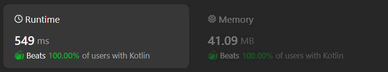

# Kotlin solution using hash set

**Author:** chayangkoon
**Votes:** 0
**Link:** [https://leetcode.com/problems/find-the-maximum-divisibility-score/solutions/5077984/](https://leetcode.com/problems/find-the-maximum-divisibility-score/solutions/5077984/)

---




# Complexity
- Time complexity:
O(nm)

- Space complexity:
O(m)

# Code
```
class Solution {
    fun maxDivScore(nums: IntArray, divisors: IntArray): Int {
        val divisorsSet = divisors.toHashSet()
        var minDivisor = Int.MAX_VALUE
        var maxDivScore = 0

        for (divisor in divisorsSet) {
            var divScore = 0
            for (num in nums) {
                if (num % divisor == 0) {
                    divScore++
                }
            }

            if (divScore > maxDivScore) {
                minDivisor = divisor
                maxDivScore = divScore
            } else if (divScore == maxDivScore && divisor < minDivisor) {
                minDivisor = divisor
            }
        }

        return minDivisor
    }
}
```