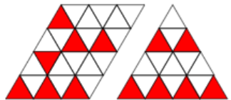
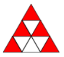

# I❤️Kotlin | With Illustrated Explanation

**Author:** user3488KQ
**Votes:** 4
**Link:** [https://leetcode.com/problems/color-the-triangle-red/solutions/3436676/](https://leetcode.com/problems/color-the-triangle-red/solutions/3436676/)

---

# Approach
Split the triangle from in chunks of 4 rows starting from bottom to the top. Paint each chunk according to the following pattern:
- 1st row: paint the first element.

- 2nd row: Paint each second element starting from the thrid one.

- 3rd row: paint the second element only.

- 4th row: paint each 2nd element in the row starting from the first one.



If there are less than 4 rows left on the top of the triangle, then manully paint the elements with the following pattern:

- Always paint the tip of the triangle.

- Under the tip, paint left and right elements on each row.




# Complexity
- Time complexity: $$O(n^2)$$.
  We pass `n`-rows, each row has `2*i + 1` elements, where `0 <= i < n`.

- Space complexity: $$O(n)$$ to store the result.

# Code
```
class Solution {
    fun colorRed(n: Int) = mutableListOf<IntArray>().apply {
        val tipSize = n % 4
        // Tip of the triangle is always painted red
        if (tipSize >= 1) {
            add(intArrayOf(1, 1))
        }
        // Paint most right and most left elements at the following rows
        for (i in 2 .. tipSize) {
            add(intArrayOf(i, 1))
            add(intArrayOf(i, 2 * i - 1))
        }
        // Paint 4-row chunks
        for (i in tipSize + 1 until n step 4) {
            // Fill the 1st row of the chunk
            add(intArrayOf(i, 1))
            // Fill the 2nd row
            (1 until i + 1).forEach { add(intArrayOf(i + 1, 2 * it + 1)) }
            // Fill the 3rd row
            add(intArrayOf(i + 2, 2))
            // Fill the 4th row
            (0 until i + 3).forEach { add(intArrayOf(i + 3, 2 * it + 1)) }
        }
    }.toTypedArray()
}
```