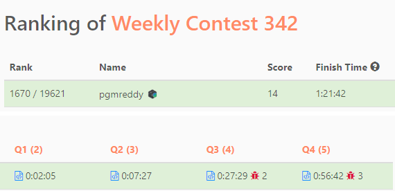

# [JavaScript] 2653. Sliding Subarray Beauty

**Author:** pgmreddy
**Votes:** 10
**Link:** [https://leetcode.com/problems/sliding-subarray-beauty/solutions/3446035/](https://leetcode.com/problems/sliding-subarray-beauty/solutions/3446035/)

---

# Intuition
<!-- Describe your first thoughts on how to solve this problem. -->

# Approach
<!-- Describe your approach to solving the problem. -->

# Complexity
- Time complexity:
<!-- Add your time complexity here, e.g. $$O(n)$$ -->

- Space complexity:
<!-- Add your space complexity here, e.g. $$O(n)$$ -->

# Code

---
1

```
var getSubarrayBeauty2 = function (a, k, xthNegOrZero) {
  const n = a.length;
  const f = new Map();
  for (let R = -50; R <= 50; R++) {
    f.set(R, 0);
  }
  const ans = [];
  let L = 0;
  for (let R = 0; R < n; R++) {
    f.set(a[R], f.get(a[R]) + 1);
    if (R < k - 1) continue;
    let totalEles = 0;
    for (let R2 = -50; R2 <= 50; R2++)
      if (f.get(R2)) {
        totalEles += f.get(R2);
        if (totalEles >= xthNegOrZero) {
          if (R2 < 0) ans.push(R2);
          else ans.push(0);
          break;
        }
      }
    f.set(a[L], f.get(a[L]) - 1);
    L++;
  }
  return ans;
};
```

---

2

```
var getSubarrayBeauty = function (a, k, xthNegOrZero) {
  const n = a.length;
  const f = new Map();
  for (let R = -50; R <= 50; R++) {
    f.set(R, 0);
  }
  const ans = new Array(n - k + 1).fill(0);
  let L = 0;
  let R;
  for (R = 0; R < k - 1; R++) {
    f.set(a[R], f.get(a[R]) + 1);
  }
  for (; R < n; R++) {
    f.set(a[R], f.get(a[R]) + 1);
    let totalEles = 0;
    for (let R2 = -50; R2 <= 50; R2++)
      if (f.get(R2)) {
        totalEles += f.get(R2);
        if (totalEles >= xthNegOrZero) {
          if (R2 < 0) ans[R - k + 1] = R2;
          break;
        }
      }
    f.set(a[L], f.get(a[L]) - 1);
    L++;
  }
  return ans;
};
```

---

**Contest**
- https://leetcode.com/contest/weekly-contest-342/ranking/67/

**All Answers**
- **Q1** - https://leetcode.com/problems/calculate-delayed-arrival-time/solutions/3446023/javascript-2651-calculate-delayed-arrival-time/?orderBy=most_votes
- **Q2** - https://leetcode.com/problems/sum-multiples/solutions/3446027/javascript-2652-sum-multiples/?orderBy=most_votes
- **Q3** - https://leetcode.com/problems/sliding-subarray-beauty/solutions/3446035/javascript-2653-sliding-subarray-beauty/?orderBy=most_votes
- **Q4** - https://leetcode.com/problems/minimum-number-of-operations-to-make-all-array-elements-equal-to-1/solutions/3446411/javascript-2654-minimum-number-of-operations-to-make-all-array-elements-equal-to-1/?orderBy=most_votes

---



---
